# 9주차 1차시. 탐색적 데이터 분석과 시각화

> 그림의 가장 큰 가치는, 우리가 전혀 예상하지 못했던 것을 알아차리도록 강제할 때 드러난다.
> (존 튜키, 『탐색적 데이터 분석』)

## 이 장에서 배우는 것

7주차까지의 과정에서 데이터를 kosis MCP로 수집하고(6주차), 결측과 이상치를 처리해 정돈된 표로 만들었다(7주차). 이번 주 2차시에는 그 방법으로 여섯 개 통계표를 받아 전국 229개 시군구의 공통 데이터를 만든다. 그렇게 준비한 229행 14열의 표도 숫자로만 읽어서는 분포나 관계 같은 구조를 파악하기 어렵다. 사람은 숫자의 나열보다 시각적 형태에서 패턴을 훨씬 쉽게 알아본다. 그래서 분석의 다음 단계는 계산이 아니라 그리기다.

이번 주에 다루는 탐색적 데이터 분석(EDA)은 본격적인 통계 분석(11주차)에 들어가기 전에 데이터를 그림으로 여러 각도에서 살펴보는 단계다. 에이전트를 사용하는 환경에서 이 단계의 역할 분담은 분명하다. 그림을 그리는 작업은 에이전트가 수행하며, 히스토그램이든 산점도든 한국어 한 문장의 지시로 몇 초 만에 만들어진다. 그러나 그려진 그림에서 무엇을 읽어 낼지, 그 그림이 정확한지 왜곡되었는지 판별하는 일은 사람의 몫으로 남는다. 이 장은 그림을 읽고 판별하는 능력을 다룬다.

구체적으로 다음을 배운다.

- EDA가 무엇이며 왜 가설 검증에 앞서 수행하는지
- 변수 하나의 분포를 보는 그림: 히스토그램, 밀도 그림, 누적분포 그림, 막대그래프
- 집단을 비교하는 그림: 박스플롯, 바이올린 그림과 스트립 그림, 점 그림, 오차막대
- 두 변수 이상의 관계를 보는 그림: 산점도와 상관, 로그 축 산점도, 색으로 집단을 나눈 산점도, 소다중, 산점도 행렬, 상관 히트맵
- 시간과 공간을 보는 그림: 시계열 그림, 두 시점을 잇는 기울기 그림·덤벨 그림·변화 산점도, 단계구분도의 개념
- 같은 데이터로도 독자를 속일 수 있다는 것: 시각화의 윤리
- 질문에 맞는 그림을 고르는 기준, 그리고 에이전트 시대에 "그림을 읽는 능력"이 왜 분석가의 핵심 역량인지

<strong>이 장의 로드맵</strong> 
이 장은 에이전트가 그림을 그리는 환경에서 사람이 맡는 역할이 무엇인지를 중심으로 전개된다.  
<strong>1.1</strong> EDA의 취지를 이해한다 (가설 검증에 앞서 데이터를 탐색한다) →
<strong>1.2</strong> 변수 하나의 분포를 보고 집단끼리 비교한다 (히스토그램, 밀도 그림, 누적분포 그림, 막대그래프, 박스플롯, 바이올린·스트립 그림, 점 그림, 오차막대) →
<strong>1.3</strong> 두 변수 이상의 관계를 본다 (산점도, 상관, 로그 축, 색 구분, 소다중, 산점도 행렬, 상관 히트맵) →
<strong>1.4</strong> 시간과 공간을 본다 (시계열 그림, 기울기·덤벨 그림, 변화 산점도, 단계구분도의 개념) →
<strong>1.5</strong> 정직한 그래프와 왜곡된 그래프를 가려낸다 (시각화의 윤리) →
<strong>1.6</strong> 질문에 맞는 그림을 고르고 에이전트와 분석가의 역할 분담을 정리한다 (에이전트는 그리고, 분석가는 고르고 읽는다).

## 1.1 EDA: 가설 검증에 앞서 데이터를 탐색한다

### 확증 중심 분석과 탐색 중심 분석

처음 접하는 업무 데이터를 분석하는 태도는 크게 확증 중심과 탐색 중심으로 나뉜다.

확증 중심 분석은 이미 결론을 정해 두고 데이터에서 그 증거만 찾는 방식이다. "우리 시의 저출산은 보육시설 부족 탓이야. 그걸 보여 주는 숫자를 뽑아 와." 이런 접근은 빠르지만 위험하다. 데이터에는 대개 어느 쪽 주장이든 뒷받침할 조각이 하나쯤 들어 있어서, 찾으려고 들면 찾아지기 때문이다. 결론을 정해 놓고 증거를 고르면, 분석은 설득의 도구로 전락한다.

탐색 중심 분석은 결론을 유보하고 데이터의 특성을 먼저 파악하는 방식이다. "출산율 데이터를 받았으니, 우선 어떤 모양인지 보자. 어디가 높고 어디가 낮지? 예상 밖의 지역은 없나? 이상한 값은 없나?" 이처럼 사전 가설 없이 데이터의 전체 모양을 살펴보는 과정을 탐색적 데이터 분석이라 한다.

<strong>정의 · 탐색적 데이터 분석</strong> 
<strong>탐색적 데이터 분석</strong>(exploratory data analysis, EDA)은 정해진 가설을 검증하기에 앞서, 그림과 요약을 통해 데이터의 분포·관계·패턴·예외를 폭넓게 살펴보는 분석 단계다. 통계학자 존 튜키(John Tukey)가 1977년의 책에서 정립한 개념으로, 핵심 도구는 수식이 아니라 그림이다.

EDA가 "가설보다 먼저"인 데는 실용적인 이유도 있다. 첫째, 데이터의 문제를 잡아낸다. 7주차에서 정제를 마쳤더라도, 그림을 그려 보면 미처 못 본 이상한 값이 눈에 띄곤 한다. 히스토그램의 외딴 막대 하나, 산점도의 동떨어진 점 하나가 입력 오류의 신호일 수 있다. 둘째, 물어볼 가치가 있는 질문을 만들어 준다. 11주차에서 우리는 "이 차이가 우연인가"를 통계로 따지게 되는데, 어떤 차이를 따질지는 EDA에서 발견한 패턴이 정해 준다. 탐색 없이 세운 가설은 실제 데이터의 특성과 무관한 질문이 되기 쉽다.

### 왜 표가 아니라 그림인가

요약통계량(평균, 중앙값 등)도 데이터를 압축해 주는데, 굳이 그림까지 그리는 이유가 있을까. 있다. 요약은 압축이고, 압축은 반드시 무언가를 버린다. 평균이 같아도 분포의 모양이 전혀 다른 두 데이터가 얼마든지 존재한다. 한쪽은 값들이 평균 근처에 모여 있고, 다른 쪽은 아주 낮은 무리와 아주 높은 무리로 갈라져 있을 수 있다. 평균이라는 숫자 하나만 보면 두 상황을 구별할 수 없지만, 히스토그램을 그리면 한눈에 갈린다. 정책의 관점에서 이 구별은 사소하지 않다. 모두가 평균 근처인 사회와 두 극단으로 쪼개진 사회는 전혀 다른 처방을 요구하기 때문이다.

이 장의 도입 인용구가 말하는 바가 그것이다. 그림의 가치는 외관을 꾸미는 데 있지 않고, 예상하지 못한 특징을 발견하게 하는 데 있다. 표를 볼 때 우리는 찾으려는 것만 찾지만, 그림을 볼 때는 찾지 않던 것이 눈에 들어온다.

## 1.2 하나의 변수: 분포 보기와 집단 비교

EDA의 순서는 간단한 데서 복잡한 데로 간다. 변수 하나의 생김새부터 보고(일변량), 그다음 변수 둘의 관계를 보고(이변량), 필요하면 시간과 공간으로 넓힌다. 이 절은 변수 하나를 다루되, 전국 전체의 분포를 보는 그림(히스토그램, 밀도 그림, 누적분포 그림, 막대그래프)에서 시작해 같은 변수를 집단끼리 비교하는 그림(박스플롯, 바이올린 그림, 스트립 그림, 점 그림, 오차막대)으로 나아간다. 이 절부터는 2차시에 만드는 실제 데이터, 곧 전국 229개 시군구의 인구 지표(`data/sigungu_mcp_2023.csv`, 행정안전부 주민등록인구·e-지방지표, 국가데이터처(옛 통계청) 인구동향조사·인구총조사, 국토교통부 지적통계를 kosis MCP로 수집해 결합)로 그림을 그려 가며 설명한다.

### 히스토그램: 값들은 어디에 몰려 있는가

변수 하나를 받았을 때 가장 먼저 물을 질문은 이것이다. "값들이 어디에 몰려 있고, 어디까지 퍼져 있으며, 어느 쪽으로 치우쳐 있는가." 이 질문에 답하는 표준 그림이 히스토그램이다. 만드는 원리는 단순하다. 변수의 값 범위를 일정한 폭의 구간으로 자르고, 각 구간에 몇 개의 관측치가 드는지 세어 막대의 높이로 그린다. 막대를 서로 붙여 그리는 것은 값이 끊김 없이 이어지는 연속형 변수라는 표시다.

시군구 고령인구비율(전체 인구 중 65세 이상의 비율)의 히스토그램을 보자.

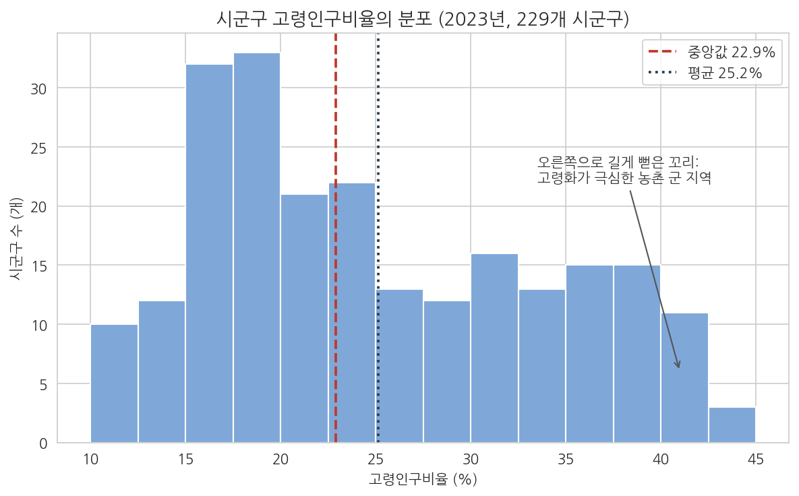

그림 읽는 법부터 익히자. 가로축은 고령인구비율(%)이고, 세로축은 각 구간(폭 2.5%포인트)에 속한 시군구의 수다. 빨간 파선은 중앙값(22.9%), 감색 점선은 평균(25.2%)의 위치다. 막대들의 전체 윤곽이 이 변수의 분포다.

이 그림에서 세 가지가 읽힌다. 첫째, 봉우리는 왼쪽에 있다. 가장 높은 막대는 17.5-20% 구간(33곳)이고 바로 왼쪽의 15-17.5% 구간(32곳)이 거의 같은 높이이며, 전형적인 시군구의 고령인구비율은 15-25% 사이다. 둘째, 오른쪽으로 꼬리가 길다. 30%를 넘는 시군구가 완만한 언덕을 이루며 45% 부근까지 이어진다. 전국에서 가장 높은 경북 의성군은 45.4%로, 주민 두 명 중 한 명 가까이가 65세 이상이다. 이렇게 한쪽으로 꼬리가 끌리는 분포를 치우친(skewed) 분포라 하며, 여기서는 오른쪽으로 치우쳤다. 셋째, 평균(25.2%)이 중앙값(22.9%)보다 오른쪽에 있다. 꼬리 쪽의 큰 값들이 평균을 끌어올리기 때문이다. 치우친 분포에서 평균과 중앙값이 벌어지는 이유가 그림에서 확인된다.

이 분포 하나가 던지는 정책적 함의도 작지 않다. 인구학에서 널리 쓰는 기준으로 고령인구비율 20% 초과를 초고령사회라 부르는데, 그림에서 20% 오른쪽에 놓인 막대들을 세어 보면 229곳 중 140곳, 전체의 61%다. 한국의 고령화는 평균의 문제가 아니라 다수 지역의 현재 상태이며, 그 정도가 지역마다 10%대부터 40%대까지 크게 다르다. 표에서는 드러나지 않던 이 사실이 그림에서는 분명하게 확인된다.

<strong>구간 폭이 그림에 미치는 영향</strong> 
히스토그램의 인상은 구간(bin)의 폭에 따라 달라진다. 폭을 너무 넓게 잡으면 막대가 몇 개 안 남아 분포의 세부가 뭉개지고, 너무 좁게 잡으면 우연한 들쭉날쭉함이 과장된다. 에이전트에게 히스토그램을 시키면 에이전트가 폭을 임의로 정하는데, 그 선택에 따라 그림의 인상이 바뀔 수 있다는 점을 기억해 두자. 미심쩍으면 "구간 폭을 바꿔서 두 가지 버전으로 그려 줘"라고 지시해 윤곽이 유지되는지 확인하면 된다. 폭을 바꿔도 유지되는 패턴만 신뢰할 수 있다.

### 밀도 그림: 히스토그램의 윤곽을 곡선으로

히스토그램의 막대 윤곽을 매끄러운 곡선 하나로 나타낸 그림이 밀도 그림(density plot)이다. 곡선은 관측치마다 그 값을 중심으로 좁은 종 모양의 곡선을 하나씩 놓고, 229개의 곡선을 모두 더해 만든다. 값이 많이 모인 곳에서는 곡선이 겹쳐 높아지고, 값이 드문 곳에서는 낮아진다. 세로축은 시군구 수가 아니라 밀도이며, 곡선 아래의 넓이 전체가 1이 되도록 눈금을 맞춘다. 그래서 두 값 사이의 곡선 아래 넓이가 그 구간에 드는 시군구의 비율이다.

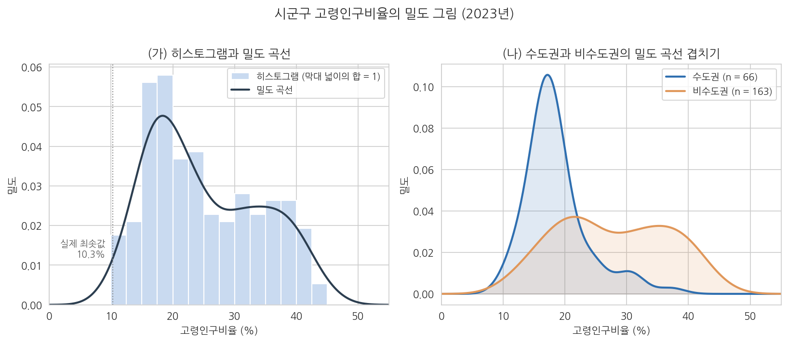

그림 읽는 법. 왼쪽(가)은 그림 9-1과 같은 히스토그램을 막대 넓이의 합이 1이 되도록 세로축을 바꾸어 그리고, 그 위에 밀도 곡선을 겹친 것이다. 오른쪽(나)은 같은 변수를 수도권 66곳과 비수도권 163곳으로 나누어 밀도 곡선 두 개를 한 축에 겹쳤다.

(가)에서 곡선은 막대들의 윤곽을 따라간다. 20% 아래쪽에 높은 봉우리가 하나 있고, 30-40% 사이에는 낮고 평평한 구간이 이어진다. 히스토그램의 들쭉날쭉한 막대 높이에 가려 있던 이 두 부분의 구조가 곡선에서는 한 번에 보인다. 밀도 그림이 히스토그램보다 나은 점은 (나)에 있다. 히스토그램 두 개를 한 축에 겹치면 막대가 서로를 가리지만, 곡선은 두 개를 겹쳐도 읽힌다. 수도권의 곡선은 17.2% 근처에 좁고 높은 봉우리를 이루고, 비수도권의 곡선은 21.5% 근처의 봉우리에서 40%를 넘는 곳까지 넓게 퍼져 있다. 그림 9-1의 오른쪽 꼬리가 거의 전부 비수도권에서 온다는 사실이 이 그림에서 드러난다.

밀도 그림을 읽을 때 주의할 점이 두 가지 있다. 첫째, 곡선은 자료가 없는 곳까지 번진다. (가)에서 실제 최솟값은 10.3%인데 곡선은 5.4% 부근에서부터 올라오기 시작한다. 고령인구비율이 5-10%인 시군구는 하나도 없으므로, 곡선의 양 끝은 자료가 아니라 그리는 방법이 만든 모양이다. 둘째, 각 곡선 아래의 넓이는 집단 크기와 관계없이 1이다. (나)에서 수도권 곡선이 더 높게 솟은 것은 수도권 시군구가 많아서가 아니라 값이 좁은 범위에 몰려 있어서다. 실제 시군구 수는 비수도권이 두 배 넘게 많다. 곡선의 매끄러운 정도는 히스토그램의 구간 폭처럼 그리는 쪽이 정하는 값(띠폭, bandwidth)에 따라 달라지므로, 봉우리의 개수나 위치가 중요한 판단 근거가 될 때는 히스토그램과 함께 본다.

### 누적분포 그림: 어떤 값 이하가 몇 %인가

정책 질문 가운데에는 "고령인구비율이 20% 이하인 시군구는 몇 %인가"처럼 기준값을 정해 놓고 그 아래나 위의 비율을 묻는 것이 많다. 히스토그램으로 답하려면 막대를 하나씩 세어 더해야 한다. 이 질문에 바로 답하는 그림이 누적분포 그림(empirical cumulative distribution plot)이다. 값을 작은 것부터 늘어놓고, 각 값에서 "그 값 이하인 관측치의 비율"을 세로축에 찍어 계단 모양으로 잇는다.

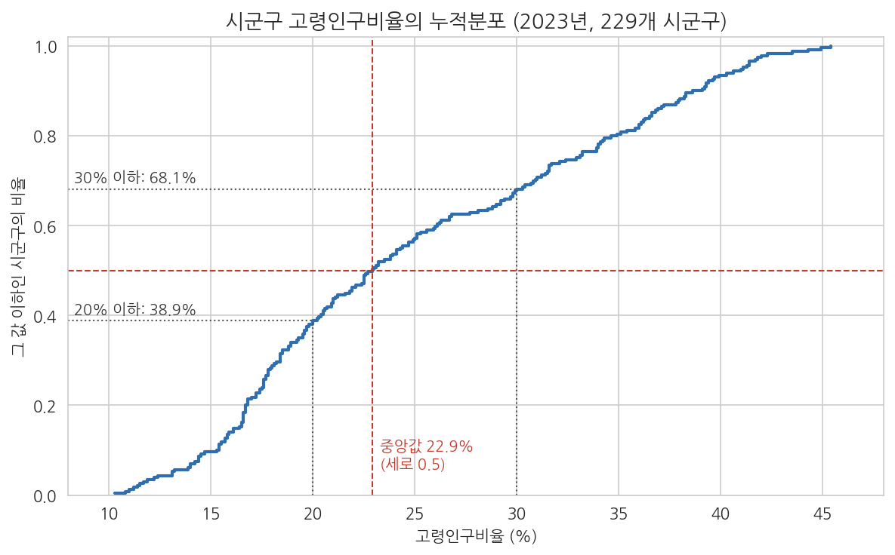

그림 읽는 법. 가로축은 고령인구비율, 세로축은 그 값 이하인 시군구의 비율(0부터 1)이다. 곡선은 왼쪽 아래에서 시작해 오른쪽 위의 1에서 끝나며 내려가는 일이 없다. 가로축에서 기준값을 고르고 위로 올라가 곡선과 만나는 높이를 읽으면 그 값 이하의 비율이 나온다. 거꾸로 세로축에서 비율을 고르고 옆으로 가서 곡선과 만나는 가로축 값을 읽으면 분위수가 나온다.

20%에서 올라가면 0.389, 곧 229곳 가운데 89곳(38.9%)이 20% 이하다. 나머지 140곳(61.1%)이 앞에서 히스토그램으로 센 초고령사회 기준 초과 지역이다. 30% 이하는 156곳(68.1%)이다. 세로축 0.5에서 옆으로 가면 중앙값 22.9%가 나오고, 0.25와 0.75에서 읽으면 각각 17.6%와 32.9%로, 뒤에 나올 박스플롯의 상자 양 끝(1사분위수와 3사분위수)과 같은 값이다. 0.9에서 읽으면 약 38.7%이므로, 고령인구비율이 이 값보다 높은 시군구는 열 곳 가운데 한 곳꼴이다. 가로축과 세로축을 바꾸어 그린 그림을 분위수 그림이라 하며, 담고 있는 정보는 같다.

누적분포 그림은 구간 폭을 정할 필요가 없어서 그리는 사람의 선택이 끼어들 여지가 적고, 모든 관측치가 그대로 계단 하나씩으로 남는다. 반면 분포의 봉우리는 직접 보이지 않는다. 값이 몰린 곳은 곡선이 가파르게 올라가는 곳(그림에서 15-20% 사이)이고 값이 드문 곳은 곡선이 완만한 곳인데, 기울기로 밀집을 읽는 일은 막대 높이로 읽는 일보다 어렵다. 그래서 "기준 이하가 몇 %인가"를 물을 때는 누적분포 그림을, "어디에 몰려 있는가"를 물을 때는 히스토그램이나 밀도 그림을 고른다.

### 막대그래프: 범주별 개수

지금까지의 변수는 고령인구비율처럼 값이 끊김 없이 이어지는 연속형이었다. 시도나 수도권 여부처럼 정해진 범주 가운데 하나를 값으로 갖는 변수를 범주형 변수라 하며, 범주형 변수 하나의 분포는 범주마다 관측치를 세어 막대그래프(bar chart)로 그린다. 우리 데이터의 시도 열을 세어 보자.

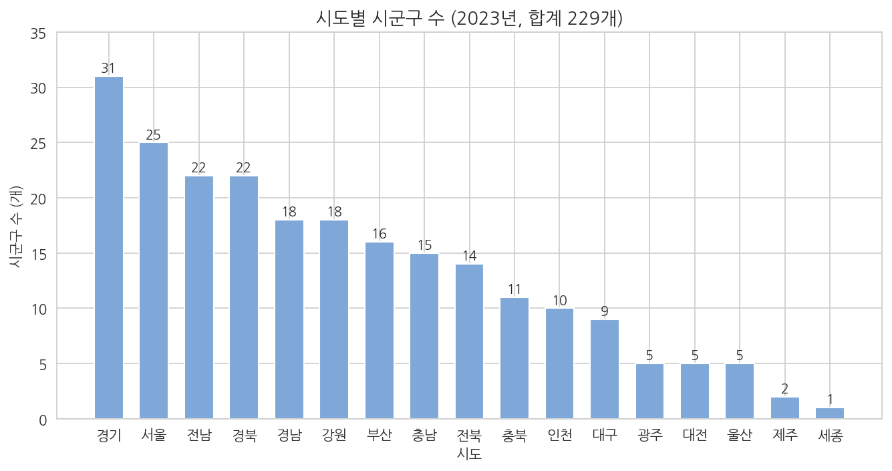

그림 읽는 법. 막대 하나가 시도 하나이고, 막대의 높이는 그 시도에 속한 시군구의 수다. 막대는 많은 순으로 정렬했다. 히스토그램과 달리 막대 사이를 띄운 것은 가로축이 연속된 값이 아니라 서로 떨어진 범주라는 표시다.

시군구 수는 시도마다 크게 다르다. 경기가 31곳으로 가장 많고, 서울 25곳, 전남과 경북이 22곳씩이다. 반대쪽 끝에는 광주·대전·울산이 5곳씩, 제주가 2곳, 세종이 1곳이다. 이 그림은 그 자체로는 단순하지만, 뒤에 나오는 모든 시도별 비교 그림을 읽을 때 기준이 된다. 시군구가 31곳인 경기와 2곳인 제주를 같은 크기의 상자로 나란히 그리면, 두 상자가 담은 정보의 양은 전혀 다르다.

막대그래프를 읽을 때의 주의점은 두 가지다. 첫째, 막대는 길이로 값을 나타내므로 세로축이 0에서 시작해야 한다. 이 원칙이 깨지면 무슨 일이 생기는지는 1.5에서 본다. 둘째, 범주에는 정해진 순서가 없으므로 막대의 순서를 그리는 쪽이 정한다. 행정 코드 순이나 가나다순으로 놓으면 크기 비교가 어렵고, 값의 크기순으로 정렬하면 순위가 바로 읽힌다. 다만 연도나 연령대처럼 범주 자체에 순서가 있으면 그 순서를 지킨다.

### 박스플롯: 여러 집단을 한 화면에서 비교하기

히스토그램으로 전국의 분포를 보았다면, 자연스러운 다음 질문은 "지역에 따라 다른가"이다. 17개 시도별로 히스토그램을 17장 그릴 수도 있지만, 나란히 놓고 비교하기가 어렵다. 여러 집단의 분포를 압축해 한 화면에서 비교하는 표준 도구가 박스플롯이다.

<strong>정의 · 박스플롯</strong> 
<strong>박스플롯</strong>(box plot, 상자그림)은 한 분포를 상자 하나로 요약한 그림이다. 상자의 양 끝은 1사분위수(작은 쪽에서 25% 지점)와 3사분위수(75% 지점)이므로, 상자는 자료의 한가운데 50%가 차지하는 범위다. 상자 안의 선은 중앙값이다. 상자에서 양쪽으로 뻗은 선(수염)은 통상적인 범위의 자료 끝까지 이어지고, 그 밖으로 벗어난 값은 이상치로 점을 찍어 따로 표시한다.

17개 시도의 고령인구비율을 중앙값이 낮은 순으로 정렬해 그렸다.

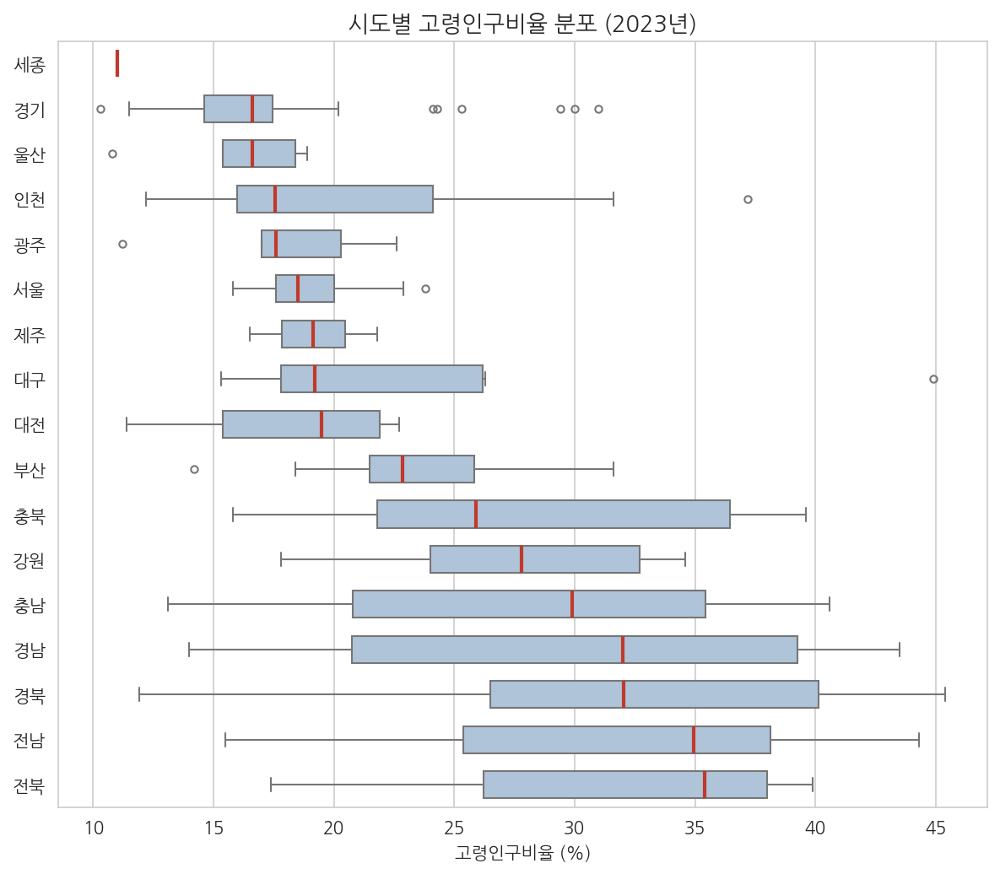

그림 읽는 법. 가로축이 고령인구비율(%)이고, 시도마다 상자 하나가 그 시도에 속한 시군구들의 분포를 요약한다. 상자의 위치는 그 시도의 고령화 수준을, 상자의 길이는 시도 내부의 지역 간 격차를 말해 준다. 빨간 선이 중앙값, 상자 밖의 동그라미가 이상치다.

읽어 낼 수 있는 것은 세 가지다. 첫째, 시도 사이의 차이. 경기(중앙값 16.6%), 울산(16.6%), 인천(17.6%), 서울(18.5%) 등 수도권과 대도시의 상자는 왼쪽에, 경북(32.1%), 전남(35.0%), 전북(35.4%)의 상자는 오른쪽에 있다. 관측치가 1개뿐인 세종을 논외로 하면, 중앙값이 가장 낮은 경기·울산과 가장 높은 전북의 차이가 약 19%포인트에 이른다. 둘째, 시도 안의 차이. 서울의 상자는 짧아서(사분위 범위 약 2.4%포인트) 25개 자치구가 비슷비슷하다는 것을 보여 주는 반면, 경남의 상자는 매우 길다. 같은 경남 안에 김해시(14.0%)와 합천군(43.5%)이 공존하기 때문이다. 고령화의 격차는 시도 대 시도의 문제이면서 동시에 같은 시도 안 도시 대 농촌의 문제이기도 하다. 셋째, 예외적인 지역. 인천의 상자 오른쪽 끝에 동그라미로 찍힌 이상치는 강화군(37.2%)이다. 젊은 수도권 광역시 안의 늙은 농촌이라는, 평균으로는 절대 보이지 않는 사실이 점 하나로 드러난다.

한 가지 주의할 것이 있다. 맨 위의 세종은 상자 없이 선 하나로만 그려져 있는데, 오류가 아니다. 세종특별자치시는 시군구 단위 데이터에서 관측치가 1개뿐이라 분포라 할 것이 없기 때문이다. 그림에서 이상해 보이는 부분을 발견하면 "왜 이렇게 그려졌지"라고 물어야 한다. 답은 대개 데이터의 구조에 있다.

<strong>유의 · 상자 뒤의 관측치 수를 확인하라</strong> 
박스플롯은 관측치가 5개든 500개든 같은 크기의 상자로 그려진다. 세종(1개)이나 제주(2개)처럼 관측치가 적은 집단의 상자는 통계적으로 말해 주는 바가 거의 없다. 그림 9-4의 막대그래프가 바로 이 확인에 쓰인다. 집단 비교 그림을 읽을 때는 반드시 각 집단의 관측치 수(n)를 함께 확인하는 습관을 들이자. 에이전트에게 "각 집단의 관측치 수도 함께 표로 알려 줘"라고 지시하면 된다.

### 바이올린 그림과 스트립 그림: 상자 안의 모양 보기

박스플롯은 분포를 다섯 개의 숫자(최솟값 쪽 수염 끝, 1사분위수, 중앙값, 3사분위수, 최댓값 쪽 수염 끝)로 줄인 그림이다. 줄이는 과정에서 상자 안의 모양이 사라진다. 상자가 길다는 것은 알 수 있어도, 그 안의 값들이 고르게 퍼져 있는지 두 무리로 갈라져 있는지는 알 수 없다. 이 모양을 되살리는 그림이 두 가지 있다. 바이올린 그림(violin plot)은 집단마다 밀도 곡선을 세로로 세워 좌우 대칭으로 그린 것이고, 스트립 그림(strip plot)은 관측치 하나하나를 점으로 찍은 것이다. 스트립 그림에서는 같은 값의 점이 겹치지 않도록 점을 좌우로 조금씩 흩어 놓는데, 이 좌우 위치에는 아무 의미가 없다.

시군구가 15곳 이상인 시도 가운데 여섯 곳의 고령인구비율을 두 방식으로 그렸다.

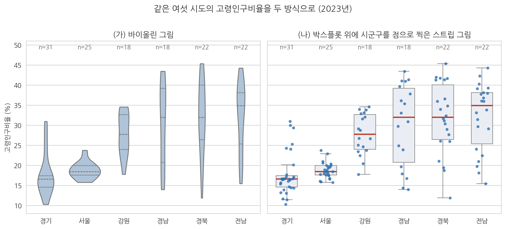

그림 읽는 법. 두 패널 모두 가로축에 시도를 중앙값 순으로 놓았고, 세로축이 고령인구비율이며, 위쪽의 n은 시군구 수다. 왼쪽(가)의 바이올린은 폭이 넓은 높이에 시군구가 많다는 뜻이고, 안쪽의 세 선 가운데 가운데 파선이 중앙값, 위아래 점선이 1사분위수와 3사분위수다. 바이올린은 실제 최솟값과 최댓값에서 잘라 그렸다. 오른쪽(나)은 박스플롯 위에 시군구 하나하나를 파란 점으로 찍었다.

박스플롯만 보면 경남은 상자가 20.75%에서 39.25%까지 길게 뻗은, 값이 넓게 고르게 퍼진 시도로 읽힌다. 그러나 (가)의 경남 바이올린은 아래쪽과 위쪽 두 곳이 불룩하고 가운데가 잘록하며, (나)의 점들도 두 무리로 갈라져 있다. 아래 무리는 김해시(14.0%), 거제시(14.4%), 양산시(16.8%), 창원시(17.9%), 진주시(19.7%), 통영시(23.9%), 사천시(24.9%)의 시 지역 7곳이고, 위 무리는 30% 이상인 10곳으로 밀양시를 빼면 모두 군이다. 그 사이인 25-30%에는 함안군(29.8%) 한 곳뿐이다. 경남의 중앙값 32.0%는 위 무리의 아래쪽 끝 근처에 놓인 값으로, 두 무리 어느 쪽의 가운데도 아니다. 경기는 반대 모양이다. 31곳 대부분이 14-18% 근처에 몰려 있고, 동두천시(24.1%), 포천시(24.3%), 여주시(25.3%), 양평군(29.4%), 가평군(30.0%), 연천군(31.0%)의 6곳이 위쪽으로 가늘고 긴 꼬리를 이룬다. 박스플롯은 이 6곳을 이상치 점으로 따로 찍지만, 바이올린과 스트립 그림에서는 이들이 경기 북부와 동부의 한 무리라는 것이 보인다.

두 그림 가운데 무엇을 고를지는 집단마다 관측치가 몇 개인지로 정한다. 관측치가 수십 개 이하이면 스트립 그림이 낫다. 점 하나하나가 실제 시군구이므로 그리는 쪽의 선택이 들어갈 자리가 없다. 관측치가 수백 개를 넘으면 점이 겹쳐 덩어리가 되므로 바이올린이 낫다. 바이올린은 밀도 곡선이므로 밀도 그림의 주의점을 그대로 물려받는다. 관측치가 몇 개뿐인 집단에도 매끄러운 바이올린이 그려지는데, 다섯 점으로 그린 곡선의 모양은 우연에 크게 흔들린다. 바이올린을 실제 자료 범위에서 자를지(이 그림처럼) 자료 밖까지 번지게 둘지도 도구의 설정에 따라 달라지므로, 에이전트에게 바이올린을 시킬 때는 "실제 최솟값과 최댓값에서 자르고 각 집단의 n을 표시해"라고 함께 지시한다.

### 점 그림과 정렬 막대: 집단 하나에 값 하나

지금까지의 집단 비교는 집단마다 여러 개의 값(시군구들)이 있을 때였다. 집단마다 값이 하나뿐인 경우도 많다. 시도별 고령인구비율, 시도별 재정자립도처럼 시도 하나에 숫자 하나가 있으면 비교의 관심은 분포가 아니라 순위와 간격이다. 이때는 값의 크기순으로 정렬한 막대그래프나 점 그림(dot plot)을 쓴다. 점 그림은 집단마다 가로선 위에 점 하나를 찍어 값을 나타낸다. 막대와 달리 길이가 아니라 위치로 값을 나타내므로, 한 줄에 점을 둘 이상 찍어 두 종류의 값을 나란히 비교할 수 있다.

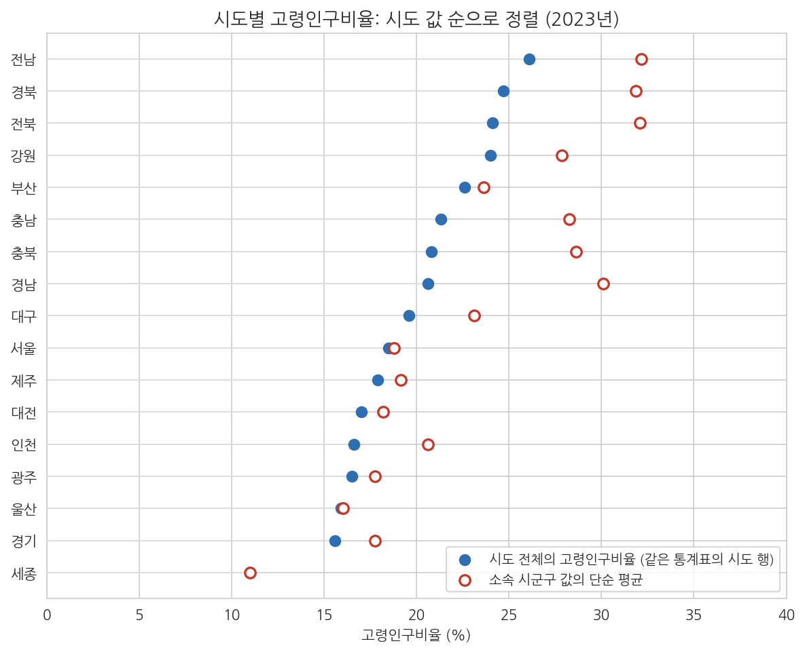

그림 읽는 법. 세로축의 시도는 파란 점의 값이 큰 순으로 위에서 아래로 정렬했다. 파란 점은 시도 전체의 고령인구비율로, 시군구 자료와 같은 e-지방지표 통계표에 함께 실려 있는 시도 행의 값이다(kosis MCP 원 응답에 시군구 행과 함께 들어 있다). 빨간 빈 점은 그 시도에 속한 시군구 값들을 단순 평균한 것이다.

파란 점의 순위로 보면 전남(26.1%)이 가장 높고 경북(24.7%), 전북(24.1%), 강원(24.0%)이 뒤를 잇는다. 가장 낮은 곳은 세종(11.0%)이고 경기(15.6%)와 울산(15.9%)이 그다음이다. 그런데 두 종류의 점을 나란히 놓으면 이 그림의 더 중요한 내용이 보인다. 서울(18.5%와 18.78%)이나 울산(15.9%와 16.02%)처럼 두 점이 거의 겹치는 시도가 있는 반면, 경남은 시도 값이 20.6%인데 시군구 단순 평균은 30.09%로 9%포인트 넘게 차이 난다. 전북(24.1%와 32.07%), 충북(20.8%와 28.61%), 경북(24.7%와 31.86%), 충남(21.3%와 28.27%)도 7%포인트 안팎 차이 난다. 순위도 바뀐다. 시도 값으로는 경남(20.6%)이 부산(22.6%)보다 낮지만, 단순 평균으로는 경남(30.09%)이 부산(23.64%)보다 높다.

차이의 이유는 그림 9-6(나)에 있다. 단순 평균은 인구가 많은 창원시와 김해시도, 인구가 적은 합천군과 남해군도 똑같이 한 번씩 센다. 경남에서는 고령인구비율이 낮은 소수의 큰 시와 고령인구비율이 높은 다수의 작은 군이 함께 있으므로, 군의 값이 단순 평균을 끌어올린다. 시도 값은 시도 전체 인구 가운데 65세 이상의 비율이므로 인구가 많은 시의 값에 가깝게 나온다. 시군구가 모두 비슷한 서울과 울산에서는 두 값이 거의 같다. 에이전트에게 "시도별 평균"을 그리게 하면 대개 시군구 값의 단순 평균이 나온다. 그 값을 "경남의 고령인구비율"이라고 부르면 틀린 문장이 된다. 집단 하나에 값 하나를 그리는 그림에서는 그 값이 어디서 온 무엇인지를 범례나 캡션에 반드시 밝힌다.

점 그림과 정렬 막대는 같은 질문에 쓰이며 차이는 축에 있다. 막대는 길이로 값을 나타내므로 축이 0에서 시작해야 한다. 점 그림은 위치로 값을 나타내므로 값들이 0에서 멀리 떨어져 있으면 축을 값 근처로 좁혀도 왜곡이 생기지 않는다. 비교할 값이 두 종류 이상이거나 값들이 서로 가까워 차이를 자세히 보아야 할 때는 점 그림을 고른다.

### 막대와 오차막대: 평균과 함께 흩어짐 보이기

보고서에서 가장 흔한 집단 비교 그림은 집단 평균을 막대 하나로 그린 것이다. 막대 하나는 평균 하나만 보여 주므로, 그 집단 안의 값들이 평균 근처에 모여 있는지 넓게 흩어져 있는지는 알 수 없다. 막대 끝에 위아래로 뻗은 선을 붙여 흩어짐을 함께 보이는 것이 오차막대(error bar)다. 여기서는 오차막대의 길이로 표준편차를 썼다. 표준편차(standard deviation)는 값들이 평균에서 평균적으로 얼마나 떨어져 있는지를 나타내는 수로, 클수록 집단 안의 값들이 넓게 흩어져 있다.

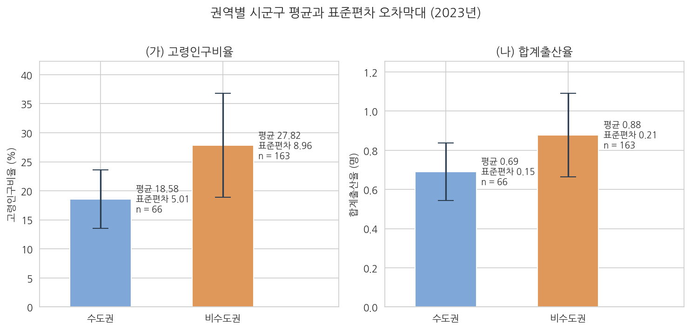

그림 읽는 법. 막대의 높이는 권역에 속한 시군구 값의 평균이고, 막대 끝에서 위아래로 뻗은 선은 평균에 표준편차를 더하고 뺀 범위다. 막대 오른쪽에 평균, 표준편차, 시군구 수를 적었다.

(가)의 고령인구비율은 수도권 평균이 18.58%, 비수도권이 27.82%다. 표준편차는 수도권 5.01%포인트, 비수도권 8.96%포인트로, 비수도권의 오차막대가 거의 두 배 길다. 비수도권 시군구들은 평균만 높은 것이 아니라 서로의 차이도 크다는 뜻이며, 그림 9-2(나)의 넓게 퍼진 곡선과 같은 내용이다. (나)의 합계출산율은 수도권 평균 0.69명(표준편차 0.15명), 비수도권 0.88명(0.21명)이다. 두 평균의 차이는 0.19명인데, 오차막대는 수도권 쪽이 0.54-0.84명, 비수도권 쪽이 0.67-1.09명으로 크게 겹친다. 평균으로는 비수도권이 높지만, 수도권보다 출산율이 낮은 비수도권 시군구도 많다는 것이 이 겹침에서 읽힌다.

오차막대를 읽을 때 가장 먼저 확인할 것은 선의 길이가 무엇인지다. 오차막대에는 표준편차 말고도 표준오차나 신뢰구간이 흔히 쓰이며, 셋은 길이가 크게 다르고 뜻도 다르다. 같은 자료라도 표준편차 막대는 길고 표준오차 막대는 짧다. 그림이 무엇을 그렸는지 캡션이나 범례에 적혀 있지 않으면 그 오차막대는 읽을 수 없다. 평균과 신뢰구간의 관계는 11주차에서 다룬다. 또한 막대와 오차막대도 박스플롯처럼 분포를 숫자 몇 개로 줄인 그림이다. 경남처럼 두 무리로 갈라진 집단은 평균과 표준편차로 나타내면 그 갈라짐이 사라지므로, 집단마다 관측치가 수십 개 이하이면 스트립 그림을 함께 그리는 편이 정보를 덜 잃는다.

## 1.3 두 변수 이상: 관계 보기

### 산점도: 점 하나가 시군구 하나

분포를 보았으면 다음은 관계다. "고령화가 심한 지역일수록 출산율이 낮을까?" 같은 질문은 변수 두 개를 동시에 보아야 답할 수 있다. 두 연속형 변수의 관계를 보는 표준 그림이 산점도(scatter plot)다. 한 변수를 가로축에, 다른 변수를 세로축에 놓고, 관측치 하나(여기서는 시군구 하나)를 점 하나로 찍는다. 점들의 구름이 이루는 모양이 두 변수의 관계다.

방금의 질문을 실제로 그려 보자. 가로축에 고령인구비율, 세로축에 합계출산율(여성 1명이 평생 낳을 것으로 기대되는 아이 수)을 놓았다.

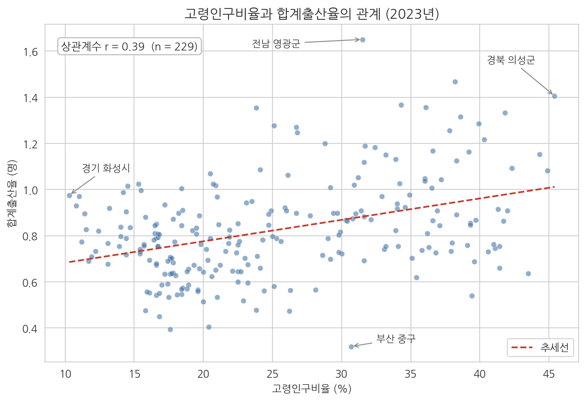

그림 읽는 법. 점 229개가 각각 시군구 하나다. 빨간 파선은 점 구름의 전반적 흐름을 요약한 추세선이고, 왼쪽 위의 상자 안에 상관계수가 표시되어 있다.

그런데 이 그림은 일반적인 예상과 다른 결과를 보여 준다. "고령화가 심하면 출산율이 낮을 것이다"라는 직관과 달리, 점 구름은 오른쪽으로 갈수록 오히려 완만하게 올라간다. 고령인구비율이 높은 시군구일수록 합계출산율도 높은 경향, 곧 양의 상관이다. 극단을 짚어 보면 더 뚜렷하다. 합계출산율 전국 최저는 부산 중구(0.32명)로 고령인구비율 30.7%의 도심이고, 전국 최고는 전남 영광군(1.65명)으로 고령인구비율 31.5%의 농촌이다. 전국에서 가장 늙은 의성군(고령인구비율 45.4%)의 출산율은 1.41명으로 서울의 어느 구보다도 높다.

이 역설은 합계출산율이라는 지표의 정의를 알면 풀린다. 합계출산율은 아이의 수를 지역 전체 인구가 아니라 가임기 여성의 수에 견준 비율이다. 농촌 군 지역은 젊은 여성의 수 자체가 매우 적지만, 남아 있는 젊은 여성이 아이를 낳는 비율은 대도시보다 높다. 반대로 대도시는 젊은 인구가 많이 모여 있어도 출산으로 이어지는 비율이 낮다. 따라서 이 그림에서 "고령화가 출산율을 높인다"는 인과의 결론을 읽어 내면 안 된다. 그림이 실제로 보여 주는 것은 저출산 문제의 지역 분포가 "젊은 도시 대 늙은 농촌"이라는 통념보다 복잡하다는 사실이며, 이는 "왜 이런 관계가 나타나는가"라는 후속 질문을 낳는다. 답을 확정하지 않고 검증할 질문을 도출하는 것이 EDA의 기능이다.

### 상관계수: 관계의 방향과 세기를 숫자 하나로

산점도의 인상을 숫자 하나로 요약한 것이 상관계수다.

<strong>정의 · 상관계수</strong> 
<strong>상관계수</strong>(correlation coefficient, 기호 r)는 두 변수의 직선적 관계의 방향과 세기를 -1과 1 사이의 숫자로 나타낸 지표다. 한 변수가 클수록 다른 변수도 큰 경향이면 양수, 반대 경향이면 음수다. 절댓값이 1에 가까울수록 점들이 직선에 가깝게 늘어서고, 0에 가까울수록 뚜렷한 직선 관계가 없다.

그림 9-9의 상관계수는 r = 0.39다. 방향은 양(+)이고, 세기는 어중간하다. 점들이 추세선 주위에 넓게 흩어져 있는 데서 보이듯, 고령인구비율만으로 출산율이 결정되는 것은 결코 아니다. 같은 데이터에서 인구밀도와 고령인구비율의 상관계수는 이 절의 뒤에서 보듯 r = -0.73으로, 사람이 빽빽이 모여 사는 곳일수록 젊다는 훨씬 강한 관계가 나온다.

상관계수는 숫자 하나로 요약되어 편리하지만, 두 가지 한계를 알아 두어야 한다. 첫째, 상관계수는 직선 관계만 잡아낸다. 두 변수가 U자형처럼 굽은 관계를 가지면 r이 0에 가깝게 나올 수 있으므로, 상관계수만 보고 "관계가 없다"고 단정하면 안 된다. 산점도를 먼저 보고 상관계수를 보는 순서가 안전하다. 둘째, 상관은 인과가 아니다. 여름철 아이스크림 판매량과 물놀이 사고 건수는 강한 양의 상관을 보이지만, 아이스크림이 사고를 일으키는 것이 아니라 더위라는 제3의 요인이 둘 다를 끌어올린다. r이 아무리 크더라도 "A가 B를 일으킨다"는 문장은 상관계수에서 나오지 않는다. 이 한계는 정책 해석에서 특히 중요하므로 11주차에서 본격적으로 다룬다.

<strong>유의 · 지역 데이터의 해석 한계: 집단의 관계는 개인의 관계가 아니다</strong> 
그림 9-9의 점은 사람이 아니라 시군구다. 따라서 이 그림이 보여 주는 것은 "고령 지역일수록 출산율이 높다"는 지역 수준의 관계이지, "고령자가 많은 동네에 사는 젊은 여성이 아이를 더 낳는다"는 개인 수준의 사실이 아니다. 집단 단위의 상관을 개인에게 그대로 적용하는 오류를 <strong>생태학적 오류</strong>(ecological fallacy)라 한다. 시군구·시도 단위 공공데이터를 다룰 때는 항상 유의해야 하는 점이다.

### 로그 축 산점도: 치우친 변수를 배수의 눈금으로

인구밀도와 고령인구비율의 관계를 산점도로 그리면 문제가 하나 생긴다. 인구밀도는 그림 9-1의 고령인구비율보다 훨씬 심하게 치우친 변수여서, 보통의 축에 그리면 점 대부분이 한쪽에 몰린다. 이때 쓰는 방법이 로그 눈금이다. 로그 눈금은 축의 눈금을 같은 크기씩이 아니라 같은 배수씩 매기는 방식이다. 보통의 축이 0, 100, 200, 300처럼 100씩 더해 가며 눈금을 매긴다면, 로그 눈금은 100, 1,000, 10,000을 같은 간격으로 놓는다. 눈금 하나를 지날 때마다 값이 열 배가 되는 것이다. 이렇게 하는 이유는 인구밀도 같은 변수의 생김새에 있다. 우리 데이터에서 인구밀도가 가장 낮은 곳은 경북 영양군으로 1제곱킬로미터에 19.2명이고, 가장 높은 곳은 서울 양천구로 25,050.4명이다. 두 곳의 차이가 1,300배가 넘는다. 보통의 축에 그리면 양천구 하나를 담기 위해 축을 25,000까지 늘려야 하고, 그러면 1,000명 아래에 있는 136곳(100명 미만 63곳, 100-1,000명 73곳)이 축 왼쪽 끝에 겹쳐 붙어 한 덩어리로 보인다. 중앙값이 491.5명인데 평균은 3,711.3명으로 일곱 배가 넘는 것도 소수의 큰 값이 평균을 끌어올린 치우친 분포의 신호다. 로그 눈금으로 바꾸면 19.2명과 192명의 차이도, 2,500명과 25,000명의 차이도 같은 간격으로 벌어져 점들이 축 전체에 고르게 퍼진다. 값을 더하기가 아니라 배수로 생각하는 편이 자연스러운 변수, 곧 인구밀도, 인구 수, 소득, 면적 같은 것들에 이 방법을 쓴다.

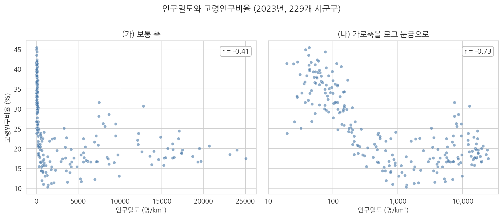

그림 읽는 법. 두 패널의 점은 같은 229개 시군구이고 세로축도 같다. 다른 것은 가로축뿐이다. 왼쪽(가)은 가로축 눈금이 5,000명씩 같은 크기로 늘어나고, 오른쪽(나)은 10, 100, 1,000, 10,000이 같은 간격으로 놓인다. 오른쪽 위 상자의 r은 각 패널의 가로축 값으로 계산한 상관계수다.

(가)에서는 점의 절반 이상이 가로축 0 근처에 세로 기둥처럼 붙어 있어서, 인구밀도가 낮은 시군구들 사이의 차이가 전혀 보이지 않는다. 같은 점들을 (나)에서 보면 관계의 모양이 드러난다. 인구밀도가 100명 안팎인 군 지역은 고령인구비율이 30-45%에 몰려 있고, 인구밀도가 커질수록 고령인구비율이 내려가다가 1,000명을 넘는 곳에서는 대부분 10-25%에서 평평해진다. 그 평평한 구간 위쪽에 떨어져 있는 25-32%의 점 8개는 인구가 빽빽하면서도 고령인구비율이 높은 부산·대구·인천의 구들로, 부산 영도구(31.6%)와 부산 중구(30.7%)가 가장 높다.

같은 두 변수인데 상관계수도 다르게 나온다. (나)의 r = -0.73은 인구밀도를 배수의 눈금으로 바꾼 뒤 계산한 값이고, 원래 값을 그대로 쓴 (가)에서는 r = -0.41이다. 상관계수가 직선 관계의 세기를 측정하는 지표이기 때문이다. 원래 값으로는 왼쪽에 몰린 채 굽어 있던 관계가 눈금을 바꾸자 직선에 가까워진 것이다. 어느 쪽이 참이냐를 가리기보다, 축을 어떻게 잡았는지 밝히고 그림과 숫자를 함께 내놓는 것이 정직한 보고다. 로그 눈금으로 그린 그림을 읽을 때는 축의 숫자를 반드시 확인해야 한다. 눈금 사이의 거리가 같아 보여도 실제 값의 차이는 한 칸마다 열 배씩 커지기 때문이다. 또한 로그 눈금에는 0과 음수를 놓을 수 없다. 인구증가율처럼 음수가 있는 변수는 이 방법으로 그릴 수 없으므로, 로그 눈금은 양수만 갖는 치우친 변수에 쓴다.

### 색으로 집단을 나눈 산점도

그림 9-9의 점 229개는 모두 같은 색이었다. 그런데 1.2에서 수도권과 비수도권의 고령인구비율 분포가 크게 다르다는 것을 보았다(그림 9-2(나)). 그렇다면 산점도의 양의 상관도 두 권역에서 똑같이 나타나는지 물을 수 있다. 세 번째 변수가 범주형이면, 그 범주에 따라 점의 색과 모양을 달리해 한 산점도에 세 변수를 담을 수 있다.

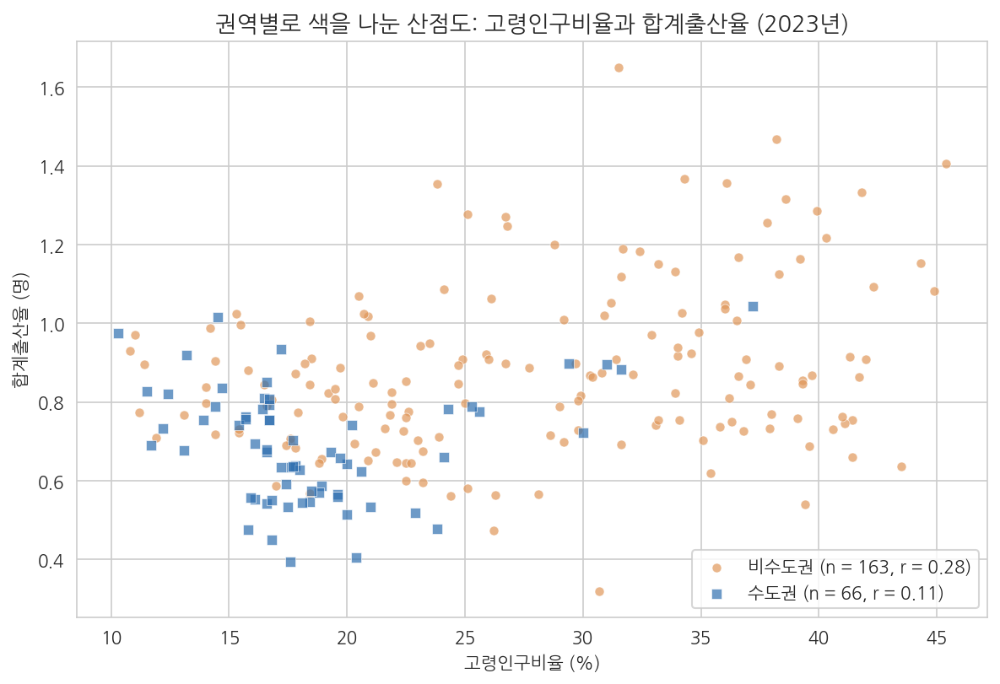

그림 읽는 법. 축은 그림 9-9와 같다. 파란 네모가 수도권 66곳, 주황 동그라미가 비수도권 163곳이다. 범례에 권역마다 따로 계산한 상관계수를 적었다.

수도권의 점은 그림의 왼쪽 아래, 곧 고령인구비율 10-25%, 합계출산율 0.4-1.0명 근처에 모여 있고 오른쪽으로 떨어진 몇 개의 점이 강화군·옹진군 같은 수도권의 군이다. 비수도권의 점은 가로로도 세로로도 넓게 퍼져 있다. 범례의 상관계수가 이 그림의 요점이다. 전체 229곳의 상관계수는 0.39였는데, 권역 안에서 따로 계산하면 비수도권 0.28, 수도권 0.11로 둘 다 전체보다 약하다. 전체에서 보인 양의 상관 가운데 일부는 각 권역 안의 관계가 아니라 "수도권은 왼쪽 아래, 비수도권은 오른쪽 위"라는 권역 사이의 차이에서 나온 것이다. 이처럼 세 번째 변수가 두 변수 모두와 얽혀 있으면 두 변수의 상관이 부풀거나 줄어들 수 있으며, 이 문제는 11주차에서 다시 다룬다.

색으로 나누는 방법은 집단이 두세 개일 때까지 잘 작동한다. 집단이 많아지면 색끼리 구별하기 어렵고 점이 겹쳐 뒤에 그린 색이 앞의 색을 가린다. 이 그림에서 색과 함께 점의 모양(네모와 동그라미)도 달리한 것은 흑백으로 인쇄하거나 색을 구별하기 어려운 독자도 집단을 가려 볼 수 있게 하려는 것이다.

### 소다중: 같은 그림을 집단마다 반복하기

시도 열일곱 곳을 열일곱 가지 색으로 칠한 산점도는 읽을 수 없다. 집단이 많을 때는 색을 나누는 대신 같은 축의 작은 그림을 집단마다 하나씩 그려 격자로 늘어놓는다. 이 방식을 소다중(small multiples)이라 한다. 그림 하나를 읽는 법을 익히면 나머지 그림은 같은 방법으로 읽히므로, 독자는 패널 사이의 차이에만 주의를 기울이면 된다.

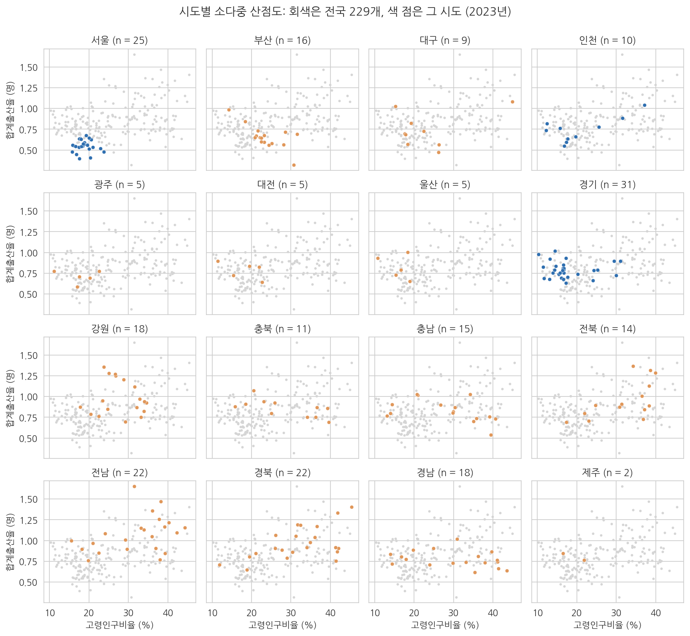

그림 읽는 법. 패널 하나가 시도 하나이며, 관측치가 1개인 세종을 뺀 16개 시도를 행정 순서로 놓았다. 모든 패널은 그림 9-9와 같은 가로축(고령인구비율)과 세로축(합계출산율)을 쓰고, 축의 범위도 16개 패널이 모두 같다. 회색 점은 모든 패널에 똑같이 깔린 전국 229곳이고, 색 점이 그 패널의 시도에 속한 시군구다. 패널 제목의 n은 색 점의 수다.

패널마다 색 점의 자리가 다르다. 서울의 25개 점은 고령인구비율 15.8-23.8%, 합계출산율 0.394-0.673명의 좁은 범위에 모여 전국 점 구름의 왼쪽 아래 끝을 차지한다. 전북(r = 0.61)과 경북(r = 0.55)에서는 점들이 오른쪽 위로 올라가 전국의 양의 상관과 같은 방향이다. 반대로 부산(r = -0.69)과 충북(r = -0.66)에서는 점들이 오른쪽 아래로 내려간다. 전국 전체에서 본 양의 상관이 시도 안에서는 방향까지 달라질 수 있다는 것이 이 그림의 발견이다. 인천은 r = 0.69로 높지만 패널을 보면 8개 구가 왼쪽 아래에 모여 있고, 강화군(37.2%, 1.043명)과 옹진군(31.6%, 0.884명) 두 점이 오른쪽 위에 따로 떨어져 있다. 상관계수가 높은 이유는 이 두 점이다.

소다중을 만들 때와 읽을 때 지킬 것은 두 가지다. 첫째, 모든 패널의 축 범위가 같아야 한다. 패널마다 축을 자기 자료에 맞추면 점이 두 개뿐인 제주도 화면을 가득 채워, 패널 사이의 위치 비교가 불가능해진다. 에이전트에게 소다중을 시킬 때는 "모든 패널의 가로축과 세로축 범위를 같게"를 지시문에 넣는다. 둘째, 패널마다 관측치 수가 다르다. 광주·대전·울산은 5곳, 제주는 2곳뿐이어서, 이런 패널의 상관계수는 점 하나만 바뀌어도 크게 달라진다. 제주의 r은 점이 두 개라 계산하면 항상 1이나 -1이 나오므로 의미가 없다. 그래서 그림 9-12에는 패널마다 상관계수 대신 n을 적었다.

### 산점도 행렬: 여러 변수의 짝을 한꺼번에

변수가 셋 이상이면 짝마다 산점도를 따로 그릴 수도 있지만, 변수 네 개면 짝이 여섯 개, 다섯 개면 열 개가 된다. 모든 짝의 산점도를 격자 하나에 모아 놓은 그림이 산점도 행렬(scatter plot matrix)이며, 짝 그림(pair plot)이라고도 부른다.

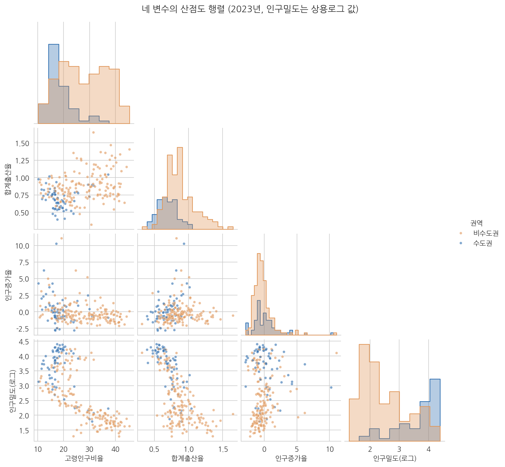

그림 읽는 법. 고령인구비율, 합계출산율, 인구증가율, 인구밀도(상용로그 값) 네 변수를 가로와 세로에 같은 순서로 놓았다. 격자의 칸 하나는 그 칸이 놓인 열의 변수를 가로축, 행의 변수를 세로축으로 한 산점도다. 예를 들어 맨 왼쪽 열의 둘째 칸은 가로축이 고령인구비율, 세로축이 합계출산율이므로 그림 9-11과 같은 그림이다. 대각선 칸은 같은 변수끼리라 산점도 대신 그 변수의 권역별 히스토그램을 그렸다. 대각선 위쪽 칸은 아래쪽 칸의 가로세로를 바꾼 것과 같으므로 비워 두었다. 인구증가율에 결측이 1곳(대구 군위군) 있어서 이 그림의 시군구는 228곳이다.

한 화면에서 여섯 짝을 훑으면 관계가 뚜렷한 짝과 그렇지 않은 짝이 갈린다. 맨 아래 행에서 인구밀도(로그)는 고령인구비율과 뚜렷한 음의 관계(r = -0.73, 그림 9-10(나)와 같은 그림)를, 합계출산율과도 음의 관계(r = -0.68)를 보인다. 반면 인구증가율이 들어간 칸들(셋째 행과 맨 아래 행의 셋째 칸)에서는 점들이 인구증가율 0 근처에 몰려 있을 뿐 뚜렷한 방향이 보이지 않는다(고령인구비율과 r = -0.28, 합계출산율과 0.07, 인구밀도와 0.11). 그 칸들에는 10%를 넘는 점 두 개가 다른 점들과 멀리 떨어져 있는데, 대구 중구(11.08%)와 경기 양주시(10.26%)다. 산점도 행렬은 이처럼 관계를 찾는 데 더해 여러 변수의 이상치를 한 번에 찾는 데도 쓰인다.

산점도 행렬의 칸 수는 변수 수의 제곱으로 늘어난다. 변수가 다섯 개를 넘으면 칸 하나하나가 작아져 점의 모양을 읽기 어려우므로, 변수가 많을 때는 다음의 상관 히트맵으로 후보 짝을 먼저 고른 뒤 그 짝만 산점도로 확인한다.

### 상관 히트맵: 상관계수 표를 색으로

변수가 여섯 개면 짝은 열다섯 개다. 짝마다 상관계수를 계산해 행과 열에 변수를 놓은 표로 정리한 것을 상관 행렬이라 하고, 그 표의 칸을 상관계수의 크기에 따라 색칠한 그림을 상관 히트맵(correlation heatmap)이라 한다. 2차시 2.6에서는 열한 개 변수의 상관 행렬로 관계 후보를 고르는데, 여기서는 여섯 개 변수로 읽는 법을 익힌다.

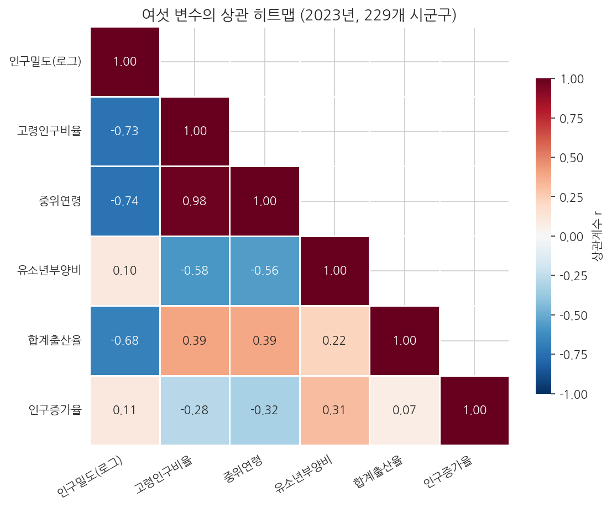

그림 읽는 법. 행과 열에 같은 여섯 변수를 같은 순서로 놓았고, 칸 안의 숫자가 그 행과 열 변수의 상관계수다. 색은 오른쪽 막대처럼 양의 상관이 빨강, 음의 상관이 파랑이며, 0에 가까울수록 옅고 절댓값이 클수록 진하다. 대각선은 변수 자신과의 상관이라 언제나 1이고, 대각선 위쪽은 아래쪽과 같은 값이라 비워 두었다.

진한 칸부터 읽는다. 가장 진한 빨강은 고령인구비율과 중위연령(0.98)이다. 두 변수는 모두 인구의 나이 구성에서 계산하는 지표여서 거의 같은 정보를 담고 있다. 이렇게 계산 방법이 겹치는 변수끼리의 높은 상관은 발견이라기보다 정의에서 나온 결과다. 진한 파랑은 인구밀도(로그)와 중위연령(-0.74), 고령인구비율(-0.73), 합계출산율(-0.68)이며, 유소년부양비와 고령인구비율(-0.58)이 그다음이다. 인구증가율의 행은 모든 칸이 옅어서(-0.32에서 0.31 사이) 다른 다섯 변수와 직선 관계가 약하다.

상관 히트맵은 숫자 표보다 빨리 읽히지만, 각 칸은 상관계수 하나일 뿐이어서 1.3 앞부분에서 본 상관계수의 한계를 그대로 갖는다. 굽은 관계는 옅은 칸으로 나타날 수 있고, 이상치 몇 개가 칸의 색을 바꿀 수도 있다. 그래서 상관 히트맵은 결론을 내리는 그림이 아니라 산점도로 확인할 짝을 고르는 그림으로 쓴다. 또 색의 진하기가 같아 보여도 -0.68과 -0.73처럼 값이 다르므로, 칸 안에 숫자를 함께 적게 한다.

## 1.4 시간과 공간: 시계열, 두 시점 비교, 지도

### 시계열 그림: 가로축이 시간이 될 때

지금까지의 그림은 2023년이라는 한 시점의 단면이었다. 그러나 정책의 질문은 "지금 얼마인가" 못지않게 "어디로 가고 있는가"를 묻는다. 시간에 따라 기록된 데이터를 시계열(time series)이라 하고, 가로축에 시간을, 세로축에 값을 놓고 점을 선으로 이은 그림을 시계열 그림이라 한다. 점을 선으로 잇는 것은 관측치들이 시간 순서로 연결된 하나의 흐름이라는 뜻이다. 시군구처럼 순서가 없는 범주를 선으로 이으면 안 되는 것과 대비된다.

소득 불평등의 대표 지표인 지니계수의 추이를 보자(data/income_dist.csv, 국가데이터처 소득분배지표, KOSIS에서 수집). 지니계수는 0(모두의 소득이 같음)부터 1(한 사람이 모든 소득을 가짐) 사이의 값으로 불평등의 정도를 나타낸다.

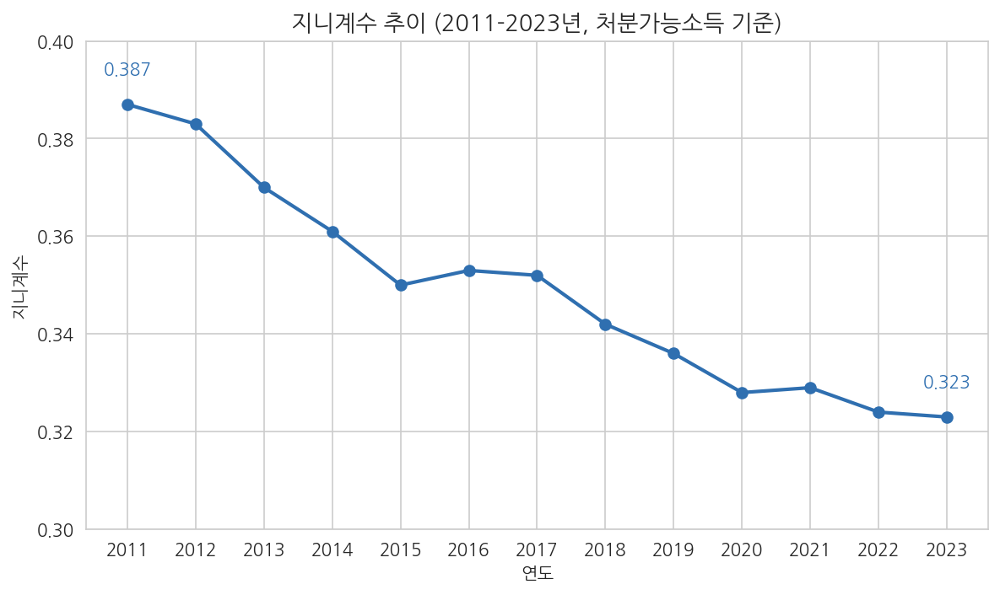

그림 읽는 법. 가로축은 연도(2011-2023년), 세로축은 지니계수다. 시계열 그림에서는 세 가지를 순서대로 본다. 먼저 전체의 추세(오르는가, 내리는가, 평평한가), 다음으로 추세가 꺾이는 지점, 마지막으로 추세에서 벗어난 예외적인 해.

이 그림의 추세는 꾸준한 하락이다. 지니계수는 2011년 0.387에서 2023년 0.323으로 12년에 걸쳐 약 17% 낮아졌다. 지표상 처분가능소득 기준의 불평등이 완화되어 온 것이다. 세부를 보면 매끄러운 직선은 아니어서, 2016년(0.350에서 0.353으로)과 2021년(0.328에서 0.329로)에 소폭의 반등이 있었다. 이런 미세한 굴곡 하나하나에 원인을 부여하는 것은 과잉해석이 되기 쉽지만, 추세가 꺾이는 듯한 지점은 해당 연도의 요인을 추가로 조사할 후보가 된다. 그림 9-15를 읽을 때 한 가지 더 확인할 것이 있다. 세로축이 0이 아니라 0.30에서 시작한다는 점이다. 이 선택이 그림의 인상을 어떻게 바꾸는지는 1.5의 주제다.

### 두 시점 비교: 기울기 그림과 덤벨 그림

시계열 그림은 해마다 값이 있을 때 쓴다. 자료가 두 시점뿐이거나, 여러 해 가운데 처음과 끝만 비교하고 싶을 때가 있다. 이번 주 2차시에는 2023년 자료와 함께 2013년 합계출산율을 받으므로 바로 이 경우다. 두 시점의 값을 집단마다 나란히 보이는 그림에는 두 가지가 있다. 기울기 그림(slope chart)은 왼쪽에 앞 시점, 오른쪽에 뒤 시점의 세로축을 세우고 집단마다 두 값을 선분으로 잇는다. 덤벨 그림(dumbbell chart)은 집단마다 가로줄 하나에 두 시점의 점을 찍고 그 사이를 선으로 잇는다.

17개 시도의 합계출산율을 두 방식으로 그렸다. 여기서 시도의 값은 시군구 값의 평균이 아니라 합계출산율 통계표에 함께 실린 시도 행의 값이다(그림 9-7에서 본 대로 둘은 다른 숫자다).

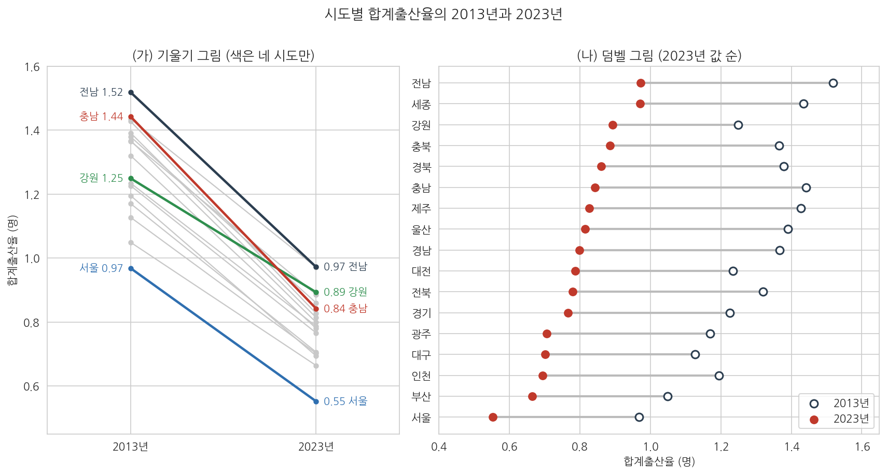

그림 읽는 법. 왼쪽(가)에서 선분 하나가 시도 하나이고, 왼쪽 끝이 2013년, 오른쪽 끝이 2023년 값이다. 선분이 오른쪽 아래로 기울수록 많이 떨어진 것이다. 17개를 모두 색칠하면 구별이 안 되므로 네 시도만 색과 이름을 붙이고 나머지는 회색으로 두었다. 오른쪽(나)은 2023년 값이 큰 순으로 시도를 위에서 아래로 놓았고, 흰 점이 2013년, 빨간 점이 2023년이며, 두 점 사이 선의 길이가 변화의 크기다.

(가)에서 먼저 보이는 것은 17개 선분이 하나도 빠짐없이 내려간다는 사실이다. 전국 값은 2013년 1.187명에서 2023년 0.721명이 되었다. 서울은 두 해 모두 가장 낮고(0.968명에서 0.552명), 전남은 두 해 모두 가장 높다(1.518명에서 0.972명). 다음으로 선분끼리 교차하는 곳을 본다. 교차는 순위가 바뀌었다는 뜻이다. 강원의 선분(1.249명에서 0.893명)은 하락 폭이 0.356명으로 가장 작아 다른 선분들을 가로지르며 올라가, 2013년 10위에서 2023년 3위가 되었다. 충남의 선분(1.442명에서 0.842명)은 제주와 함께 하락 폭이 0.600명으로 가장 커서 2위에서 6위로 내려갔다. (나)의 덤벨 그림에서는 같은 사실이 선의 길이로 보인다. 강원과 부산(0.385명 하락)의 선이 짧고 충남, 제주, 울산(0.577명 하락)의 선이 길다. 2023년 값으로는 전남(0.972명)과 세종(0.971명)이 거의 같다.

두 그림의 쓰임은 집단 수로 갈린다. 기울기 그림은 순위의 교차가 선으로 보이는 대신 집단이 열 개를 넘으면 선이 엉켜 이름을 붙이기 어렵다. 이 그림에서 네 시도만 색칠한 이유다. 덤벨 그림은 집단마다 줄이 따로 있어 열일곱 개도 이름과 함께 읽히지만, 순위의 변화는 정렬 기준이 아닌 시점의 점을 위아래로 견주어 읽어야 한다. 두 그림 모두에 해당하는 주의점이 있다. 두 시점만 이었으므로 그 사이 열 해 동안 값이 어떻게 움직였는지는 그림에 없다. 선분이 곧다고 해서 해마다 고르게 떨어졌다는 뜻이 아니다. 또 기울기 그림의 기울기는 두 세로축 사이의 가로 간격을 얼마로 그리느냐에 따라 달라 보이므로, 기울기의 가파름이 아니라 양 끝의 숫자로 변화량을 읽는다.

### 변화 산점도: 대각선으로 변화를 읽기

두 시점의 값을 산점도의 두 축으로 쓸 수도 있다. 가로축에 앞 시점의 값, 세로축에 뒤 시점의 값을 놓고 대상 하나를 점 하나로 찍으면, 왼쪽 아래에서 오른쪽 위로 긋는 대각선 위의 점은 두 시점의 값이 같은 대상이다. 이 대각선을 기준선으로 그은 산점도를 변화 산점도라 부르기로 한다.

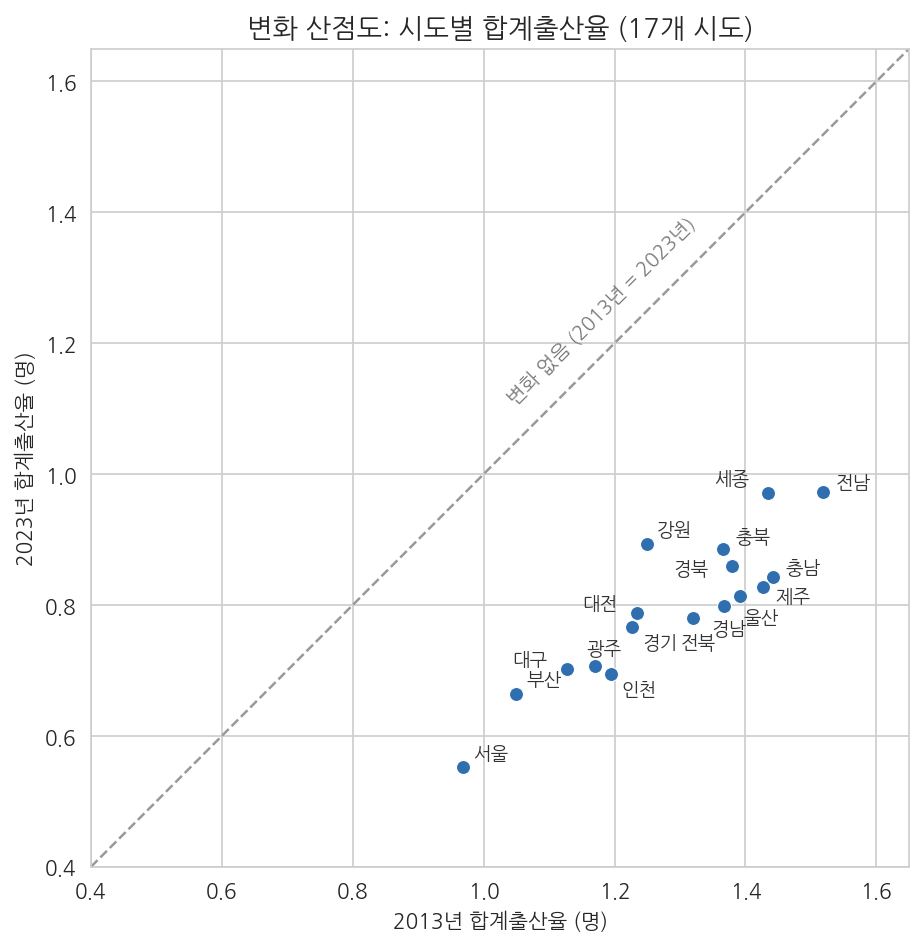

그림 읽는 법. 가로축이 2013년, 세로축이 2023년 합계출산율이고 점 하나가 시도 하나다. 회색 파선이 "변화 없음"의 대각선이다. 대각선보다 아래에 있는 점은 값이 줄어든 시도이고, 대각선에서 세로로 떨어진 거리가 줄어든 양이다. 두 축의 범위와 눈금 간격을 같게 맞추어 대각선이 정확히 45도가 되게 했다.

17개 점이 모두 대각선 아래에 있다. 그림 9-16에서 본 "모든 시도가 하락했다"는 사실이 여기서는 점 전체의 위치로 나타난다. 점들은 대각선 아래에서 대각선과 비슷한 방향으로 늘어서 있으며, 2013년 값과 2023년 값의 상관계수는 0.888이다. 2013년에 높았던 시도가 2023년에도 대체로 높다는 뜻이다. 늘어선 줄에서 위로 벗어난 점이 상대적으로 덜 떨어진 시도인데, 강원이 가장 뚜렷하다.

변화 산점도는 대상이 많을 때 기울기 그림과 덤벨 그림보다 낫다. 2차시 2.7에서는 시군구 229곳의 두 시점을 이 방식으로 그리는데, 선 229개나 줄 229개는 읽을 수 없지만 점 229개는 읽힌다. 대신 대상의 이름을 점마다 붙이기 어렵고, 변화량을 대각선까지의 세로 거리로 어림해야 한다. 두 축의 범위와 눈금이 다르면 대각선이 45도가 아니게 되어 이 어림이 틀어지므로, 에이전트에게 시킬 때는 "두 축의 범위를 같게 하고 대각선을 그어"라고 지시한다.

### 지도: 공간 위의 데이터 (개념만)

시군구 데이터에는 시간 축 못지않게 중요한 축이 하나 더 있다. 공간이다. 그림 9-5의 박스플롯은 시도별 차이를 보여 주지만, 어느 지역이 어디에 붙어 있는지는 말해 주지 못한다. 값을 지리적 위치 위에 얹어 보여 주는 그림이 지도이고, 그중 행정구역을 값의 크기에 따라 색의 진하기로 칠한 지도를 단계구분도(choropleth map)라 한다. 고령인구비율 단계구분도를 그리면, 수도권과 대도시가 옅고 남서부와 경북 내륙의 농촌이 짙은, 고령화의 공간적 집중이 한눈에 드러난다.

다만 지도를 실제로 그리려면 행정구역의 경계 좌표 파일이 따로 필요하고, 행정구역 개편(7주차에서 본 문제다)으로 경계 파일과 데이터의 지역 코드가 어긋나는 일도 잦다. 그래서 이 교재에서 지도는 개념 소개에 그치고, 2차시 실습은 이 장의 다른 그림들 가운데 몇 가지를 골라 쓴다.

단계구분도를 읽을 때 가장 먼저 의심할 것은 면적 효과다. 단계구분도에서 눈에 들어오는 양은 색칠된 넓이인데, 행정구역의 넓이는 인구와 거의 관계가 없다. 우리 데이터로 따져 보면, 서울은 25개 구를 합쳐 605.2제곱킬로미터로 전국 면적의 0.6%에 불과하지만 인구는 9,386,034명으로 전국의 18.3%다. 반대로 가장 넓은 강원 홍천군은 1,820.6제곱킬로미터로 서울 전체의 세 배가 넘지만 인구는 67,309명이다. 고령인구비율이 30% 이상인 시군구 74곳을 짙게 칠하면 그 색이 전국 면적의 50.3%를 덮는다. 그러나 그 74곳에 사는 인구는 전국의 6.9%다. 지도는 "국토의 절반이 짙다"는 인상을 주지만, 그 사실은 "인구의 대부분이 고령인구비율 30% 이상인 곳에 산다"는 뜻이 아니다. 단계구분도에는 이 밖에도 두 가지 선택이 들어간다. 하나는 색의 단계를 나누는 경계로, 히스토그램의 구간 폭처럼 경계를 어디에 두느냐에 따라 같은 자료가 다르게 칠해진다. 다른 하나는 칠하는 값의 종류로, 출생아수 같은 총량을 칠하면 인구가 많은 지역이 진해질 뿐이므로 단계구분도에는 고령인구비율이나 합계출산율 같은 비율을 칠한다. 지도를 받으면 범례의 단계 경계와 칠한 값이 무엇인지를 먼저 확인하고, 면적의 인상을 인구의 사실로 옮겨 읽지 않는다.

## 1.5 좋은 그래프, 나쁜 그래프: 시각화의 윤리

### 같은 데이터, 다른 인상

그림은 독자에게 강한 인상을 주므로 의도적이든 아니든 왜곡될 수 있다. 숫자를 조작하는 것은 명백한 거짓이지만, 숫자는 그대로 두고 축의 범위나 도형의 크기 같은 그림의 구성 요소만 조정하여 독자의 인상을 바꾸는 일은 훨씬 흔하고 발견하기 어렵다. 가장 고전적인 수법이 세로축 자르기다.

수도권(서울·경기·인천)과 비수도권 시군구의 평균 합계출산율은 각각 0.69명과 0.88명이다. 같은 두 숫자를 두 가지 방식으로 그렸다.

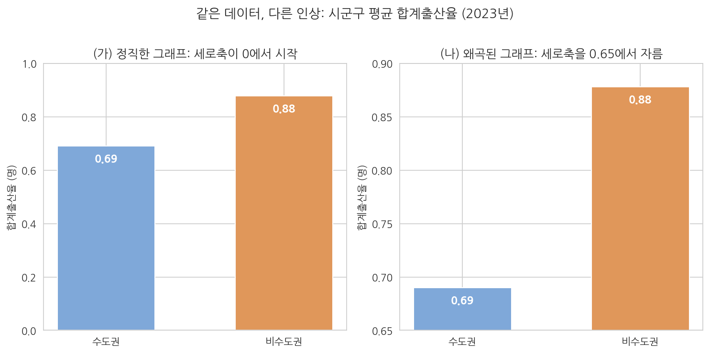

그림 읽는 법. 두 패널의 데이터는 완전히 같고, 다른 것은 세로축의 시작점뿐이다. 왼쪽(가)은 세로축이 0에서 시작한다. 막대의 높이 비가 실제 값의 비(0.69 대 0.88, 약 1.3배)와 일치하므로, 눈에 보이는 차이가 곧 실제 차이다. 오른쪽(나)은 세로축을 0.65에서 잘랐다. 수도권 막대는 바닥에 붙고 비수도권 막대는 6배 가까이 높아 보인다. 실제로는 1.3배 차이가 시각적으로는 몇 배의 차이로 부풀려진 것이다.

막대그래프에서 이것이 왜곡인 이유는 분명하다. 막대그래프는 막대의 길이로 값을 나타내는 방식이므로 길이의 비가 값의 비와 일치해야 하는데, 축을 자르면 두 비가 어긋난다. 그래서 막대그래프의 세로축은 0에서 시작하는 것이 원칙이다. 반면 그림 9-15 같은 시계열 선 그림은 값의 크기보다 변화의 방향과 굴곡을 보여 주는 그림이므로, 축 범위를 데이터 근처로 좁히는 것이 관행으로 허용된다. 지니계수처럼 0부터 그리면 변화가 아예 안 보이는 경우도 있다. 다만 허용된다는 것이지 인상이 중립이라는 뜻은 아니다. 같은 하락도 축을 좁힐수록 가파른 폭락처럼 보인다. 그림을 읽는 쪽이 지켜야 할 확인 원칙은 하나로 요약된다. 어떤 그래프든 축의 숫자부터 읽는다.

### 그 밖의 흔한 왜곡 수법들

세로축 자르기 외에 공공 보고서와 언론에서 자주 마주치는 수법 몇 가지를 알아 두자.

**표 9-1. 흔한 시각화 왜곡 수법과 방어법**

| 수법 | 무엇이 문제인가 | 읽는 사람의 확인 방법 |
|------|------|------|
| 세로축 자르기 | 막대 길이의 비가 값의 비와 어긋난다 | 축의 시작점을 확인한다 |
| 이중 축 | 왼쪽·오른쪽 두 세로축의 눈금을 조절해 무관한 두 변수가 함께 움직이거나 교차하는 것처럼 연출할 수 있다 | 두 축의 단위와 범위를 각각 읽고, 교차·동행의 인상을 무시한다 |
| 3D 효과 | 원근 때문에 앞쪽 조각이 실제보다 커 보인다. 특히 3D 원그래프가 심하다 | 각 항목의 실제 수치를 찾아 확인한다 |
| 그림문자 크기 | 값이 2배일 때 그림의 가로·세로를 각각 2배로 키우면 넓이는 4배가 되어 과장된다 | 길이가 아닌 넓이·부피로 표현된 그림을 의심한다 |
| 누적 기간 조절 | 시계열의 시작 연도를 유리하게 골라 "역대 최대 증가" 같은 인상을 만든다 | 더 긴 기간의 데이터를 찾아본다 |

이 표를 관통하는 원리는 하나다. 그림의 시각적 요소(길이, 넓이, 기울기)가 데이터의 값과 비례 관계를 유지하면 정직한 그림이고, 그 비례를 깨뜨리면 왜곡이다. 여러분은 이 수법들을 두 방향에서 알아야 한다. 읽는 사람으로서 속지 않기 위해서, 그리고 만드는 사람으로서 저지르지 않기 위해서다. 공공기관의 이름으로 나가는 그래프가 왜곡을 담고 있으면, 그것이 실수였더라도 기관의 신뢰가 손상된다.

<strong>유의 · 에이전트가 그린 그래프도 예외가 아니다</strong> 
왜곡은 악의에서만 나오지 않는다. 그래프 도구들은 보기 좋으라고 축 범위를 데이터에 맞춰 자동으로 좁히곤 하며, 에이전트도 지시가 없으면 그 기본값을 따른다. 즉 여러분이 시키지 않아도 축이 잘린 막대그래프가 나올 수 있다. 에이전트가 만든 그래프를 받으면 축의 시작점 확인을 검증 목록에 반드시 넣어야 하는 이유다. 이 확인은 2차시 실습에서 직접 해 본다.

### 좋은 그래프의 조건

왜곡을 피하는 것은 최소 조건이고, 좋은 그래프에는 갖출 것이 더 있다. 이 교재의 모든 그림이 따르는 기준이자, 여러분이 에이전트에게 요구해야 할 기준이다.

- **제목이 그림의 요지를 말한다.** "그림 1"이 아니라 "시군구 고령인구비율의 분포"처럼, 제목만 읽어도 무엇을 그렸는지 알 수 있게 한다.
- **두 축에 라벨과 단위가 있다.** "고령인구비율 (%)", "합계출산율 (명)"처럼 무엇을 어떤 단위로 쟀는지 밝힌다. 단위 없는 축은 읽을 수 없는 축이다.
- **데이터의 출처와 시점이 어딘가에 밝혀져 있다.** 그림 안이든 캡션이든, 이 숫자가 어디서 온 언제 것인지를 독자가 추적할 수 있어야 한다.
- **시각 요소가 데이터 전달에 쓰인다.** 화려한 배경, 불필요한 3D, 과도한 색은 데이터를 가린다. 시각 요소는 정보 전달에 기여해야 한다.

## 1.6 그림 고르기, 에이전트의 그리기와 분석가의 읽기

이 장의 내용을 두 가지로 정리한다. 하나는 질문에 맞는 그림을 고르는 기준이고, 다른 하나는 에이전트와 분석가의 역할 분담이다. 1주차에서 배운 지시·검증·해석의 순환이 EDA에서 어떻게 구체화되는지를 보는 것이다.

### 질문에서 그림으로

이 장에서 본 그림은 열여덟 장이다. 종류가 많아 보이지만 고르는 순서는 단순하다. 먼저 묻고 싶은 질문을 한 문장으로 쓰고, 그 질문에 들어가는 변수가 몇 개이며 각각 연속형인지 범주형인지, 시간이 들어가는지를 확인한다. 그러면 후보가 한두 개로 좁혀진다. 표 9-2는 그 대응을 정리한 것이다.

**표 9-2. 질문과 자료 유형에 따른 그림 고르기**

| 질문 | 자료 (변수 수·유형) | 그림 | 이 장의 예 |
|------|------|------|------|
| 값이 어디에 몰려 있고 어느 쪽으로 치우쳤는가 | 연속형 1개 | 히스토그램, 밀도 그림 | 그림 9-1, 9-2(가) |
| 어떤 기준값 이하가 몇 %인가, 분위수는 얼마인가 | 연속형 1개 | 누적분포 그림(분위수 그림) | 그림 9-3 |
| 범주마다 몇 개인가 | 범주형 1개 | 막대그래프 | 그림 9-4 |
| 집단마다 분포가 어떻게 다른가 | 연속형 1개 + 범주형 1개 | 박스플롯, 바이올린 그림, 스트립 그림(집단당 관측치가 적을 때), 밀도 곡선 겹치기(집단이 두세 개일 때) | 그림 9-5, 9-6, 9-2(나) |
| 집단마다 값이 하나일 때 순위와 간격은 어떤가 | 범주형 1개 + 집단별 값 1개 | 정렬 막대, 점 그림(값이 두 종류 이상이면 점 그림) | 그림 9-7 |
| 집단 평균과 그 흩어짐은 어떤가 | 연속형 1개 + 범주형 1개 | 막대와 오차막대(무엇의 오차막대인지 명시) | 그림 9-8 |
| 두 변수가 함께 움직이는가 | 연속형 2개 | 산점도와 상관계수, 치우친 양수 변수는 로그 축 | 그림 9-9, 9-10 |
| 그 관계가 집단마다 다른가 | 연속형 2개 + 범주형 1개 | 색으로 나눈 산점도(집단이 두세 개일 때), 소다중(집단이 많을 때) | 그림 9-11, 9-12 |
| 여러 변수 가운데 어느 짝이 관련되는가 | 연속형 3개 이상 | 산점도 행렬(다섯 개 안팎까지), 상관 히트맵(그 이상) | 그림 9-13, 9-14 |
| 시간에 따라 어떻게 변해 왔는가 | 연속형 1개 + 여러 시점 | 시계열 그림 | 그림 9-15 |
| 두 시점 사이에 누가 얼마나 변했는가 | 연속형 1개 + 두 시점 | 기울기 그림(대상이 열 개 안팎까지), 덤벨 그림, 변화 산점도(대상이 많을 때) | 그림 9-16, 9-17 |
| 값이 공간에 어떻게 분포하는가 | 비율 1개 + 지역 경계 | 단계구분도 | 개념만(1.4) |

표의 마지막 열이 가리키는 그림마다 "읽을 때 주의할 점"이 있었다. 밀도 그림과 바이올린은 자료 밖으로 번지고, 막대는 0에서 시작해야 하며, 점 그림의 값은 출처를 밝혀야 하고, 오차막대는 무엇의 막대인지 적어야 하며, 로그 축은 눈금 숫자를, 소다중은 축 범위를, 변화 산점도는 두 축의 같음을 확인해야 한다. 그림을 고르는 일과 그 그림의 주의점을 지시문에 함께 적는 일은 같은 일이다. "시도별 고령인구비율의 차이를 보여 줘"라고만 지시하면 에이전트가 그림 종류와 설정을 정하지만, "시도별 고령인구비율을 시군구가 점 하나인 스트립 그림으로, 시도는 중앙값 순으로, 각 시도의 n을 표시해서 그려 줘"라고 지시하면 분석가가 고른 그림이 나온다.

### 에이전트의 그리기와 분석가의 읽기

그리는 일은 에이전트의 몫이다. 불과 몇 년 전까지 이 장의 그림 열여덟 장을 만들려면 matplotlib라는 그림 도구의 명령어 수십 개를 익혀야 했다. 지금은 "고령인구비율 히스토그램을 그리고 중앙값을 표시해 줘"라는 한국어 한 문장이면 된다. 그림의 문법(어느 그림을 쓸지)을 지정하는 것도, 축과 제목을 다듬으라고 요구하는 것도 지시로 해결된다.

그러나 읽는 일은 사람의 몫으로 남는다. 여기서 읽기는 세 층위다. 첫째 층위는 기술적 읽기다. 축이 무엇이고 점과 막대가 무엇을 나타내는지 파악한다(모든 그림의 "그림 읽는 법"). 둘째 층위는 패턴 읽기다. 치우침, 이상치, 추세, 상관 같은 구조를 알아본다. 이 장에서 배운 어휘들이 이 층위의 도구다. 셋째 층위는 의미 읽기다. 그 패턴이 우리 정책 맥락에서 무엇을 뜻하는지, 어떤 새 질문을 낳는지 판단한다. 그림 9-9에서 양의 상관을 발견하는 것이 둘째 층위라면, "그렇다면 저출산 대책의 초점은 어디여야 하는가"라는 질문으로 나아가는 것이 셋째 층위다.

에이전트는 첫째 층위를 대신할 수 있고 둘째 층위도 어느 정도 수행한다. 실제로 에이전트에게 그림을 시키면 "오른쪽으로 치우친 분포입니다" 같은 해설을 함께 내놓는다. 그러나 그 해설은 검증의 대상이지 결론이 아니다. 에이전트는 그림을 눈으로 보는 것이 아니라 데이터의 숫자로 미루어 말하는 것이어서, 그럴듯하지만 어긋난 해설이 나올 수 있다. 그리고 셋째 층위, 곧 우리 지역의 사정과 제도를 아는 사람만이 할 수 있는 의미 부여는 애초에 에이전트의 것이 아니다. 1주차에서 말한 행정학도의 비교우위가 EDA에서는 바로 이 지점에 있다.

마지막으로 11주차를 예고해 둔다. EDA는 패턴을 발견하는 단계이지 확정하는 단계가 아니다. 그림 9-18에서 본 수도권과 비수도권의 출산율 차이 0.19명은 눈에 보이는 차이다. 그런데 눈에 보이는 차이가 우연의 산물일 가능성은 없는가. 이 질문에 답하려면 그림만으로는 부족하며 통계적 추론이 필요하다. 11주차에서는 "이 차이는 우연인가"를 따지는 방법을 배운다. 그림으로 질문을 만들고 통계로 그 질문을 검증하는 것이 3부 전체의 흐름이다.

## 요약

탐색적 데이터 분석(EDA)은 가설 검증에 앞서 그림으로 데이터의 분포·관계·패턴·예외를 살펴보는 단계로, 결론을 정해 놓고 증거를 찾는 확증 중심 분석과 달리 데이터의 특성을 먼저 파악하는 탐색 중심 분석이다(1.1). 변수 하나의 분포는 히스토그램(값이 몰린 곳, 퍼짐, 치우침), 밀도 그림(윤곽을 곡선으로, 집단 곡선 겹치기), 누적분포 그림(기준값 이하의 비율과 분위수)으로 보고, 범주형 변수는 막대그래프로 센다. 집단 비교에는 박스플롯을 쓰되 상자 안의 모양은 바이올린 그림과 스트립 그림으로 확인하며, 집단마다 값이 하나이면 점 그림이나 정렬 막대로, 평균과 흩어짐은 오차막대로 보인다. 시군구 고령인구비율은 오른쪽으로 치우친 분포이고, 경남처럼 한 시도 안이 두 무리로 갈라진 곳도 있으며, 시도 값과 시군구 단순 평균은 다른 숫자다(1.2). 두 변수의 관계는 산점도로 보고 상관계수로 요약한다. 고령인구비율과 합계출산율은 통념과 반대로 양의 상관(r = 0.39)을 보이는데, 이는 인과가 아니라 검증할 질문의 출발점이며, 집단의 상관을 개인에게 적용하는 생태학적 오류를 경계해야 한다. 치우친 양수 변수는 로그 축으로 그리고(인구밀도와 고령인구비율 r = -0.41에서 -0.73), 세 번째 변수는 색이나 소다중으로 나누어 보며(권역 안의 상관은 비수도권 0.28, 수도권 0.11), 변수가 많으면 산점도 행렬과 상관 히트맵으로 후보 짝을 고른다(1.3). 시계열 그림은 추세·전환점·예외를 읽는 그림이고(지니계수는 2011년 0.387에서 2023년 0.323으로 하락), 두 시점은 기울기 그림, 덤벨 그림, 변화 산점도로 비교하며(17개 시도의 합계출산율이 모두 하락), 단계구분도는 값의 공간적 집중을 보여 주되 면적이 큰 지역이 과대 대표된다. 고령인구비율 30% 이상인 시군구는 면적의 50.3%를 차지하지만 인구로는 6.9%다(1.4). 세로축 자르기, 이중 축, 3D 효과 같은 수법은 숫자를 그대로 둔 채 인상을 조작하며, 방어법은 축의 숫자부터 읽는 습관이다. 좋은 그래프는 요지를 말하는 제목, 단위 있는 축 라벨, 출처를 갖춘다(1.5). 그림은 질문과 자료 유형(변수 수, 연속형·범주형, 시간)으로 고르고 그 그림의 주의점을 지시문에 함께 적는다. 그리기는 에이전트의 몫이지만, 그림을 고르고 패턴을 알아보고 정책적 의미를 부여하고 왜곡을 가려내는 읽기는 분석가의 몫이다(1.6).

## 연습문제

**9-1. 그림 고르기.** 다음 여섯 가지 질문에 각각 어떤 그림이 가장 적합한지 표 9-2를 보며 고르고, 이유를 한 문장씩 써 보라.
(a) 우리 도 시군별 재정자립도는 최근 10년간 어떻게 변해 왔는가
(b) 전국 시군구의 1인당 지방세 부담액은 어떤 모양으로 퍼져 있는가
(c) 재정자립도가 높은 지역일수록 복지 예산 비중이 낮은가
(d) 특별시·광역시·도 세 유형 사이에 공무원 1인당 주민 수의 분포가 다른가
(e) 전국 시군구 가운데 1인당 지방세 부담액이 전국 중앙값의 절반 이하인 곳은 몇 %인가
(f) 17개 시도의 재정자립도 순위는 2015년과 2025년 사이에 어떻게 바뀌었는가

**9-2. 그림 읽기.** (a) 그림 9-5(시도별 박스플롯)에서 인천의 상자가 서울의 상자보다 훨씬 긴 이유를 인천의 행정구역 구성(도심의 구와 외곽의 군)을 떠올려 추측해 보라. (b) 어떤 시도의 "평균 고령인구비율"이 같더라도 상자의 길이가 다르면 정책적으로 무엇이 달라지는지 한 단락으로 써 보라. (c) 그림 9-7에서 경남의 두 점(시도 값 20.6%, 시군구 단순 평균 30.09%)이 9%포인트 넘게 떨어진 이유를 그림 9-6(나)의 경남 점들의 배치와 연결해 설명하라. 보도자료에 "경남의 평균 고령인구비율은 30%"라고 쓰면 어떤 문제가 생기는가.

**9-3. 왜곡 잡아내기.** 어느 기관의 보도자료에 "청년 취업자 수, 2배 증가 시각화"라는 막대그래프가 실렸다. 세로축은 130만 명에서 시작하고, 두 막대는 132만 명(작년)과 138만 명(올해)이다. (a) 실제 증가율은 몇 %인가. (b) 그림에서 막대의 높이는 몇 배로 보이겠는가. (c) 이 그래프를 정직하게 다시 그리려면 무엇을 바꿔야 하는가. (d) 신문 기사, 보고서, 광고 등에서 이 장의 표 9-1에 해당하는 실제 사례를 하나 찾아 어떤 수법이 쓰였는지 분석해 보라.
