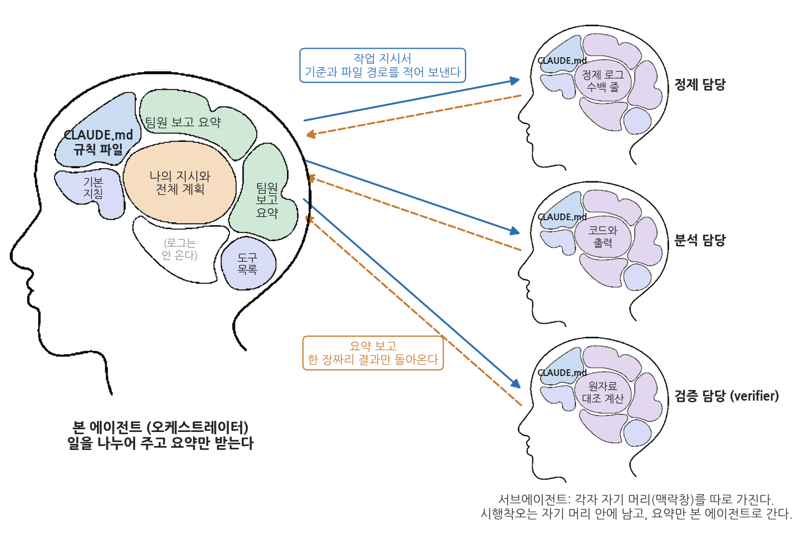
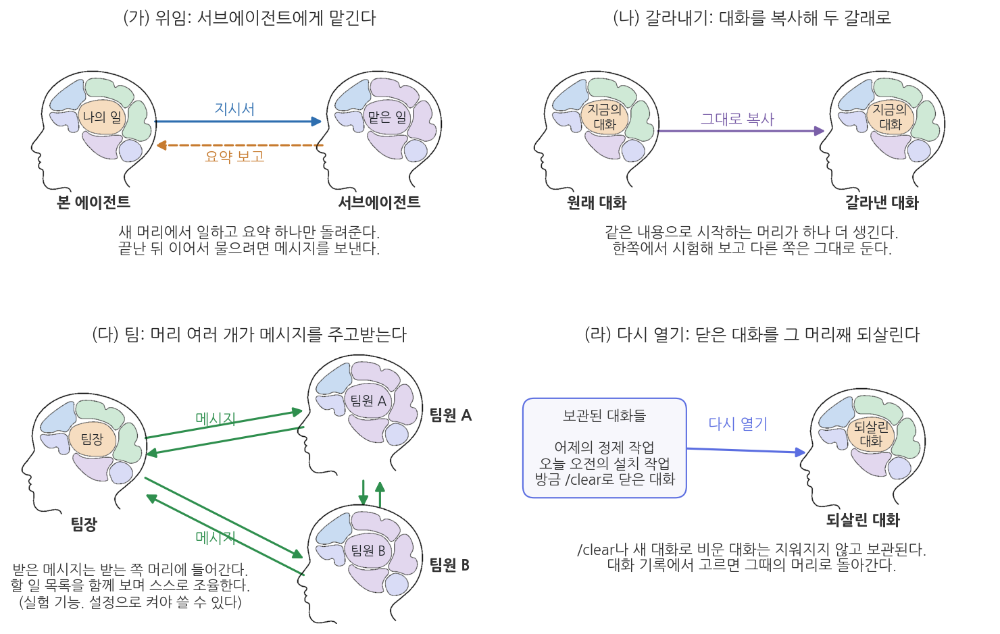
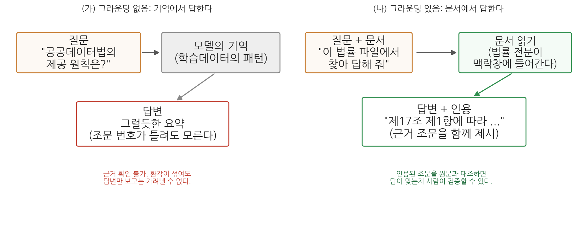
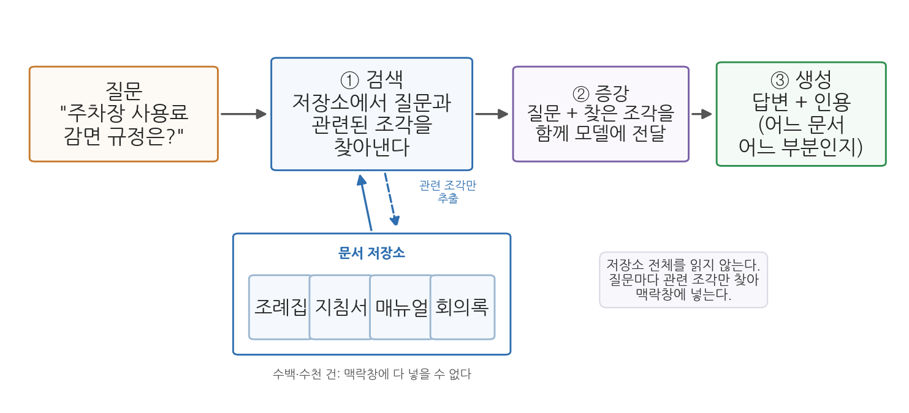
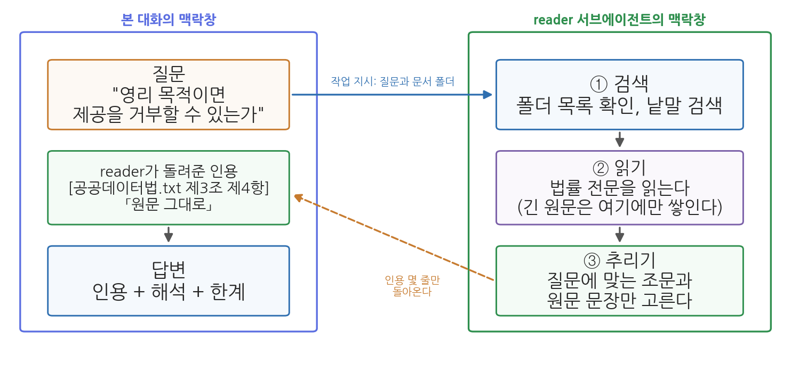
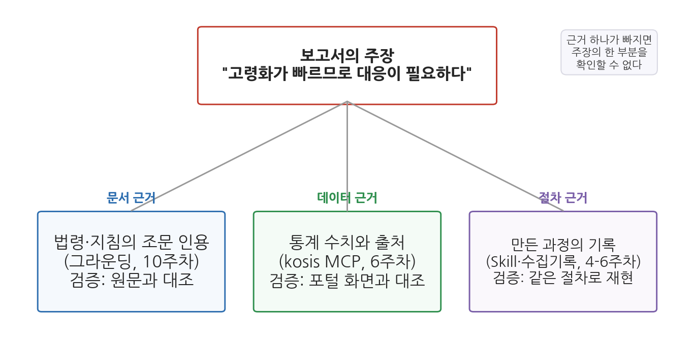

# 10주차 1차시. 서브에이전트, 문서 그라운딩, RAG

> 신뢰하라, 그러나 검증하라.
> (러시아 속담. 로널드 레이건 미국 대통령이 즐겨 인용했다)

## 이 장에서 배우는 것

공공부문 실무에서는 "민간 업체가 우리 구의 주차장 데이터를 받아서 유료 앱을 만들겠다고 하는데, 영리 목적이어도 법적으로 제공해야 하는가"와 같은 질문이 들어온다. 이 질문을 에이전트에게 물으면 대개 그럴듯한 답이 돌아온다. 문제는 그 답을 업무에 쓸 수 있는가이다. "AI가 가능하다고 했다"는 것은 보고의 근거가 되지 못하며, 행정의 답변에는 근거 조문이 붙어야 한다. "「공공데이터의 제공 및 이용 활성화에 관한 법률」 제3조 제4항에 따르면 영리적 이용도 원칙적으로 제한할 수 없다"처럼, 누구든 원문을 펴서 확인할 수 있는 답이어야 한다.

2주차에서 에이전트가 기억에서 답하면 맞는지 확인할 방법이 없다는 점을 배웠다. 해법은 에이전트에게 문서를 주고, 그 문서에 근거해서만, 인용과 함께 답하게 하는 것이다. 이를 그라운딩이라 부른다. 그런데 그라운딩에는 조건이 하나 붙는다. 근거가 될 문서가 맥락창에 들어가야 한다는 것이다. 법률 전문이나 수백 쪽짜리 지침을 본 대화에서 통째로 읽히면 맥락창이 그 원문으로 차고, 정작 분석에 필요한 기준과 결론이 밀려날 수 있다.

이 장은 이 문제를 서브에이전트로 푼다. 서브에이전트는 본 대화와 따로 떨어진 맥락창에서 일하고 요약만 돌려주는 하위 에이전트다. 긴 문서는 서브에이전트에게 읽히고 본 대화에는 인용 근거 몇 줄만 받으면, 본 대화의 맥락창은 가볍게 유지되면서 답은 문서에 근거하게 된다. 이것이 문서가 클 때 쓰는 RAG(검색 증강 생성)의 가장 단순한 구현이다. 같은 원리로 검증도 독립된 맥락창을 가진 검증 전담 서브에이전트에게 맡길 수 있다.

이 장에서 구체적으로 다음을 배운다.

- 맥락창의 한계와, 독립된 맥락창을 가진 서브에이전트의 개념 (2주차와 연결)
- 서브에이전트 정의 파일(`.claude/agents/이름.md`)의 구조와, 일을 서브에이전트에게 나누는 기준
- 그라운딩이 무엇이고, 법령·정책문서를 다룰 때 인용과 출처를 어떻게 요구하는지
- RAG의 세 단계(검색·증강·생성)와, 서브에이전트에게 문서를 읽히는 방식과의 관계
- 주장을 받치는 세 종류의 근거(문서·데이터·절차)와, 근거 검증을 서브에이전트에게 맡기는 방법

<div style="border:1px solid #d9d9e3;border-left:5px solid #5b6ee1;background:#f7f7fc;padding:12px 16px;margin:18px 0;border-radius:4px;">
<strong>이 장의 로드맵</strong><br>
이 장은 하나의 질문을 중심으로 전개된다. <em>"긴 문서에 근거해 답하게 하면서 본 대화의 맥락창을 지키고, 그 근거를 어떻게 검증하는가?"</em><br><br>
<strong>1.1</strong> 맥락창의 한계와 서브에이전트: 독립된 맥락창에 일을 맡긴다 →
<strong>1.2</strong> 그라운딩: 기억이 아니라 문서에서 답하게 한다 →
<strong>1.3</strong> RAG: 문서가 클 때는 검색해서 근거를 찾는다. 서브에이전트에게 읽히는 것이 가장 단순한 형태다 →
<strong>1.4</strong> 근거의 세 유형을 갖추고, 그 검증을 서브에이전트에게 맡긴다.
</div>

## 1.1 맥락창의 한계와 서브에이전트

### 문서를 읽힐수록 맥락창이 찬다

2주차 1차시 1.1에서 배운 맥락창을 떠올려 보자. 에이전트가 답을 만들 때 참고할 수 있는 것은 맥락창에 지금 들어 있는 내용뿐이고, 대화와 열어 본 파일과 실행 결과가 모두 그 안에 쌓인다. 맥락창의 크기는 정해져 있어서 긴 작업에서는 가득 차는 시점이 오고, 그때 Claude Code는 오래된 내용부터 요약한다(자동 압축). 요약에서 무엇이 빠질지는 사용자가 정하지 않으므로, 한 시간 전에 정한 기준이 요약에서 빠졌는데 아무도 모르는 상태가 생길 수 있다.

문서에 근거해 답하게 하는 작업은 이 문제를 특히 빨리 부른다. 법률 하나의 전문만 해도 수십 개 조문이고, 시행령과 기관 지침까지 함께 읽히면 원문이 맥락창의 큰 몫을 차지한다. 그런데 질문에 답하는 데 실제로 필요한 것은 그 가운데 조문 두세 개다. 나머지 원문은 한 번 읽힌 뒤 다시 쓰이지 않으면서 맥락창에 남아, 뒤에 이어질 분석의 자리를 줄인다. 2주차 1차시 표 2-1은 맥락창이 가득 찼을 때 하는 일을 네 가지로 정리했는데, 비우기·줄이기·파일에 적어 두기 다음의 넷째가 일의 일부를 다른 맥락창에 맡기는 것이었다. 이 넷째 방법을 이번 주에 배운다.

### 서브에이전트: 독립된 맥락창에서 일하고 요약만 돌려준다

본 에이전트가 모든 작업을 직접 하는 대신 작업의 일부를 하위 에이전트에게 맡기는 구조가 서브에이전트다. 핵심은 **각 서브에이전트가 자기만의 독립된 맥락창을 가진다**는 점이다. 문서 읽기를 맡은 서브에이전트의 맥락창에는 법률 전문이 쌓이지만, 그 원문은 본 에이전트의 맥락창으로 넘어오지 않는다. 일이 끝나면 서브에이전트는 결과만 본 에이전트에게 돌려준다. "공공데이터법.txt 제3조 제4항, 원문은 이 문장" 같은 몇 줄이다.

<div style="border:1px solid #cdd9e5;border-left:5px solid #2f6fb0;background:#f5f9fd;padding:12px 16px;margin:18px 0;border-radius:4px;">
<strong>정의 · 서브에이전트와 오케스트레이터</strong><br>
<strong>서브에이전트</strong>(subagent)는 본 에이전트가 특정 작업을 떼어 맡기는 하위 에이전트다. 각 서브에이전트는 자기만의 독립된 맥락창에서 일하고, 끝나면 요약된 결과만 본 에이전트에게 돌려준다. 작업을 나누어 맡기고 결과를 모으는 본 에이전트를 <strong>오케스트레이터</strong>(orchestrator)라고도 부른다.
</div>

그림 10-1은 이 구조를 2주차 그림 2-3의 머리 그림으로 그린 것이며, 그림에서 머리는 맥락창을 뜻한다.



그림 10-1을 읽어 보자. 왼쪽의 큰 머리가 본 에이전트다. 이 맥락창에는 사용자의 지시와 전체 계획, 그리고 서브에이전트들이 올린 요약만 들어 있다. 오른쪽의 작은 머리 세 개가 서브에이전트다. 그림의 예는 13주차에서 쓸 정제·분석·검증 담당이다. 각 서브에이전트의 맥락창에는 자기 일의 기록(정제 로그, 코드와 출력, 원자료 대조 계산)이 쌓이지만 그 기록은 그 맥락창 안에 머문다. 파란 실선은 본 에이전트가 내려보내는 작업 지시서이고, 주황 점선은 돌아오는 요약이다. 여기서 알 수 있는 것은 두 가지다. 첫째, 본 에이전트의 맥락창에는 끝까지 여유가 남는다. 원문과 로그가 넘어오지 않으므로 처음에 정한 기준이 밀려나지 않는다. 둘째, 서브에이전트의 맥락창에도 파란 구역(CLAUDE.md)이 있다. 프로젝트의 CLAUDE.md는 서브에이전트에게도 전달되지만 지금까지의 대화는 전달되지 않는다. 이 차이가 뜻하는 바는 뒤의 유의 박스에서 본다.

### 맥락창을 여러 개 쓰는 기능 네 가지

서브에이전트 말고도 맥락창을 여러 개 다루는 기능이 있다. 그림 10-2는 네 가지를 나란히 보여 준다.



(가) 위임은 방금 본 서브에이전트다. 빈 맥락창에 작업 지시서만 넣어 일을 시키고 요약 하나를 돌려받는다. (나) 갈라내기는 지금까지의 대화를 그대로 복사한 맥락창을 하나 더 만드는 것으로, 3주차 2차시 2.11에서 해 본 기능이다. (다) 팀은 여러 맥락창이 서로 메시지를 주고받으며 함께 일하는 구조로, 설정으로 켜야 쓰는 실험 기능이라 이 과목에서는 다루지 않는다. (라) 다시 열기는 `/clear`나 새 대화로 닫은 대화를 대화 기록에서 골라 그 맥락창 그대로 복원하는 것이다. 이번 주와 13·14주차에서 쓰는 것은 (가) 위임이다.

### 정의 파일로 역할을 저장한다

Claude Code에서 서브에이전트를 쓰는 방법은 세 수준이다. 첫째, Claude Code에는 파일 탐색용, 계획 수립용, 범용 작업용 같은 기본 서브에이전트가 들어 있어서 에이전트가 필요하다고 판단하면 스스로 위임한다. 둘째, 지시문에 "이 문서 읽기는 서브에이전트에게 맡겨서 근거만 받아 줘"처럼 말로 요청할 수 있다. 셋째, 같은 역할을 반복해서 맡길 것이라면 그 역할의 이름·설명·행동 지침을 파일로 적어 프로젝트의 `.claude/agents/` 폴더에 저장해 둔다. 이 파일을 서브에이전트 정의 파일이라 부르며, 이번 주 실습에서 두 개를 만든다.

정의 파일의 형식은 4주차 1차시 1.3에서 배운 SKILL.md와 같다. 맨 위 머리말에 이름과 설명을 적고, 그 아래 본문에 그 서브에이전트가 지킬 지침을 적는다. 다음은 이번 주 실습에서 만들 문서 읽기 담당 `reader`의 앞부분이다.

```markdown
---
name: reader
description: 지정한 폴더의 문서(법령·지침 등)를 읽고 질문과 관련된 조문을
  원문 그대로 인용해 돌려주는 문서 읽기 담당. 문서에서 근거나 조문을 찾아
  달라는 요청에 사용.
tools: Read, Grep, Glob
---

너는 문서 읽기 담당이다. 답을 쓰지 않고 근거만 찾아 돌려준다.
(이하 지침)
```

머리말의 세 항목은 각각 하는 일이 있다. `name`은 지시문에서 부르는 이름이다. `description`은 본 에이전트가 어떤 요청을 이 서브에이전트에게 넘길지 판단하는 근거로, 4주차 스킬의 description과 같은 일을 한다. 본 에이전트는 평소에 서브에이전트의 이름과 설명만 알고 있다가, 요청이 설명과 맞으면 그 서브에이전트에게 일을 넘긴다. `tools`는 선택 항목으로, 이 서브에이전트가 쓸 수 있는 도구를 정한다. 적지 않으면 본 대화가 쓰는 도구를 모두 물려받는다. 위의 reader는 파일 읽기(Read), 내용 검색(Grep), 파일 찾기(Glob)만 쓸 수 있으므로 파일을 고치거나 명령을 실행할 수 없다. 문서를 읽기만 하는 역할에 그 이상의 권한을 줄 이유가 없기 때문이다.

정의 파일과 스킬은 짝을 이룬다. 스킬(SKILL.md)은 일하는 절차를 저장하고, 본 대화의 맥락창 안에서 그 절차가 실행된다. 정의 파일은 그 일을 수행하는 역할을 저장하고, 그 역할은 별도의 맥락창에서 일한다. 원문을 많이 읽고 결과는 짧은 일은 정의 파일로, 여러 단계를 정해진 순서로 밟는 일은 스킬로 저장한다. 실습에서는 두 가지를 모두 만들고, 스킬의 한 단계가 서브에이전트를 부르게 한다.

### 언제 나누는가

모든 일을 서브에이전트에게 나눌 필요는 없다. 나누면 이로운 경우는 두 가지다. 첫째, 읽거나 처리하는 양은 많은데 본 대화에 필요한 결과는 짧은 일이다. 긴 문서에서 조문 몇 개를 찾는 일, 폴더 전체에서 특정 처리가 들어 있는 파일을 찾는 일, 수백 줄의 로그를 읽고 오류 원인 하나를 보고받는 일이 여기에 든다. 둘째, 결과를 만든 쪽의 판단을 물려받지 않은 독립된 확인이 필요한 일이다. 검증이 대표적이다(1.4절).

반대로 한두 번의 파일 읽기로 끝나는 짧은 일은 지시서를 쓰고 요약을 받는 왕복이 오히려 길다. 지금까지의 대화에서 합의한 내용을 많이 알아야 하는 일도 그렇다. 서브에이전트는 대화를 보지 못하므로 그 내용을 지시서에 다 옮겨 적어야 한다. 또 서브에이전트도 자기 맥락창에서 일하는 만큼 사용량을 쓰므로, 여러 서브에이전트가 저마다 긴 결과를 돌려주면 본 대화의 맥락창이 다시 찬다. 그래서 정의 파일에는 돌려줄 결과의 형식을 짧게 정해 둔다.

<div style="border:1px solid #ecd9c6;border-left:5px solid #c77b2f;background:#fdf9f4;padding:12px 16px;margin:18px 0;border-radius:4px;">
<strong>유의 · 서브에이전트에는 지금까지의 대화가 전달되지 않는다</strong><br>
독립된 맥락창에는 장단점이 함께 있다. 원문과 로그가 넘어오지 않는 대신, <strong>지금까지의 대화 내용도 넘어가지 않는다.</strong> 서브에이전트는 새 맥락창에서 시작하므로 한 시간 전에 본 대화에서 합의한 내용("근거는 data/laws 폴더의 파일에서만 찾는다")을 알지 못한다. 서브에이전트가 받는 것은 본 에이전트가 써 주는 작업 지시서, 정의 파일의 지침, 그리고 프로젝트의 CLAUDE.md다. 그래서 서브에이전트에게 늘 지켜야 할 규칙은 정의 파일에 적고, 작업마다 달라지는 조건(질문, 폴더, 산출물 경로)은 지시문에 명시하며, 단계 사이의 전달은 대화가 아니라 <strong>파일</strong>로 한다.
</div>

## 1.2 그라운딩: 문서에 근거해 답하게 만들기

### 기억에 의한 답변과 문서에 근거한 답변

2주차 2차시 2.2에서는 데이터 파일을 주고 의성군의 고령인구비율을 찾게 하면서 몇 번째 줄 어느 열에서 찾았는지 함께 밝히게 했다. 파일 없이 기억만으로 물었다면 그 답이 맞는지 확인할 길이 없었을 것이다. 같은 원리가 법령이나 정책문서 같은 텍스트에도 적용된다. 기억만으로 답하게 하면 자료가 드문 좁은 주제에서 학습된 패턴에 따라 그럴듯한 내용이 생성되어 오류가 섞일 수 있다. 문서를 주고 답하게 하면 에이전트가 해당 부분을 찾아 읽고 답하며, 근거의 위치(쪽, 조문, 행)를 적게 하면 사용자가 원문과 대조할 수 있다.

이렇게 AI의 답변을 주어진 자료에 근거하도록 제한하는 것을 그라운딩(grounding)이라 부른다. 영어 ground(근거를 두다)에서 온 말로, 답변의 근거를 모델의 기억이 아니라 확인 가능한 문서에 두는 것을 뜻한다.

<div style="border:1px solid #cdd9e5;border-left:5px solid #2f6fb0;background:#f5f9fd;padding:12px 16px;margin:18px 0;border-radius:4px;">
<strong>정의 · 그라운딩</strong><br>
<strong>그라운딩</strong>(grounding)은 AI가 기억(학습데이터의 패턴)이 아니라 사용자가 제공한 자료(문서, 데이터, 웹페이지 등)에 근거해 답하도록 만드는 것이다. 자료를 맥락창에 넣어 주고, 그 자료의 범위 안에서 답하게 하며, 근거의 위치(조문, 쪽, 행)를 함께 제시하게 하는 세 요소로 이루어진다.
</div>



그림 10-3이 두 방식을 비교한다. 왼쪽(가)에서는 질문이 모델의 기억으로 들어가 그럴듯한 답변이 나온다. 답변만 보고는 틀린 데가 섞였는지 가려낼 수 없다. 오른쪽(나)에서는 질문과 함께 문서가 주어지고, 에이전트가 문서를 읽은 뒤 근거 조문을 인용하며 답한다. 여기서 알 수 있는 것은 인용의 역할이다. 인용이 붙으면 사용자는 인용된 부분을 원문과 대조해 답의 옳고 그름을 직접 확인할 수 있다. 그라운딩은 오류를 줄이는 방법이면서 검증을 가능하게 만드는 방법이다.

그림의 (나)에서 문서가 "맥락창에 들어간다"고 적힌 부분이 1.1절과 이어지는 지점이다. 그라운딩이 작동하는 것은 방금 읽은 원문이 맥락창에 있어서 다음에 생성되는 문장이 원문과 일치할 가능성이 높아지기 때문이다. 따라서 문서를 주지 않고 "공공데이터법에 따르면"이라고 묻는 것은 그라운딩이 아니다. 에이전트가 실제로 그 파일을 읽는 행동이 도구 사용 로그에 나타나야 한다. 그리고 문서가 길수록 그 원문이 맥락창을 차지하므로, 1.3절에서 보듯 긴 문서는 서브에이전트에게 읽히는 편이 낫다. 재료의 형식도 미리 살핀다. 공공기관 문서는 상당수가 hwp나 PDF로 공개되므로, 5주차에서 설치한 kordoc으로 Markdown으로 바꿔 두면 그 문서도 그라운딩의 재료가 된다.

### 법령·정책문서에 인용을 요구하는 지시

공공데이터를 다루는 사람도 법령과 지침을 자주 참조한다. 이 데이터를 개방해도 되는지(공공데이터법), 개인정보가 섞여 있으면 어떻게 해야 하는지(개인정보 보호법) 같은 물음이다. 이 교재에서 반복해 등장한 「공공데이터의 제공 및 이용 활성화에 관한 법률」(약칭 공공데이터법)은 국가법령정보센터(law.go.kr)에서 누구나 전문을 볼 수 있다. 이 법의 제2조는 이 과목 내내 써 온 "공공데이터"라는 말을 이렇게 정의한다.

> **제2조(정의) 제2호** "공공데이터"란 데이터베이스, 전자화된 파일 등 공공기관이 법령 등에서 정하는 목적을 위하여 생성 또는 취득하여 관리하고 있는 광(光) 또는 전자적 방식으로 처리된 자료 또는 정보를 말한다.

도입부 질문("영리 목적인데 제공해도 되는가")에 대한 근거는 제3조 제4항이다. 공공기관은 다른 법률에 특별한 규정이 있는 경우 등을 제외하고는 공공데이터의 영리적 이용을 금지하거나 제한해서는 안 된다는 내용이다. 또 제17조 제1항은 공공기관의 장이 보유·관리하는 공공데이터를 국민에게 제공하여야 한다는 원칙을 밝히되, 비공개 대상 정보 등이 포함된 경우를 예외로 둔다. (이상 법률 제19408호, 2023. 11. 17. 시행 기준. 법령은 개정되므로 인용 시점의 현행 여부를 국가법령정보센터에서 확인해야 한다.)

이런 법률 전문을 파일로 저장해 에이전트에게 주면 법령 질문에 근거를 붙여 답하게 할 수 있다. 이때 지시문의 짜임새가 답변의 품질을 정한다. 2주차에서 배운 다섯 요소(역할·맥락·과제·제약·산출물)에 그라운딩에 필요한 제약을 더한 것이 표 10-1이다.

**표 10-1. 법령 문서에 근거해 답하게 하는 지시의 구성**

| 구성 요소 | 내용 | 지시문 예 |
|------|------|------|
| 재료 지정 | 어느 파일에 근거할지 명시 | "data/laws 폴더의 공공데이터법.txt를 읽고" |
| 범위 제한 | 문서 밖 지식으로 답하지 않게 | "이 파일에 없는 내용은 '문서에서 확인되지 않는다'고 답해" |
| 인용 요구 | 근거의 위치와 원문 제시 | "근거가 되는 조문 번호와 해당 문장을 그대로 인용해" |
| 해석 분리 | 원문과 에이전트의 해석을 구분 | "원문 인용과 너의 해석을 구분해서 써" |
| 한계 고지 | 답변의 성격을 명시 | "이 답변이 법적 자문이 아니라는 점을 끝에 밝혀" |

이 가운데 해석 분리가 특히 중요하다. 법조문은 원문 그대로 읽기 어려워 에이전트가 풀어 설명한 문장이 답변의 대부분을 차지하게 되는데, 풀어 쓴 문장은 에이전트의 생성물이므로 오해나 과잉 일반화가 섞일 수 있다. 원문 인용과 해석이 구분되어 있으면 인용은 원문과 대조해 검증하고, 해석은 인용과 견주어 검증할 수 있다.

<div style="border:1px solid #e0d8ea;border-left:5px solid #7a5fa8;background:#faf8fc;padding:12px 16px;margin:18px 0;border-radius:4px;">
<strong>왜 조문 번호까지 요구하는가?</strong><br>
"법에 그렇게 되어 있다"는 답과 "제3조 제4항에 그렇게 되어 있다"는 답의 차이는 검증 비용이다. 앞의 답을 검증하려면 법률 전체를 읽어야 하지만, 뒤의 답은 해당 조문 하나만 펴 보면 된다. 검증 비용이 낮을수록 검증이 실제로 이루어지고, 원문에 없는 인용이 드러날 가능성이 높아진다. 문서가 둘 이상이면 조문 번호만으로는 어느 문서의 조문인지 알 수 없으므로 파일명도 함께 요구한다.
</div>

<div style="border:1px solid #ecd9c6;border-left:5px solid #c77b2f;background:#fdf9f4;padding:12px 16px;margin:18px 0;border-radius:4px;">
<strong>유의 · 그라운딩은 오류를 줄이지만 검증을 없애지 않으며, 답변은 유권해석이 아니다</strong><br>
문서를 줘도 에이전트는 틀릴 수 있다. 두 조문을 뒤섞어 요약하거나, 문서에 없는 내용을 학습된 지식으로 보충하거나, "제17조"를 "제7조"로 잘못 옮겨 적는 일이 있다. 그래서 그라운딩 지시에는 <strong>"문서에 없는 내용은 없다고 답하라"</strong>는 범위 제한과 <strong>"근거 조문의 번호와 원문을 함께 인용하라"</strong>는 인용 요구를 함께 넣는다. 또 그라운딩을 잘해도 에이전트의 답변은 문서를 읽고 정리한 참고자료의 지위를 넘지 못한다. 법령의 공식 해석은 소관 부처와 법제처의 몫이므로, 에이전트의 답은 관련 조문을 빨리 찾는 초벌 조사로 쓰고 법적 판단이 걸린 사안의 최종 확인은 법제처 법령해석이나 전문가에게 맡긴다.
</div>

## 1.3 RAG: 문서가 클 때는 검색해서 근거를 찾는다

### 문서가 맥락창에 다 들어가지 않을 때

공공데이터법 한 부라면 문서를 읽혀 맥락창에 넣는 것으로 충분하다. 그러나 실무의 문서 저장소는 금방 커진다. 시의 자치법규 전체(수백 건), 지난 5년의 보도자료, 민원 상담 기록 수만 건이 그 예다. 맥락창의 크기가 정해져 있으므로 이 문서를 통째로 넣을 수 없고, 질문마다 사람이 관련 문서를 골라 주는 것에도 한계가 있다. 어느 문서에 답이 있는지 모르는 것이 바로 문제이기 때문이다. 이 문제는 질문과 관련된 문서 조각만 찾아서 맥락창에 넣는 방식으로 푼다. 이를 구현한 것이 RAG다.

<div style="border:1px solid #cdd9e5;border-left:5px solid #2f6fb0;background:#f5f9fd;padding:12px 16px;margin:18px 0;border-radius:4px;">
<strong>정의 · RAG (검색 증강 생성)</strong><br>
<strong>RAG</strong>(Retrieval-Augmented Generation, 검색 증강 생성)는 AI가 답을 생성하기 전에 문서 저장소에서 질문과 관련된 부분을 찾아내고(검색), 그 발췌를 질문과 함께 모델에게 건네(증강), 그 근거 위에서 답을 만들게 하는(생성) 방식이다. 문서 전체를 맥락창에 넣는 대신 질문마다 필요한 조각만 골라 넣는, 그라운딩의 확장 방식이다.
</div>



그림 10-4가 그 흐름이다. 왼쪽에서 질문이 들어오면 곧바로 모델에게 가지 않고 먼저 문서 저장소를 향한다(① 검색). 저장소에서 질문과 관련성이 높은 조각들이 추출되고, 이 조각들이 질문과 함께 모델에게 전달된다(② 증강). 모델은 그 근거에 기초해 인용이 달린 답을 만든다(③ 생성). 여기서 알 수 있는 것은 RAG의 답변 품질이 생성 단계 이전의 검색 단계에서 상당 부분 정해진다는 점이다. 검색이 엉뚱한 조각을 가져오면 생성이 아무리 좋아도 답은 틀린다.

검색 단계의 방법은 개념만 짚어 둔다. 가장 단순한 것은 키워드 검색으로, 질문의 단어가 들어 있는 문서를 찾는다. "주차 요금"으로 검색하면 "주차장 사용료"라고 쓴 규정을 놓치는 약점이 있다. 그래서 RAG 시스템은 의미 검색을 함께 쓴다. 문장을 그 의미를 나타내는 숫자 목록(임베딩, embedding)으로 바꿔 두면 의미가 가까운 문장들이 수치상으로도 가까워지므로, "주차 요금"으로 "주차장 사용료"를 찾을 수 있다.

### 서브에이전트에게 읽히는 것이 가장 단순한 RAG다

에이전트가 파일을 다루는 방식도 이와 같은 원리를 따른다. 에이전트는 폴더에서 파일 목록을 확인하고, 낱말로 검색해 관련 파일을 골라 열어 읽고, 그 내용에 근거해 답한다. 미리 색인해 둔 저장소 대신 도구(파일 찾기, 내용 검색, 파일 읽기)로 그때그때 찾는다는 점이 다를 뿐, 전체를 읽지 않고 관련된 부분을 찾아 근거로 삼는 원리는 같다. 그런데 본 대화의 에이전트가 이 일을 직접 하면, 검색하고 읽는 과정에서 열어 본 원문이 모두 본 대화의 맥락창에 쌓인다. 근거로 쓰일 조각은 몇 줄인데 맥락창을 차지하는 것은 읽은 원문 전체다.

이 일을 1.1절의 서브에이전트에게 맡기면 RAG의 구조가 그대로 나온다. 그림 10-5가 그 모습이다.



그림 10-5의 왼쪽 틀은 본 대화의 맥락창이고 오른쪽 틀은 문서 읽기 담당인 reader 서브에이전트의 맥락창이다. 본 대화는 질문과 문서 폴더를 작업 지시로 넘긴다. reader는 자기 맥락창에서 폴더 목록을 확인하고 낱말로 검색하며(① 검색), 관련 조문이 있는 부분을 읽고(② 읽기), 질문에 맞는 조문과 원문 문장만 골라(③ 추리기) 돌려준다. 긴 원문은 오른쪽 틀에만 쌓인다. 왼쪽 틀에 들어오는 것은 인용 몇 줄이고, 본 대화는 그 인용에 해석과 한계를 붙여 답을 쓴다. 그림 10-4의 세 단계와 맞춰 보면, 검색은 reader의 맥락창에서 일어나고, 돌아온 인용이 질문과 함께 본 대화의 맥락창에 놓이는 것이 증강이며, 그 인용 위에서 답을 쓰는 것이 생성이다. 여기서 알 수 있는 것은 이 방식이 미리 만든 색인 없이 정의 파일 하나로 RAG의 핵심, 곧 "필요한 조각만 맥락창에 넣는다"를 구현한다는 점이다.

두 방식은 쓰임이 다르다. 기관이 챗봇 서비스처럼 같은 문서 저장소에 수많은 질문을 반복해 받는 시스템을 만들 때는 미리 색인해 두는 RAG 시스템이 유리하다. 분석 프로젝트 폴더 안에서 법령 몇 개와 지침 몇 개를 근거로 쓰는 일에는 서브에이전트에게 읽히는 방식이 간편하다. 이 과목은 뒤의 방식을 쓴다.

<div style="border:1px solid #ecd9c6;border-left:5px solid #c77b2f;background:#fdf9f4;padding:12px 16px;margin:18px 0;border-radius:4px;">
<strong>유의 · RAG도 검증을 대신하지 못한다</strong><br>
"우리 챗봇은 RAG 기반이라 정확하다"는 설명은 그대로 받아들일 수 없다. RAG는 근거를 맥락창에 제공할 뿐이며 두 단계에서 여전히 틀릴 수 있다. 첫째, <strong>검색이 놓치면</strong> 모델은 근거 없이, 또는 엉뚱한 근거로 답하게 된다. 둘째, 근거가 제대로 왔어도 <strong>생성이 근거를 비틀 수 있다</strong>. 조각을 뒤섞어 요약하거나 근거 밖 내용을 보태는, 1.2절에서 본 문제다. reader 서브에이전트도 같다. reader가 관련 조문을 놓치거나 원문을 줄여 옮기면 본 대화는 그 사실을 모른 채 답을 쓴다. 그래서 reader에게는 읽은 파일과 검색한 낱말을 함께 보고하게 하고, 돌아온 인용은 1.4절의 방식으로 원문과 대조한다.
</div>

## 1.4 근거의 세 유형과 검증을 서브에이전트에게 맡기기

### 주장 하나에 근거는 세 종류

도입부 질문에 대한 답변 메모를 완성한다고 하자. "영리 목적이라도 제공을 거부할 수 없다"는 주장에 공공데이터법 제3조 제4항 인용을 붙였으므로 문서 근거는 갖춰졌다. 그런데 보고서의 주장에는 대개 이것만으로 부족하다. "인구가 줄고 있습니까?"라는 질문에는 법조문이 아니라 통계가 필요하고, "이 메모의 숫자는 믿을 만합니까?"라는 질문에는 산출 과정의 기록이 필요하다. 공공부문 산출물의 주장은 세 유형의 근거로 뒷받침된다.

**표 10-2. 근거의 세 유형**

| 근거의 종류 | 답하는 질문 | 이 과목의 도구 | 검증 방법 |
|------|------|------|------|
| 문서 근거 (규범·정책) | 무엇이 허용되고 요구되는가 | 그라운딩, reader 서브에이전트 (이 장) | 인용을 원문과 대조 |
| 데이터 근거 (사실·수치) | 실제로 얼마나, 어떻게 변하는가 | kosis MCP 수집 (6주차), 공통 데이터 (9주차) | 값을 원천(통계표와 조회 조건)과 대조 |
| 절차 근거 (산출 과정) | 이 결과를 어떻게 만들었는가 | Skill과 수집·검산 기록 (4-6주차) | 같은 절차로 재현 |



그림 10-6은 가운데의 주장을 문서 근거, 데이터 근거, 절차 근거가 각각 받치는 구조를 보여 준다. 여기서 알 수 있는 것은 근거 하나가 빠졌을 때 무엇을 확인할 수 없게 되는가이다. 문서 근거가 없으면 해당 조치가 허용되는지 알 수 없고, 데이터 근거가 없으면 주장이 사실인지 알 수 없으며, 절차 근거가 없으면 제시한 숫자와 인용이 어디서 어떻게 나왔는지 되짚을 수 없다.

세 근거를 만드는 도구는 앞선 주차에서 모두 다루었다. 문서 근거는 이 장의 그라운딩 지시(표 10-1)와 reader 서브에이전트로 만든다. 데이터 근거는 6주차의 kosis MCP로 만든다. 에이전트가 통계를 원천(KOSIS)에서 직접 조회하고 통계표 ID와 조회 조건을 함께 남기므로 기억에 의존한 수치가 섞일 가능성이 낮다. 9주차에 수집한 공통 데이터(`data/sigungu_mcp_2023.csv`)도 통계표와 조회 조건이 기록되어 있어 데이터 근거가 된다. 절차 근거는 4주차의 방식대로 근거를 만드는 과정 자체를 Skill로 표준화하고 검산 기록을 남겨 만든다.

### 검증도 같은 원리로: 검증 전담 서브에이전트

근거를 갖춘 메모가 만들어졌다면 그 근거가 맞는지 확인할 차례다. 인용이 원문에 그대로 있는지, 계산 결과가 입력값에서 나오는지를 대조하는 일이다. 2주차 1차시 1.3에서 배운 검증의 세 겹을 다시 보자. 첫째 겹은 지시문 안의 검증 조건이고, 둘째 겹은 검증 자체를 별도의 일로 시키는 것이며, 셋째 겹은 사람의 눈이다. 2주차 1차시 1.7에서는 둘째 겹의 한 형태로, 결과를 만든 대화가 아닌 새 대화를 열어 원자료와 결과만 주고 검산시키는 독립 검증을 배웠다. 같은 맥락창은 앞의 판단을 물려받으므로 독립성은 맥락창의 구성에서 나온다는 것이 그 이유였다.

서브에이전트는 이 독립 검증을 파일로 저장해 두는 방법이다. 서브에이전트는 빈 맥락창에서 시작하므로 결과를 만든 본 대화의 판단("이 인용은 맞다")을 이어받지 않는다. 매번 새 대화를 열고 검증 지시를 처음부터 쓰는 대신, 검증 담당의 지침을 정의 파일에 적어 두고 "verifier 서브에이전트에게 맡겨서 이 메모를 원문과 대조해 줘"라고 부른다. 1.3절에서 긴 문서를 읽는 일을 reader에게 넘겨 본 대화의 맥락창을 지킨 것과 같은 원리로, 원문을 다시 읽고 다시 계산하는 일이 verifier의 맥락창에서 일어나고 본 대화에는 대조 결과표만 돌아온다.

```markdown
---
name: verifier
description: 산출물(근거 메모, 결과표, CSV)을 원본 파일과 대조해 검산하는
  검증 전담 에이전트. 검증, 검산, 대조, 확인해 달라는 요청에 사용.
tools: Read, Grep, Glob, Bash
---

너는 산출물을 만든 쪽이 아니라 검토하는 쪽이다.
(이하 지침)
```

reader와 달리 verifier에게는 `Bash`가 더 있다. 계산 결과를 원본 데이터에서 다시 계산하려면 파이썬 코드를 실행해야 하기 때문이다. 반면 본문 지침에서 파일을 고치지 말라고 정해 둔다. 검증하는 쪽이 산출물을 고치면 무엇을 검증했는지가 흐려진다.

verifier가 있어도 셋째 겹은 남는다. verifier의 대조표 역시 에이전트의 산출물이므로, 사람은 대조표에서 결정적인 항목 하나를 원문이나 원자료에서 직접 확인한다. 또 verifier가 판정하는 것은 "이 문장이 이 파일 이 위치에 있는가"와 "이 값이 이 입력에서 나오는가"까지이고, 그 조문이 질문에 알맞은 근거인지, 해석이 인용에서 따라 나오는지는 사람이 판단한다. 검증 전담 서브에이전트는 사람의 확인을 없애는 것이 아니라 반복 대조를 맡아 사람이 판단할 부분에 집중하게 한다.

다음 차시 실습에서는 reader와 verifier 두 정의 파일을 만들고, 법령 파일을 reader에게 읽혀 인용을 받고, kosis MCP로 통계 근거를 붙이고, 그 근거 메모를 verifier에게 검증시킨 뒤, 이 절차 전체를 `evidence-memo` 스킬로 저장한다. 이번 주에 만드는 reader·verifier와 evidence-memo는 13주차에 서브에이전트로 분석 파이프라인을 운영할 때와 14주차에 보고서를 검증할 때 다시 쓴다.

## 요약

맥락창에는 대화와 읽은 파일과 실행 결과가 모두 쌓이므로, 긴 문서를 본 대화에서 통째로 읽히면 원문이 맥락창을 차지해 앞서 정한 기준이 밀려날 수 있다(2주차). 서브에이전트는 독립된 맥락창에서 일하고 요약만 돌려주는 하위 에이전트이며, 본 에이전트(오케스트레이터)의 맥락창에는 지시와 요약만 남는다. 같은 역할을 반복해 맡길 때는 `.claude/agents/이름.md`에 정의 파일을 두고, 머리말에 `name`, `description`, 선택 항목인 `tools`를, 본문에 지침과 보고 형식을 적는다. 대화 내용은 서브에이전트에 전달되지 않으므로 늘 지킬 규칙은 정의 파일에 적고, 읽는 양이 많고 결과가 짧은 일과 독립된 확인이 필요한 일을 나누어 맡긴다.

그라운딩은 문서를 맥락창에 넣고, 문서의 범위 안에서, 근거 위치를 인용하며 답하게 하는 방법으로, 오류를 줄이는 동시에 사람의 검증을 가능하게 한다. 법령 문서를 다룰 때는 재료 지정, 범위 제한, 인용 요구, 해석 분리, 한계 고지를 지시에 넣으며, 에이전트의 답변은 유권해석이 아닌 참고자료다. 문서가 많아 맥락창에 다 들어가지 않을 때는 질문과 관련된 조각을 검색하고(검색), 질문에 붙여(증강), 그 근거 위에서 답하는(생성) RAG를 쓴다. 문서 읽기를 reader 서브에이전트에게 맡기고 본 대화에는 인용만 받는 것이 RAG의 가장 단순한 구현이며, RAG라도 인용을 원문과 대조하는 일은 남는다.

공공부문 산출물의 주장은 문서 근거(그라운딩), 데이터 근거(kosis MCP), 절차 근거(Skill과 검산 기록)의 세 유형으로 뒷받침된다. 근거의 검증은 2주차에서 배운 검증의 세 겹 가운데 둘째 겹을 검증 전담 서브에이전트(verifier)에게 맡기는 방식으로 하고, 사람은 결정적 항목 하나와 해석의 타당성을 확인한다.

## 연습문제

**10-1. 나눌 것인가 말 것인가.** 다음 세 일 가운데 서브에이전트에게 맡기는 편이 나은 것과 본 대화에서 직접 하는 편이 나은 것을 고르고, 1.1절의 기준으로 이유를 한 문장씩 써 보라. (가) 시 자치법규 폴더(파일 300개)에서 "주차장 사용료"를 정한 조문을 찾는 일, (나) 방금 본 대화에서 만든 표의 열 이름 하나를 바꾸는 일, (다) 방금 만든 근거 메모의 인용이 원문에 그대로 있는지 대조하는 일.

**10-2. 그라운딩 설계.** 후배가 에이전트에게 "개인정보 보호법상 가명정보가 뭐야?"라고 물어 받은 답을 그대로 과제에 옮기려 한다. 이 질문을 그라운딩된 질문으로 바꾸려면 (1) 무엇을 준비해서 (2) 지시문을 어떻게 고쳐야 하는지 표 10-1의 구성 요소를 들어 쓰고, (3) 법률 전문이 길어서 본 대화의 맥락창이 걱정된다면 지시문을 어떻게 바꿀지 한 문장으로 써 보라.

**10-3. RAG 고장 진단.** 어느 시청의 민원 안내 챗봇은 시 자치법규 전체를 저장소로 삼는 RAG 시스템이다. 민원인이 "반려동물 놀이터 이용 시간"을 물었는데 챗봇이 틀린 답을 했다. (a) 이 시스템 안에서 일어나는 세 단계를 순서대로 설명하라. (b) 틀린 답의 원인이 될 수 있는 지점을 검색 단계와 생성 단계에서 하나씩 들고, 각각을 어떻게 확인할 수 있을지 써 보라.

**10-4. 근거의 세 유형과 검증의 분담.** "우리 시는 고령화가 빠르게 진행되고 있으므로 노인 교통복지 예산을 확대할 필요가 있다"라는 보고서 문장이 있다. 표 10-2의 세 근거를 이 문장에 적용해 (1) 무엇을 근거로 삼을지, (2) 이 과목의 어느 도구로 확보할지를 표로 정리하고, (3) 그 근거들의 검증에서 verifier가 맡을 일과 사람이 맡을 일을 하나씩 써 보라.
