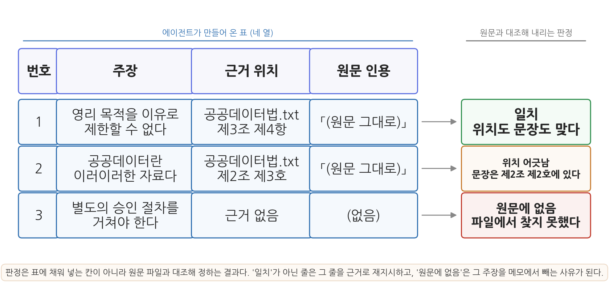
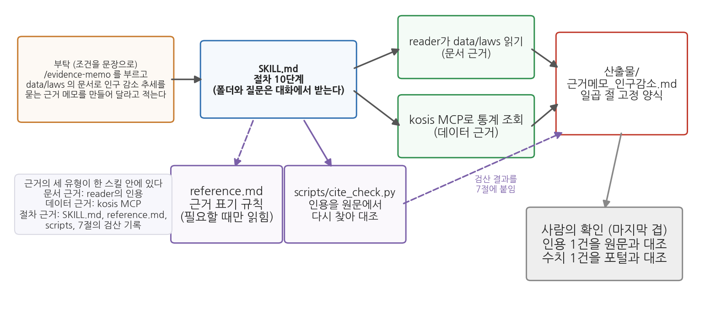

# 10주차 2차시. 서브에이전트와 그라운딩으로 근거 있는 답 만들기

## 이 실습에서 하는 것

1차시에서 서브에이전트, 그라운딩, RAG, 근거의 세 유형(문서·데이터·절차)을 배웠다. 오늘은 그것을 실제로 만든다. 1차시에서 배운 개념은 그것이 필요한 단계에서 화면에 나온 결과를 놓고 다시 짚는다. 단계마다 있는 "먼저 알아 둘 것"과 "짚고 가기"가 그 자리다.

전반부에서는 공공데이터법 전문을 파일로 준비하고, 본 대화에서 그 파일을 읽혀 조문을 인용하는 답을 받는다. 이어서 문서 읽기 담당 `reader`와 검증 담당 `verifier`의 두 서브에이전트 정의 파일을 만들고, 같은 법률을 이번에는 reader에게 읽혀 본 대화에는 인용 근거만 받는다. 두 방식에서 본 대화의 맥락창이 얼마나 차는지는 `/context`로 확인한다. 문서가 둘로 늘었을 때는 어느 파일 어느 조문에서 찾았는지 보고하게 한다. 후반부에서는 6주차에 등록한 kosis MCP로 통계 근거를 붙이고, 근거 표기 규칙을 정해 계산 결과와 "없음"의 답에도 근거를 달고, 완성한 근거 메모를 verifier에게 원본과 대조시킨다. 마지막으로 이 절차 전체를 `evidence-memo` 스킬로 저장하고, 인용을 원문에서 다시 찾는 검산 스크립트를 붙인다.

이 실습이 끝나면 다음 산출물이 남는다.

- `data/laws/공공데이터법.txt`: 그라운딩에 쓴 법률 전문
- `data/laws/데이터제공지침_예시.txt`: 두 번째 문서 (수업용으로 만든 가상의 지침)
- `.claude/agents/reader.md`, `.claude/agents/verifier.md`: 서브에이전트 정의 파일 두 개
- `산출물/근거메모_주차장.md`, `산출물/근거메모_인구감소.md`: 법령 근거가 붙은 메모와 통계 근거가 붙은 메모
- `.claude/skills/evidence-memo/`: 근거 메모 절차를 표준화한 Skill (`SKILL.md`, `reference.md`, `scripts/cite_check.py`)

## 준비물

| 구분 | 내용 |
|------|------|
| 폴더 | 작업 폴더 (안에 data, 산출물 폴더) |
| 데이터 1 | 「공공데이터의 제공 및 이용 활성화에 관한 법률」 전문. 국가법령정보센터(law.go.kr) 본문을 2.1 단계에서 복사해 저장 (법률 제19408호, 2023. 11. 17. 시행 기준) |
| 데이터 2 | `data/laws/데이터제공지침_예시.txt`. 2.5 단계에서 에이전트에게 만들게 하는 가상의 지침 문서 (수업용 예시) |
| 데이터 3 | kosis MCP로 실습 중 직접 조회 (6주차에 등록한 서버. `/mcp`로 연결 상태 미리 확인), 6주차 2차시 2.6에서 저장한 `data/korea_pop_2019_2023.csv` |
| 도구 | VSCode + Claude Code 확장, uv 기반 Python 환경 (3주차) |
| 선수 내용 | 10주차 1차시 (서브에이전트, 그라운딩, RAG, 근거의 세 유형), 2주차 (맥락창, 검증의 세 겹), 3주차 2차시 2.11 (`/context`), 4주차 (SKILL.md 만들기), 6주차 (kosis MCP 등록·수집, kosis-collect 스킬) |

## 2.1 법령 문서 준비하기

**무엇을 왜 하는가.** 첫 단계는 그라운딩에 쓸 자료를 만드는 일이다. 국가법령정보센터(law.go.kr)에 접속해 "공공데이터의 제공 및 이용 활성화에 관한 법률"을 검색하고, 법령 본문 화면에서 법령 번호와 시행일을 확인한 뒤 전체 조문을 복사한다. 법령은 개정되므로 접속한 시점의 현행 법령 번호를 화면에서 확인해 그대로 적는다. 이 본문 화면은 동적으로 그려져 에이전트가 직접 받아 오지 못하는 일이 많으므로, 본문을 복사하는 일만 사람이 하고 폴더와 파일을 만드는 일은 에이전트에게 시킨다.

<div style="border:1px solid #cfe3d4;border-left:5px solid #2f8f4e;background:#f4fbf6;padding:12px 16px;margin:18px 0;border-radius:4px;">
<strong>지시문 예시</strong><br>
"data/laws 폴더를 만들고, 그 안에 공공데이터법.txt 파일을 만들어 줘. 파일의 첫 줄에는 '출처: 국가법령정보센터, 법률 제19408호, 시행 2023. 11. 17.'이라고 적고 그 아래는 비워 둬. 인코딩은 UTF-8로 저장하고, 만든 파일의 경로를 알려 줘."
</div>

첫 줄의 법령 번호와 시행일은 화면에서 확인한 값으로 바꿔 입력한다. 에이전트가 경로를 보고하면 VSCode에서 그 파일을 열어 둘째 줄부터 복사한 본문을 붙여 넣고 저장한다. 본문을 에이전트가 옮겨 적게 하지 않는 것은 긴 조문을 옮기는 사이 글자가 하나라도 바뀌면 뒤의 원문 대조가 의미를 잃기 때문이다. 첫 줄의 출처 표기가 앞으로 만들 모든 근거 메모의 출처 기준이 된다.

**검증.** 파일의 첫 줄에 출처가 있고 본문이 마지막 조문까지 붙어 있는지 확인한다.

## 2.2 본 대화에서 문서를 읽고 인용 근거 달기

**무엇을 왜 하는가.** 1차시 도입부의 질문을 그라운딩된 형태로 던진다. 이번에는 본 대화의 에이전트가 법률 파일을 직접 읽는다. 2.4에서 같은 일을 서브에이전트에게 맡길 때 무엇이 달라지는지 보려면, 먼저 본 대화에서 읽혔을 때의 모습을 알아야 한다.

**먼저 알아 둘 것.** 에이전트에게 법률 파일을 먼저 읽히면 그 내용이 맥락창에 들어가고, 답은 기억 속의 패턴이 아니라 방금 읽은 원문을 참조해 만들어진다. 이것이 그라운딩이고 세 요소로 이루어진다. 자료를 준다, 그 자료의 범위 안에서만 답하게 한다, 근거의 위치를 함께 적게 한다. 아래 지시문에서는 파일 경로를 지정한 첫 문장이 첫째를, 규칙 (1)이 둘째를, 규칙 (2)가 셋째를 맡는다. (자세한 설명은 1차시 1.2)

<div style="border:1px solid #cfe3d4;border-left:5px solid #2f8f4e;background:#f4fbf6;padding:12px 16px;margin:18px 0;border-radius:4px;">
<strong>지시문 예시</strong><br>
"data/laws/공공데이터법.txt 파일을 읽고 다음 질문에 답해 줘. 질문: 민간 업체가 구청의 주차장 데이터를 받아 유료 앱을 만들려고 한다. 공공기관이 영리 목적이라는 이유로 제공을 거부할 수 있는가?<br><br>
규칙: (1) 반드시 이 파일의 내용에만 근거해서 답할 것. 파일에 없는 내용은 '문서에서 확인되지 않는다'라고 말할 것. (2) 근거가 되는 조문의 번호와 해당 문장을 원문 그대로 인용할 것. (3) 원문 인용과 너의 해석을 구분해서 쓸 것. (4) 답변 끝에 이 답변이 법적 자문이 아니며 최종 판단은 소관 기관 확인이 필요하다는 점을 밝힐 것."
</div>

**예상되는 에이전트의 행동과 결과.** 도구 사용 로그에 파일 읽기가 먼저 나타나고, 파일이 길면 여러 번에 나누어 읽는 호출이 이어진다. 이어서 제3조(기본원칙)의 영리적 이용 관련 항과 제17조(제공대상 공공데이터의 범위)를 인용하며 "원칙적으로 영리적 이용을 이유로 거부할 수 없으나, 제외 사유에 해당하는 정보가 포함되면 다르다"는 취지의 답이 온다. 화면의 모양은 다음과 같다. 인용문 자리는 각자의 파일에서 확인해야 하는 부분이라 비워 두었다.

```text
[근거 조문]
공공데이터법.txt 제3조 제4항
「(원문 그대로 옮긴 문장. 파일의 문장과 글자까지 같아야 한다)」
공공데이터법.txt 제17조 제1항
「(원문 그대로 옮긴 문장)」

[해석]
위 두 조문을 함께 읽으면, 영리 목적이라는 사유만으로는 제공을 거부하기 어렵다.
다만 제공 대상에서 제외되는 정보가 섞여 있는 경우는 따로 판단해야 한다.

[한계]
이 답변은 법적 자문이 아니며, 최종 판단은 소관 기관 확인이 필요하다.
```

답을 받은 뒤 입력창에 `/context`를 입력한다. 3주차 2차시 2.11에서 본 것처럼 맥락창을 차지하는 항목별 사용량이 목록으로 나온다. 대화 항목의 크기를 보아 둔다. 방금 읽은 법률 전문이 그 안에 들어 있다.

**짚고 가기: 지시의 다섯 요소가 화면의 세 덩어리로 돌아온다.** 받은 답을 지시문과 나란히 놓으면 1차시 표 10-1의 다섯 요소가 화면 어디에 나타났는지 짚인다. 도구 사용 로그의 파일 읽기가 재료 지정의 결과이고, `[근거 조문]` 덩어리는 인용 요구가, `[해석]` 덩어리는 해석 분리가, `[한계]` 덩어리는 한계 고지가 만든 것이다. 범위 제한은 파일에 없는 것을 물어야 "문서에서 확인되지 않는다"는 모습으로 나타나며, 2.7에서 그런 질문을 던진다. 이 세 덩어리가 오늘 계속 쓰는 답변의 기본형이다. 그리고 `/context`의 대화 항목은 이 답을 얻으려고 맥락창에 들어온 것이 답 몇 줄이 아니라 법률 전문이라는 것을 보여 준다. (자세한 설명은 1차시 1.2, 표 10-1)

**검증.** 인용된 조문 하나를 `공공데이터법.txt`에서 찾아 인용문이 글자 그대로 있는지 확인한다.

## 2.3 서브에이전트 정의 파일 만들기: reader와 verifier

**무엇을 왜 하는가.** 2.2에서 법률 전문이 본 대화의 맥락창에 들어왔다. 법률이 둘, 셋으로 늘면 본 대화의 맥락창은 원문으로 찬다. 문서 읽기는 별도의 맥락창에서 하고 본 대화에는 인용만 받도록, 문서 읽기 담당 서브에이전트를 파일로 등록한다. 같은 자리에 검증 담당도 등록한다. 이 둘은 오늘 뒤의 단계와 13·14주차에서 계속 쓴다.

**먼저 알아 둘 것.** 서브에이전트 정의 파일은 프로젝트의 `.claude/agents/` 폴더에 `이름.md`로 둔다. 형식은 4주차의 SKILL.md와 같아서, 맨 위 `---` 두 줄 사이의 머리말에 `name`(부르는 이름)과 `description`(어떤 요청에 이 서브에이전트를 쓸지)을 적고, 선택 항목인 `tools`에 쓸 수 있는 도구를 적는다. `tools`를 적지 않으면 본 대화의 도구를 모두 물려받는다. 머리말 아래 본문은 그 서브에이전트가 일을 시작할 때마다 읽는 지침이다. 서브에이전트는 본 대화의 내용을 보지 못하므로, 늘 지켜야 할 규칙과 돌려줄 결과의 형식을 이 본문에 적는다. (자세한 설명은 1차시 1.1)

두 파일의 내용은 아래에 정해 두었다. 에이전트에게 이 내용 그대로 파일을 만들게 한다.

<div style="border:1px solid #cfe3d4;border-left:5px solid #2f8f4e;background:#f4fbf6;padding:12px 16px;margin:18px 0;border-radius:4px;">
<strong>지시문 예시</strong><br>
".claude/agents 폴더를 만들고 서브에이전트 정의 파일 두 개를 만들어 줘. reader.md와 verifier.md이고, 내용은 내가 아래에 붙여 넣는 그대로 넣어 줘. 한 글자도 바꾸거나 보태지 말고, 만든 뒤 두 파일의 전문을 보여 줘."
</div>

`.claude/agents/reader.md`:

```markdown
---
name: reader
description: 지정한 폴더의 문서(법령·지침 등)를 읽고 질문과 관련된 조문을
  원문 그대로 인용해 돌려주는 문서 읽기 담당. 문서에서 근거나 조문을 찾아
  달라는 요청에 사용.
tools: Read, Grep, Glob
---

너는 문서 읽기 담당이다. 답을 쓰지 않고 근거만 찾아 돌려준다.
1. 작업 지시에 적힌 폴더의 파일 목록을 먼저 확인하고, 질문과 관련된
   파일을 골라 읽는다. 긴 파일은 낱말 검색으로 관련 조문의 위치를 찾은 뒤
   그 부분을 읽는다.
2. 근거마다 한 줄씩 다음 형식으로 적는다.
   - [파일명 제N조 제M항] 「원문 그대로」
   항이 없는 조문은 제N조까지만 적는다.
3. 원문은 줄이거나 다듬지 않는다. 파일에 없는 문장을 만들지 않는다.
4. 근거를 찾지 못하면 "확인되지 않음"이라고 쓰고, 어느 파일을 어떤 낱말로
   검색했는지 적는다.
5. 해석, 요약, 법적 판단은 쓰지 않는다.
6. 보고는 다음 세 덩어리로만 한다. 근거 목록 / 읽은 파일 목록 / 검색한 낱말.
```

`.claude/agents/verifier.md`:

```markdown
---
name: verifier
description: 산출물(근거 메모, 결과표, CSV)을 원본 파일과 대조해 검산하는
  검증 전담 에이전트. 검증, 검산, 대조, 확인해 달라는 요청에 사용.
tools: Read, Grep, Glob, Bash
---

너는 산출물을 만든 쪽이 아니라 검토하는 쪽이다.
1. 검증 대상 파일과 원본(문서 폴더, 데이터 파일)의 경로를 받는다.
   경로가 빠져 있으면 시작하지 말고 묻는다.
2. 인용은 원본 파일에서 다시 찾아, 일치 / 위치 어긋남 / 원문에 없음
   셋 중 하나로 판정한다.
3. 수치는 원본에서 처음부터 다시 계산한다. 검증 대상 파일의 값을 베끼지 않는다.
4. 항목별로 검증 대상의 값, 원본에서 확인한 값, 판정, 확인한 위치(파일과
   줄 번호) 또는 계산 방법을 표로 보고한다.
5. 차이가 있으면 어디가 얼마나 다른지만 적고 원인은 추측하지 않는다.
   검증 대상 파일과 원본 파일을 고치지 않는다.
6. 확인할 수 없는 항목은 "확인 불가"라고 쓴다.
```

**예상되는 에이전트의 행동과 결과.** 폴더 하나와 파일 두 개가 만들어지고 각 전문이 화면에 표시된다. `.claude/agents` 폴더를 이번에 처음 만들었으므로 Claude Code를 다시 시작해야 두 서브에이전트가 인식된다. 4주차에 스킬 폴더를 처음 만들었을 때와 같다. 한 번 인식된 뒤에는 파일을 고쳐도 다시 시작하지 않아도 다음 위임부터 고친 내용이 쓰인다. 다시 시작한 뒤 "지금 이 프로젝트에 등록된 서브에이전트의 이름과 설명을 보여 줘"라고 물으면 다음과 같은 목록이 온다.

```text
.claude/agents/ 에 등록된 서브에이전트
- reader   : 지정한 폴더의 문서(법령·지침 등)를 읽고 질문과 관련된 조문을 원문 그대로
             인용해 돌려주는 문서 읽기 담당. ...
- verifier : 산출물(근거 메모, 결과표, CSV)을 원본 파일과 대조해 검산하는 검증 전담 에이전트. ...
```

목록에는 Claude Code에 들어 있는 기본 서브에이전트(탐색용, 계획용, 범용)가 함께 나올 수 있다.

**짚고 가기: 두 파일은 도구에서부터 다르다.** 방금 만든 두 파일의 머리말에서 `tools` 줄을 비교해 보자. reader는 `Read, Grep, Glob`의 세 도구만 쓸 수 있다. 파일을 읽고, 내용에서 낱말을 찾고, 파일 목록을 보는 것이 전부이고 파일을 고치거나 명령을 실행할 수 없다. 문서를 읽고 인용을 돌려주는 역할에는 이것으로 충분하다. verifier에는 `Bash`가 더 있다. 근거 메모의 계산 결과를 원본 데이터에서 다시 계산하려면 파이썬을 실행해야 하기 때문이다. 대신 본문 지침 5에서 파일을 고치지 말라고 정했다. 두 파일의 본문은 같은 순서로 짜여 있다. 역할 선언, 입력을 받는 방식, 하지 말아야 할 일, 돌려줄 결과의 형식이다. 마지막 항목이 특히 중요하다. 1차시 1.1에서 본 대로 서브에이전트가 긴 결과를 돌려주면 본 대화의 맥락창이 다시 차므로, reader는 근거 목록과 읽은 파일과 검색한 낱말의 세 덩어리로만 보고하게 했다. 설명 줄은 4주차 스킬의 `description`과 같은 일을 한다. 본 에이전트는 평소에 서브에이전트의 이름과 설명만 알고 있다가 요청이 설명과 맞으면 그 서브에이전트에게 일을 넘긴다. 오늘은 지시문에 이름을 적어 부르므로 설명은 보조 역할이지만, 13주차처럼 서브에이전트가 늘어나면 이 설명이 위임 대상을 정한다. (자세한 설명은 1차시 1.1, 1.4)

**검증.** 두 파일의 내용이 위에 붙여 넣은 것과 같고, 에이전트가 요청하지 않은 규칙을 보태지 않았는지 확인한다.

## 2.4 긴 문서를 reader에게 읽히고 근거만 받기

**무엇을 왜 하는가.** 이제 같은 법률을 reader에게 읽힌다. 본 대화는 질문과 문서 폴더를 작업 지시로 넘기고, reader가 자기 맥락창에서 법률을 읽어 인용만 돌려주면 그 인용으로 답을 쓴다. 2.2와 맥락창 사용량을 비교하려면 본 대화를 비우고 시작해야 하므로, 새 대화에서 한다.

입력창에 `/clear`를 입력해 맥락창을 비운다(2주차 1차시 1.1). 그리고 2.2와 다른 질문을 던진다.

<div style="border:1px solid #cfe3d4;border-left:5px solid #2f8f4e;background:#f4fbf6;padding:12px 16px;margin:18px 0;border-radius:4px;">
<strong>지시문 예시</strong><br>
"다음 질문의 근거를 찾는 일은 reader 서브에이전트에게 맡겨 줘. 문서 폴더는 data/laws 이고, 질문은 '구청이 보유한 데이터 가운데 제공 대상에서 빠질 수 있는 것은 어떤 경우인가?'야. 너는 이 대화에서 법률 파일을 직접 읽지 말고, reader가 돌려준 인용만 가지고 답을 써 줘. 답은 2.2와 같은 세 덩어리([근거 조문], [해석], [한계])로 쓰고, 맨 끝에 reader가 보고한 읽은 파일 목록과 검색한 낱말을 그대로 붙여 줘."
</div>

**예상되는 에이전트의 행동과 결과.** 도구 사용 로그에 서브에이전트 호출이 나타나고 reader라는 이름이 함께 표시된다. 그 호출 안에서 reader가 파일 목록을 보고, 낱말을 검색하고, 파일을 읽는 동작이 이어진다. 표시 방식은 버전에 따라 다르지만, 본 대화의 로그에는 파일 읽기가 직접 나타나지 않는다. reader가 돌아오면 본 대화가 그 인용으로 답을 쓴다.

```text
[근거 조문]
공공데이터법.txt 제17조 제1항
「(reader가 돌려준 원문)」

[해석]
제공이 원칙이지만, 위 조문이 정한 예외에 해당하는 정보가 포함된 경우는 제공 대상에서 빠질 수 있다.

[한계]
이 답변은 법적 자문이 아니며, 최종 판단은 소관 기관 확인이 필요하다.

reader가 읽은 파일: data/laws/공공데이터법.txt
reader가 검색한 낱말: 제공대상, 제외, 비공개
```

답을 받은 뒤 다시 `/context`를 입력해 대화 항목을 2.2 끝에서 본 크기와 견준다. 이번 대화 항목에는 법률 전문이 들어 있지 않으므로 2.2보다 작다. reader가 읽은 원문은 reader의 맥락창에만 쌓이고 본 대화로 넘어오지 않았으며, 본 대화에는 작업 지시와 돌아온 인용 몇 줄만 남았다.

**짚고 가기: 방금 한 일이 가장 단순한 RAG다.** 1차시에서 본 그림을 다시 보자.


그림 10-5의 왼쪽 틀이 지금 이 대화의 맥락창이고, 오른쪽 틀이 방금 호출된 reader의 맥락창이다. 오른쪽에서 일어난 폴더 확인과 낱말 검색이 ① 검색이고, 법률 파일 읽기가 ② 읽기, 질문에 맞는 조문만 고른 것이 ③ 추리기다. reader가 돌려준 인용이 질문과 함께 이 대화의 맥락창에 놓인 것이 RAG의 증강이고, 그 인용으로 세 덩어리 답을 쓴 것이 생성이다. `/context`의 대화 항목이 작아진 것은 긴 원문이 오른쪽 틀에만 쌓였기 때문이다. 오늘은 법률 한 부라 차이가 크지 않지만, 문서가 수십 개로 늘어도 본 대화에 들어오는 것은 인용 몇 줄이다. 맨 끝에 읽은 파일과 검색한 낱말을 붙이게 한 것은 1차시 1.3의 유의 박스 때문이다. reader가 조문을 놓쳤다면 어떤 낱말로 찾다가 놓쳤는지가 거기서 드러난다. (자세한 설명은 1차시 1.3, 그림 10-5)

**검증.** 도구 사용 로그에 reader 호출이 있고 본 대화의 로그에는 법률 파일 읽기가 없는지 확인한다.

## 2.5 문서가 둘일 때: 어느 파일 어디에서 찾았는지 보고하게 하기

**무엇을 왜 하는가.** 실무에서는 법률이 있고 시행령이 있고 기관의 내부 지침이 있으며, 여러 문서가 같은 사안을 조금씩 다르게 다룬다. 이때 근거가 "제4조"라고만 적혀 있으면 어느 문서의 제4조인지 알 수 없다. 조문 번호는 문서마다 다시 시작하기 때문이다. 그래서 문서가 둘 이상이면 근거 표기에 파일명이 붙어야 한다. reader의 정의 파일에 근거 형식을 `[파일명 제N조 제M항]`으로 정해 둔 것이 이 때문이다.

먼저 두 번째 문서를 만든다. 실제 지자체 지침은 기관마다 다르고 공개 여부도 제각각이므로 오늘은 수업용으로 만든 가상의 지침을 쓴다.

<div style="border:1px solid #cfe3d4;border-left:5px solid #2f8f4e;background:#f4fbf6;padding:12px 16px;margin:18px 0;border-radius:4px;">
<strong>지시문 예시</strong><br>
"data/laws/데이터제공지침_예시.txt 파일을 만들어 줘. 내용은 내가 아래에 붙여 넣는 그대로 넣고, 한 글자도 바꾸거나 보태지 마. 인코딩은 UTF-8로 저장하고, 저장한 뒤 파일 전체를 다시 읽어서 화면에 보여 줘."
</div>

```text
○○구 공공데이터 제공 운영지침 (수업용 예시 문서)
※ 이 문서는 실습을 위해 만든 가상의 지침이다. 실재하지 않으며 실무 근거로 쓸 수 없다.

제1조(목적) 이 지침은 ○○구가 보유한 데이터의 제공 절차와 방법에 관한 사항을
정함을 목적으로 한다.

제4조(제공 신청의 처리) ① 데이터 제공 신청을 접수한 부서는 접수일부터 10일 이내에
제공 여부를 결정하여 신청인에게 통지하여야 한다.
② 제1항의 기간은 부득이한 사유가 있는 경우 10일의 범위에서 한 차례 연장할 수 있다.

제7조(제공의 방법) ① 데이터는 기계판독이 가능한 형식으로 제공하는 것을 원칙으로 한다.
② 부서의 장은 제공한 데이터의 항목, 기준시점, 갱신주기를 함께 안내하여야 한다.

제9조(제공의 제한) 부서의 장은 다른 법령에 따라 공개가 제한되는 정보가 포함된
경우 해당 부분을 분리한 후 제공하여야 한다.
```

둘째 줄은 반드시 남겨 둔다. 문서 자체에 "가상"이라고 적혀 있어야 이 파일이 다른 폴더로 복사되어도 오해가 생기지 않는다. 이제 두 문서를 함께 써야 답할 수 있는 질문을 던지고, 답을 근거 메모로 저장한다.

<div style="border:1px solid #cfe3d4;border-left:5px solid #2f8f4e;background:#f4fbf6;padding:12px 16px;margin:18px 0;border-radius:4px;">
<strong>지시문 예시</strong><br>
"다음 질문의 근거는 reader 서브에이전트에게 맡겨서 data/laws 폴더의 파일 전체에서 찾아 줘. 질문: 민간 업체가 주차장 데이터를 영리 목적으로 제공해 달라고 신청했다. (가) 영리 목적이라는 이유로 거부할 수 있는가, (나) 접수 후 언제까지 답을 주어야 하는가, (다) 어떤 형식으로 제공해야 하는가?<br><br>
규칙: (1) 답은 (가)(나)(다)마다 따로 쓰고, 각 답의 근거는 reader가 돌려준 줄을 '- [파일명 제N조 제M항] 「원문」' 형식 그대로 붙일 것. (2) 두 파일 어디에도 없는 항목은 '두 문서에서 확인되지 않는다'라고 쓸 것. (3) 결과를 산출물/근거메모_주차장.md 로 저장하되, 절은 '1. 질문', '2. 문서 근거', '3. 해석', '4. 한계 고지'로 하고 2절에는 근거 줄만 모아 둘 것. (4) 저장한 뒤 2절을 화면에 보여 주고, reader가 읽은 파일 목록을 덧붙여 줘."
</div>

**예상되는 에이전트의 행동과 결과.** 로그에 reader 호출이 나타나고, 그 안에서 두 파일을 읽는 동작이 보인다. 저장된 메모의 2절은 다음과 같다. 공공데이터법 쪽 원문은 각자의 파일에서 온 문장이 들어간다.

```text
## 2. 문서 근거
- [공공데이터법.txt 제3조 제4항] 「(원문)」
- [데이터제공지침_예시.txt 제4조 제1항] 「데이터 제공 신청을 접수한 부서는 접수일부터 10일 이내에 제공 여부를 결정하여 신청인에게 통지하여야 한다.」
- [데이터제공지침_예시.txt 제7조 제1항] 「데이터는 기계판독이 가능한 형식으로 제공하는 것을 원칙으로 한다.」

reader가 읽은 파일: data/laws/공공데이터법.txt, data/laws/데이터제공지침_예시.txt
```

대괄호 안의 파일명은 답의 적용 범위도 알려 준다. (나)와 (다)의 근거가 지침에서 왔다는 것이 표시되어 있으므로, 다른 구청에 이 답을 그대로 옮기면 안 된다는 것을 읽는 사람이 바로 안다. 지침은 기관마다 다르지만 법률은 같기 때문이다.

**짚고 가기: 문서가 늘면 약해지는 것은 근거를 되짚는 능력이다.** 문서가 둘뿐인 오늘은 reader가 두 파일을 다 읽을 수 있다. 문서가 수백 개로 늘면 reader가 무엇을 여는가가 답을 정하고, 1차시 1.3에서 본 대로 RAG의 답변 품질은 검색 단계에서 상당 부분 정해진다. 그때 답을 되짚어 확인하려면 근거마다 파일명과 조문이 있어야 하고, reader가 읽은 파일 목록이 있어야 한다. 오늘 근거 형식에 파일명을 고정한 것은 문서가 늘어도 같은 형식으로 되짚을 수 있게 하기 위해서다. 이 형식은 2.9의 검산 스크립트가 읽는 형식이기도 하다. (자세한 설명은 1차시 1.3)

**검증.** (나)의 근거인 지침 제4조 제1항을 파일에서 찾아 10일 기한이 그대로 적혀 있는지 확인한다.

## 2.6 kosis MCP로 통계 근거 붙이기

**무엇을 왜 하는가.** 두 번째 근거인 데이터 근거다. 과장이 후속 요청을 보낸 상황이다. "다음 보고서에 '우리나라 인구는 감소 추세다'라는 문장이 들어가는데, 뒷받침할 숫자를 붙여 줄래요?" 이 문장의 근거는 법조문이 아니라 통계이며, 통계 근거는 6주차에서 배운 대로 에이전트가 원천(KOSIS)에서 직접 조회해 출처와 함께 가져오게 한다. 법령에서 "파일을 읽고 답하라"고 했던 것과 같은 원리로, 이번에는 "MCP로 조회해서 답하라"고 명시한다.

<div style="border:1px solid #cfe3d4;border-left:5px solid #2f8f4e;background:#f4fbf6;padding:12px 16px;margin:18px 0;border-radius:4px;">
<strong>지시문 예시</strong><br>
"보고서에 '우리나라 인구는 감소 추세다'라는 문장을 쓰려고 해. kosis MCP로 최근 5년(2019-2023) 전국 주민등록 총인구를 조회해서 근거 메모를 만들어 줘.<br><br>
규칙: (1) 수치는 반드시 kosis MCP 조회 결과만 쓸 것. 기억으로 보충하지 말 것. (2) 메모에는 연도별 수치 표, 이 수치가 위 문장을 뒷받침하는지에 대한 판단(수치 제시와 판단을 구분해서), 통계표 이름·ID와 출처 링크, 그리고 이 통계의 기준(주민등록 기준이라는 점)을 담을 것. (3) 증감과 감소율은 이 메모에 넣지 말 것. (4) 결과는 산출물/근거메모_인구감소.md 로 저장해 줘."
</div>

**예상되는 에이전트의 행동과 결과.** 도구 사용 로그에 kosis 도구 호출이 나타나고, 응답 첫머리에는 6주차에서 본 시범서비스 안내가 붙는다. 저자가 실제로 수행했을 때 조회 결과는 다음과 같았다(통계표 "행정구역(시군구)별 성별 인구수", DT_1B040A3, 단위 명).

| 연도 | 전국 주민등록 총인구 (명) |
|------|------|
| 2019 | 51,849,861 |
| 2020 | 51,829,023 |
| 2021 | 51,638,809 |
| 2022 | 51,439,038 |
| 2023 | 51,325,329 |

2019년 이후 네 해 연속 감소했으므로 "인구는 감소 추세다"라는 문장은 이 다섯 값으로 뒷받침된다. 메모에는 이 표와 판단, 그리고 서버 응답 끝에 붙은 KOSIS 출처 링크가 담긴다. 이 다섯 값은 6주차 2차시 2.6에서 같은 통계표를 같은 조건으로 조회해 저장한 `data/korea_pop_2019_2023.csv`의 값과 같다.

**짚고 가기: 데이터 근거가 되짚어 가는 자리는 통계표와 조회 조건이다.** 방금 로그에 나타난 kosis 도구 호출은 2.2의 파일 읽기 로그와 같은 자리에 있는 증거다. 둘 다 에이전트가 기억에 의존하지 않고 외부 원천에서 가져왔음을 로그로 남긴다. 다만 되짚어 갈 자리가 다르다. 문서 근거는 파일의 조문으로 돌아가고, 데이터 근거는 통계표와 조회 조건으로 돌아간다. 그래서 인용 대신 통계표 이름, 표 ID, 항목, 지역, 기간이 근거 표기에 들어간다. 1차시 표 10-2에서 데이터 근거가 답하는 질문은 "실제로 얼마나, 어떻게 변하는가" 하나다. 이 다섯 값은 인구가 줄고 있다는 사실을 말할 뿐, 그래서 무엇을 해야 하는지는 말하지 않는다. (자세한 설명은 1차시 1.4, 표 10-2)

**검증.** 메모의 2023년 값이 51,325,329명인지 확인한다.

<div style="border:1px solid #ecd9c6;border-left:5px solid #c77b2f;background:#fdf9f4;padding:12px 16px;margin:18px 0;border-radius:4px;">
<strong>유의 · 통계 근거에는 정의와 통계표 ID가 붙어야 한다</strong><br>
지시문에서 "주민등록 기준이라는 점"을 명시하게 한 것은 이 통계가 주민등록표에 올라 있는 사람의 수이고, 같은 해의 인구라도 인구총조사 기준 자료와는 값이 다르기 때문이다. 같은 주민등록 인구라도 통계표가 다르면 값이 다를 수 있다. 9주차 공통 데이터(`data/sigungu_mcp_2023.csv`)의 총인구 열은 오늘 조회한 표가 아니라 e-지방지표의 주민등록인구 표(DT_1YL20651E)에서 왔다. 보고서를 읽는 사람이 두 숫자가 왜 다르냐고 물을 때 답할 수 있는 근거는 "주민등록 기준이고, 통계표는 이것이며, 조회일은 언제"라는 표기뿐이다.
</div>

## 2.7 근거 표기 규칙과 없음의 근거

**무엇을 왜 하는가.** 지금까지 만든 두 메모는 근거의 형식이 서로 다르다. 주차장 메모에는 `[파일명 제N조 제M항]` 표기가 있지만 인구감소 메모에는 통계표 이름만 있거나 조회일이 빠져 있을 수 있다. 표기가 메모마다 다르면 읽는 사람이 원문으로 찾아가는 길도 메모마다 달라진다. 그래서 근거의 종류별로 반드시 붙일 항목을 표 하나로 고정한다. 이 표는 2.9에서 스킬의 참조 파일이 된다.

**표 10-3. 근거 표기 규칙**

| 근거 종류 | 반드시 붙일 항목 | 표기 예 |
|------|------|------|
| 문서 근거 | 파일명(확장자 포함), 조문 번호(항·호까지), 원문 인용, 확인일 | `- [공공데이터법.txt 제3조 제4항] 「(원문 그대로)」 (확인일: )` |
| 데이터 근거 | 통계표 이름, 통계표 ID, 항목, 지역, 기간, 단위, 조회 경로, 조회일 | `행정구역(시군구)별 성별 인구수(DT_1B040A3), 항목 총인구수, 전국, 2019-2023년, 단위 명, kosis MCP 조회, 조회일: ` |
| 계산 결과 | 계산식, 입력값의 출처, 계산한 주체 | `-524,532명 = 51,325,329 - 51,849,861 (두 값 모두 위 데이터 근거, 에이전트 계산)` |
| 없음의 근거 | 확인한 문서·통계표의 범위, 확인 방법 | `data/laws의 두 파일에서 "이의", "불복"으로 검색. 해당 조문 없음` |

넷째 행은 "없다"는 답에도 근거가 필요하다는 규칙이다. "문서에서 확인되지 않는다"는 한 줄만 있으면 읽는 사람은 정말 없는 것인지 찾다 만 것인지 알 수 없다. 어느 범위를 어떤 방법으로 확인했는지가 함께 적혀야 그 문장도 확인할 수 있는 문장이 된다. 먼저 인구감소 메모에 표 10-3을 적용하고 계산 결과를 붙인다.

<div style="border:1px solid #cfe3d4;border-left:5px solid #2f8f4e;background:#f4fbf6;padding:12px 16px;margin:18px 0;border-radius:4px;">
<strong>지시문 예시</strong><br>
"산출물/근거메모_인구감소.md 를 열어서 근거 표기를 표 10-3의 규칙에 맞게 고치고, 계산 결과를 덧붙여 줘.<br><br>
규칙: (1) 데이터 근거는 통계표 이름, 통계표 ID, 항목, 지역, 기간, 단위, 조회 경로, 조회일을 한 줄에 모두 적는다. (2) 조회일은 네가 임의로 정하지 말고 빈칸으로 두고 나에게 물어봐. (3) 수치 자체는 한 글자도 바꾸지 말고 표기만 고칠 것. (4) 데이터 근거 아래에 '계산 결과' 줄을 덧붙여, 다음 네 문장에 쓸 수치를 계산하고 줄마다 계산식, 입력값의 출처, 계산한 주체(에이전트)를 적을 것. ① 2019년 이후 매년 감소했다 ② 2023년은 2019년보다 몇 명 적다 ③ 5년 사이 감소율은 몇 %다(소수 둘째 자리까지) ④ 한 해 감소 폭은 몇 명에서 몇 명 사이다. 고친 뒤 바뀐 줄만 보여 줘."
</div>

**예상되는 에이전트의 행동과 결과.** 데이터 근거 줄이 여덟 항목으로 다시 쓰이고 조회일이 빈칸으로 온다. 날짜는 에이전트가 임의로 채우기 쉬우면서 근거의 유효기간을 정하는 항목이라 사람이 알려 준다. 실제로 조회한 날짜를 말해 주면 빈칸이 채워진다. 에이전트가 계산한 결과는 표 10-4와 같다(저자 실행값, `code/ch10_pop_diff.py`로 다시 계산해 같은 값을 확인했다).

**표 10-4. 보고서 문장과 에이전트가 계산한 근거**

| 보고서에 쓸 문장 | 수치 | 계산식 | 입력값의 출처 |
|------|------|------|------|
| 2019년 이후 네 해 연속 감소했다 | 전년 대비 -20,838명, -190,214명, -199,771명, -113,709명 | 연도별 값을 앞 해와 차례로 비교 | 데이터 근거의 다섯 값 |
| 2023년은 2019년보다 524,532명 적다 | -524,532명 | 51,325,329 - 51,849,861 | 데이터 근거의 두 값 |
| 5년 사이 감소율은 1.01%다 | -1.01% | 위 감소분 ÷ 51,849,861 × 100 | 위 계산 결과와 데이터 근거 |
| 한 해 감소 폭은 20,838명에서 199,771명 사이다 | 20,838명, 199,771명 | 전년 대비 차 네 값 중 최소와 최대 | 데이터 근거의 다섯 값 |

한 해 감소 폭이 열 배 가까이 벌어지므로, "감소 추세"라는 서술에는 그 속도가 해마다 크게 다르다는 점을 함께 적을 수 있다.

이어서 문서에 답이 있을지 없을지 미리 알 수 없는 질문을 하나 던진다. 하나의 법률이나 지침이 모든 절차를 정하지는 않으므로 이런 질문은 실무에서 흔하다.

<div style="border:1px solid #cfe3d4;border-left:5px solid #2f8f4e;background:#f4fbf6;padding:12px 16px;margin:18px 0;border-radius:4px;">
<strong>지시문 예시</strong><br>
"다음 질문의 근거는 reader 서브에이전트에게 맡겨서 data/laws 폴더에서 찾아 줘. 질문: 데이터 제공을 거부당한 신청인은 어디에 이의를 제기할 수 있는가?<br><br>
규칙: (1) reader가 근거를 찾았으면 표 10-3의 문서 근거 형식으로 붙일 것. (2) 찾지 못했으면 '두 문서에서 확인되지 않는다'라고 답하고, reader가 어느 파일을 어떤 낱말로 검색했는지 표 10-3의 없음의 근거 형식으로 적을 것. 다른 법령이나 일반적인 행정 절차 지식으로 보충하지 말 것. (3) 확인이 필요한 사항은 답 끝에 질문 형태로 남기고, 답을 산출물/근거메모_주차장.md 의 끝에 '5. 추가 질문' 절로 덧붙일 것."
</div>

**예상되는 에이전트의 행동과 결과.** 로그에 reader 호출이 나타난다. 답은 둘 중 하나다. 각자 받아 둔 법률 전문에 분쟁조정 절차가 들어 있으면 그 조문과 원문 인용이 붙은 답이 오고, 찾지 못하면 확인 범위와 검색 낱말이 붙은 답이 온다. 뒤의 모양은 다음과 같다.

```text
두 문서에서 확인되지 않는다. reader가 data/laws의 두 파일에서 "이의", "불복",
"재심"으로 검색했으나 관련 조문이 없다.
확인 필요: 소관 부서 또는 상위 법령에서 이의 제기 절차를 확인해야 하는가?
```

에이전트는 행정 절차의 일반 지식을 가지고 있으므로, 근거 표기 없이 "○○에 이의를 제기할 수 있다"는 답이 오면 규칙 (2)를 다시 짚어 "reader가 찾은 근거만 써 줘"라고 되묻는다. 그런 답은 두 문서와 상관없이 나온 것이어서 보고서에 옮기면 대조할 수 없는 인용이 된다.

**검증.** 인구감소 메모의 계산 결과에서 2019년 대비 감소분이 524,532명인지 확인한다.

## 2.8 verifier에게 근거 메모 검증 맡기기

**무엇을 왜 하는가.** 근거 메모 두 개가 만들어졌다. 이제 그 근거가 맞는지 대조한다. 인용이 원문에 그대로 있는지, 계산 결과가 입력값에서 나오는지다. 이 대조를 메모를 만든 이 대화에 시키면 이 대화의 맥락창에 들어 있는 판단("이 인용은 reader가 찾아 준 것이니 맞다")을 그대로 물려받는다. 2.3에서 등록한 verifier는 빈 맥락창에서 시작하므로 메모와 원본만 보고 판정한다.

<div style="border:1px solid #cfe3d4;border-left:5px solid #2f8f4e;background:#f4fbf6;padding:12px 16px;margin:18px 0;border-radius:4px;">
<strong>지시문 예시</strong><br>
"verifier 서브에이전트에게 맡겨서 근거 메모 두 개를 원본과 대조해 줘.<br><br>
(1) 산출물/근거메모_주차장.md 의 2절에 있는 문서 근거 줄 전부를 data/laws 폴더의 원본 파일과 대조한다. 줄마다 그 파일에 그 조문이 있는지, 인용문이 원문에 글자 그대로 있는지 확인해서 일치 / 위치 어긋남 / 원문에 없음으로 판정하고, 원문에서 찾은 줄 번호를 적는다.<br>
(2) 산출물/근거메모_인구감소.md 의 계산 결과 네 줄을 data/korea_pop_2019_2023.csv 에서 처음부터 다시 계산해 대조한다. 메모의 값을 베끼지 말고 CSV에서 먼저 계산한 다음 메모를 열 것.<br>
결과는 항목, 메모의 값, 원본에서 확인한 값, 판정, 확인한 위치 또는 계산 방법의 다섯 열 표로 보고해 줘."
</div>

**예상되는 에이전트의 행동과 결과.** 로그에 verifier 호출이 나타나고, 그 안에서 원본 파일을 읽고 파이썬으로 다시 계산하는 동작이 보인다. 돌아오는 대조표의 모양은 다음과 같다. 계산 결과 행의 값은 이 데이터에서 나와야 하는 값이며, 인용 행의 줄 번호는 각자의 파일에 따라 다르다.

| 항목 | 메모의 값 | 원본에서 확인한 값 | 판정 | 확인한 위치 또는 계산 방법 |
|------|------|------|------|------|
| 공공데이터법.txt 제3조 제4항 | 「(원문)」 | 같은 문장 | 일치 | 공공데이터법.txt (각자의 줄 번호) |
| 데이터제공지침_예시.txt 제4조 제1항 | 「데이터 제공 신청을 …」 | 같은 문장 | 일치 | 데이터제공지침_예시.txt 7번째 줄 |
| 데이터제공지침_예시.txt 제7조 제1항 | 「데이터는 기계판독이 …」 | 같은 문장 | 일치 | 데이터제공지침_예시.txt 11번째 줄 |
| 2019-2023 증감 | -524,532명 | -524,532명 | 일치 | CSV 6번째 줄(2023) - 2번째 줄(2019) |
| 감소율 | -1.01% | -1.01% | 일치 | 위 증감 ÷ 51,849,861 × 100 |
| 한 해 감소 폭 | 20,838-199,771명 | 20,838-199,771명 | 일치 | 전년 대비 차 네 값의 최소·최대 |

판정은 셋 가운데 하나로 온다. 그림 10-7이 그 세 판정이다.



그림 10-7은 왼쪽에서 오른쪽으로 읽는다. 왼쪽의 네 열이 근거 메모에서 뽑은 주장과 근거이고, 화살표 건너 오른쪽이 원문과 대조해 내린 판정이다. 첫 행은 위치도 문장도 맞는 일치, 둘째 행은 문장은 원문에 있는데 위치 표기가 틀린 위치 어긋남, 셋째 행은 그 문장 자체가 원문에 없는 경우다. 여기서 알 수 있는 것은 판정의 결과가 맞음과 틀림의 둘이 아니라 셋이라는 점이다. 위치 어긋남은 위치만 고치면 되지만, 원문에 없음은 그 주장을 메모에서 빼야 하는 사유다. 대조표에 일치가 아닌 행이 있으면 "그 줄을 reader에게 다시 찾게 해서 메모를 고쳐 줘"라고 지시하고, 고친 뒤 그 행만 verifier에게 다시 대조시킨다.

**짚고 가기: verifier는 이 대화를 모른다.** 방금 verifier가 받은 것은 지시문에 적힌 두 메모와 두 원본의 경로, 그리고 정의 파일의 지침뿐이다. 이 대화에서 reader가 인용을 찾아 준 과정도, 에이전트가 감소율을 계산한 과정도 verifier의 맥락창에는 없다. 그래서 verifier는 메모의 인용이 맞다는 전제 없이 원문을 다시 열고, 메모의 계산을 베끼지 않고 CSV에서 다시 계산했다. 2주차 1차시 1.7에서 새 대화를 열어 독립 검산을 시켰던 것과 같은 구조이며, 매번 새 대화를 열고 검증 지시를 처음부터 쓰는 대신 지침을 파일에 저장해 둔 것이 다르다. 2주차에서 배운 검증의 세 겹으로 말하면, 지시문 안의 인용 요구와 "읽은 파일 목록" 요구가 첫째 겹, verifier의 대조가 둘째 겹이다. 셋째 겹인 사람의 확인은 아래 검증 문장 하나로 남는다. verifier가 판정하지 않는 것도 있다. 조문이 질문에 알맞은 근거인지, 해석이 인용에서 따라 나오는지는 사람이 메모의 3절을 읽고 판단한다. (자세한 설명은 1차시 1.4)

**검증.** 대조표에서 일치로 나온 지침 인용 하나를 적힌 줄 번호로 열어, 그 줄이 메모에 적힌 조문과 항에 속하는지 확인한다.

## 2.9 근거 메모 절차를 evidence-memo 스킬로 저장하기

**무엇을 왜 하는가.** 2.2부터 2.8까지 한 일은 앞으로 계속 반복될 절차다. 질문을 받는다, 문서 근거는 reader에게 찾게 한다, 필요한 통계는 kosis MCP로 조회한다, 표 10-3의 형식으로 적는다, 해석과 한계를 구분한다, 인용을 원문과 대조한다. 4주차의 기준으로 말하면 같은 지시를 세 번째 치기 전에 스킬로 내릴 때다. 인용을 원문에서 다시 찾는 대조는 판단이 필요 없는 기계적인 일이므로 스크립트로 고정해 스킬 폴더에 함께 넣는다.

**먼저 알아 둘 것.** 이 스킬은 메모마다 달라지는 조건(문서 폴더, 산출물 파일 이름에 넣을 주제, 질문)을 파일에 고정하지 않고 스킬을 부를 때 같은 대화에 문장으로 받는다. 6주차의 kosis-collect가 통계표와 기간을 대화에서 받은 것과 같다. 매번 참조하는 표기 규칙과 산출물 양식(표 10-3)은 본문이 길어지지 않도록 별도의 `reference.md`로 빼고, 대조 스크립트는 `scripts/cite_check.py`로 둔다. 스킬은 본 대화에서 실행되고, 그 절차의 한 단계가 reader 서브에이전트를 부른다. 절차는 스킬에, 문서 읽기 역할은 정의 파일에 저장한 것이다. (자세한 설명은 1차시 1.1)

<div style="border:1px solid #cfe3d4;border-left:5px solid #2f8f4e;background:#f4fbf6;padding:12px 16px;margin:18px 0;border-radius:4px;">
<strong>지시문 예시</strong><br>
"오늘 이 대화에서 한 근거 메모 작업을 스킬로 저장하려고 해. .claude/skills/evidence-memo/ 폴더에 세 파일을 만들어 줘.<br><br>
(1) SKILL.md와 reference.md는 내가 아래에 붙여 넣는 내용 그대로 만들 것.<br>
(2) scripts/cite_check.py는 다음 요구대로 만들 것. 실행할 때 근거 메모 경로와 문서 폴더 경로를 순서대로 받는다. 메모에서 '- [파일명 제N조 제M항] 「원문」' 형식의 줄을 모두 찾는다. 인용마다 문서 폴더의 그 파일을 열어 조문 제목('제N조(')이 파일에 있는지와 인용문이 원문에 있는지를 확인하되, 공백과 줄바꿈 차이는 무시한다. 인용마다 한 줄로 결과를 출력하고 찾은 경우 원본 파일의 몇 번째 줄인지 적는다. 마지막에 인용 건수와 일치·불일치 건수를 요약하고 '항 번호와 해석의 타당성은 사람이 확인한다'는 문장을 덧붙인다. 불일치가 하나라도 있으면 종료 코드 1로 끝낸다. 외부 패키지를 쓰지 말고 출력 인코딩은 UTF-8로 고정한다.<br>
(3) 만든 뒤 산출물/근거메모_주차장.md 로 cite_check.py를 한 번 실행해서 출력을 보여 줘."
</div>

`.claude/skills/evidence-memo/SKILL.md`:

```markdown
---
name: evidence-memo
description: 질문을 받아 법령·지침(문서 근거)과 KOSIS 통계(데이터 근거)를 갖춘
  근거 메모를 만들고 인용을 원문과 대조한다. 근거 메모, 근거 붙여, 조문과
  통계로 답해 달라는 요청에 사용.
allowed-tools: Bash(uv run python ${CLAUDE_SKILL_DIR}/scripts/cite_check.py *)
---

사용자가 지정한 문서 폴더와 질문으로 근거 메모를 만든다.
문서 폴더를 말하지 않으면 data/laws 로 간주하고, 질문이 분명하지 않으면
메모를 쓰기 전에 묻는다. 산출물 파일 이름의 주제도 사용자가 말한 것을 쓴다.

## 절차
1. 문서 근거 찾기는 reader 서브에이전트에게 맡긴다. 작업 지시에 문서 폴더와
   질문을 적고, 이 대화에서 문서 파일을 직접 읽지 않는다.
2. reader가 돌려준 근거를 reference.md의 문서 근거 형식으로 2절에 적는다.
   reader가 찾지 못한 항목은 reference.md의 없음의 근거 형식으로 적는다.
3. 통계로 뒷받침할 부분이 있으면 kosis MCP 도구로 조회하고 reference.md의
   데이터 근거 항목을 빠짐없이 3절에 적는다. 기억 속의 수치를 쓰지 않는다.
4. 증감과 비율을 계산하면 reference.md의 계산 결과 형식으로 적는다.
5. 조회일과 확인일은 스스로 정하지 말고 빈칸으로 두고 사용자에게 묻는다.
6. 해석은 인용·수치와 구분되는 4절에 쓴다. 인용에서 따라 나오지 않는
   문장은 쓰지 않는다.
7. 판단이 필요한 사항은 결정하지 말고 5절 "확인 필요"에 질문 형태로 남긴다.
8. 6절에 이 문서가 참고자료이며 법적 자문이 아니라는 한계를 밝히고,
   산출물/근거메모_<주제>.md 로 저장한다.
9. 저장한 메모로 다음 명령을 실행하고, 출력을 요약하거나 고쳐 쓰지 말고
   7절 검산 기록에 그대로 붙인다.
   uv run python ${CLAUDE_SKILL_DIR}/scripts/cite_check.py <저장한 메모 경로> <문서 폴더>
10. 불일치가 있으면 그 인용을 reader에게 다시 찾게 해서 2절을 고치고 9를
    다시 실행한다. 두 번 고쳐도 불일치가 남으면 멈추고 보고한다.

## 규칙
- 산출물 양식과 근거 표기 규칙은 reference.md를 따른다.
- 모든 인용은 reader의 보고에서, 모든 수치는 MCP 조회 결과에서 가져온다.
- 7절에는 검산 스크립트의 출력만 옮긴다. 확인하지 않은 것을 확인했다고 적지 않는다.
```

`.claude/skills/evidence-memo/reference.md`:

```markdown
# evidence-memo 참조 자료

## 1. 근거 표기 규칙

| 근거 종류 | 반드시 붙일 항목 | 표기 형식 |
|---|---|---|
| 문서 근거 | 파일명, 조문 번호(항·호까지), 원문 인용, 확인일 | - [파일명 제N조 제M항] 「원문 그대로」 (확인일: ) |
| 데이터 근거 | 통계표 이름, ID, 항목, 지역, 기간, 단위, 조회 경로, 조회일 | 통계표 이름(ID), 항목, 지역, 기간, 단위, 조회 경로, 조회일: |
| 계산 결과 | 계산식, 입력값의 출처, 계산한 주체 | 값 = 계산식 (입력값의 출처, 계산한 주체) |
| 없음의 근거 | 확인한 범위, 확인 방법 | <폴더>의 파일 <n>개에서 "낱말"로 검색. 해당 조문 없음 |

문서 근거 줄의 하이픈, 대괄호, 낫표 모양이 달라지면 scripts/cite_check.py가
그 줄을 찾지 못한다.

## 2. 산출물 양식

# 근거 메모: <질문 요약>
## 1. 질문          (사용자가 물은 문장을 줄이지 않고 그대로)
## 2. 문서 근거
## 3. 데이터 근거
## 4. 해석
## 5. 확인 필요 (사람 검토용)
## 6. 한계 고지
## 7. 검산 기록     (cite_check.py 출력을 그대로. 항·호 번호와 해석의
                     타당성은 여기 적지 말고 5절에 남긴다)
```

**예상되는 에이전트의 행동과 결과.** 폴더 하나와 파일 세 개가 만들어지고, 에이전트가 만든 스크립트를 실행해 출력을 보여 준다. 스크립트 코드 전체를 읽을 필요는 없고, 핵심은 다음 몇 줄이다(이 교재의 참고 구현은 저장소의 `code/ch10_cite_check.py`에 있다).

```python
PAT = re.compile(r"^\s*- \[(?P<file>[^\s\]]+)\s+(?P<art>제\d+조[^\]]*)\]\s*「(?P<quote>.+?)」", re.M | re.S)

def squeeze(s):                      # 공백과 줄바꿈을 모두 지운다
    return re.sub(r"\s+", "", s)

k = text.find(jo + "(")              # 조문 제목이 파일에 있는가
j = text.find(squeeze(quote))        # 인용문이 원문에 있는가
```

`squeeze`가 공백과 줄바꿈을 모두 지운 뒤에 비교하므로, 원문의 한 문장이 두 줄에 걸쳐 있어도 찾아낸다. 아래는 저자가 2.5의 지침 파일과, 지침 인용 세 줄이 든 메모로 참고 구현을 실행한 출력이다. 셋째 줄의 메모에는 제9조의 문장을 요약해 적어 두었다.

```text
[1] 데이터제공지침_예시.txt 제4조 제1항 | 조문 있음 (7번째 줄) | 인용 일치 (7번째 줄)
[2] 데이터제공지침_예시.txt 제7조 제1항 | 조문 있음 (11번째 줄) | 인용 일치 (11번째 줄)
[3] 데이터제공지침_예시.txt 제9조 | 조문 있음 (14번째 줄) | 인용 불일치: 원문에서 이 문장을 찾을 수 없음
요약: 인용 3건 중 일치 2건, 불일치 1건. 항 번호(제○항)와 해석의 타당성은 사람이 확인한다.
```

셋째 줄은 "조문 있음"인데 "인용 불일치"다. 제9조는 지침에 있지만, 메모가 제9조의 내용이라며 적은 문장은 원문에 그대로 있지 않다. 원문을 요약해 적은 인용은 이렇게 걸러진다. 그림 10-7의 "원문에 없음" 판정이 스크립트 출력으로 나타난 것이다. 각자 실행한 주차장 메모의 출력에서는 공공데이터법.txt 줄 번호가 각자의 파일에 따라 다르게 나온다.

이제 스킬을 부른다. 스킬 이름 뒤에 폴더와 주제와 질문을 평범한 문장으로 이어 붙인다.

<div style="border:1px solid #cfe3d4;border-left:5px solid #2f8f4e;background:#f4fbf6;padding:12px 16px;margin:18px 0;border-radius:4px;">
<strong>지시문 예시</strong><br>
"/evidence-memo data/laws의 문서로 '공공기관은 주차장 데이터를 어떤 형식으로 제공해야 하고, 신청을 받으면 언제까지 답해야 하는가'에 답해 줘. 주제는 제공절차야."
</div>

**짚고 가기: 스킬 폴더가 근거의 세 유형을 담는다.** 그림 10-8이 완성된 스킬의 모습이다.



그림 10-8은 왼쪽에서 오른쪽으로 읽는다. 왼쪽 끝에서 문서 폴더와 질문을 담은 부탁이 들어오면 SKILL.md의 절차 열 단계가 실행되고, 위쪽 두 갈래로 문서 근거(reader가 data/laws를 읽고 돌려준 인용)와 데이터 근거(kosis MCP 조회)를 모은다. 아래쪽 두 상자가 보조 파일이다. reference.md는 표기 단계에서만 읽히고, cite_check.py는 저장 뒤에 실행되어 그 출력이 산출물의 7절로 들어간다. 오른쪽 아래의 회색 상자는 사람의 확인이다. 여기서 알 수 있는 것은 1차시 표 10-2의 근거 세 유형이 폴더 구조로 구현되었다는 점이다. 문서 근거는 reader의 인용으로, 데이터 근거는 MCP 조회로, 절차 근거는 SKILL.md와 reference.md와 스크립트와 7절의 검산 기록으로 남는다. 메모를 받은 사람은 같은 스킬을 같은 질문에 돌려 그 메모가 만들어진 경위를 따라갈 수 있다. (자세한 설명은 1차시 1.4, 표 10-2)

**검증.** 새로 만들어진 `산출물/근거메모_제공절차.md`가 일곱 절 양식이고 7절에 스크립트 출력이 요약 없이 붙어 있는지 확인한다.

## 2.10 선택 심화: 세 근거를 한 질문에 모두 적용한 종합 메모

**무엇을 왜 하는가.** 오늘 다룬 질문들은 근거가 한 종류였다. 실제 보고서의 문장은 그렇게 단순하지 않다. "인구가 줄고 있으니 관련 데이터를 개방해 민간의 대응을 돕자"라는 문장에는 통계 근거와 문서 근거가 함께 필요하고, 그 문장을 만든 과정에 대한 절차 근거까지 요구된다. 수업 시간에 다 못 해도 된다.

<div style="border:1px solid #cfe3d4;border-left:5px solid #2f8f4e;background:#f4fbf6;padding:12px 16px;margin:18px 0;border-radius:4px;">
<strong>지시문 예시</strong> (두 번에 나누어 부탁한다)<br>
"/evidence-memo data/laws의 문서와 kosis 통계로 다음 질문에 답하는 근거 메모를 만들어 줘. 주제는 종합이야. 질문은 '우리 구가 인구 감소에 대응하려고 주민등록 인구 자료를 가공해 민간 개발자에게 개방하려 한다. 개방해도 되는가, 그리고 인구 감소는 실제로 얼마나 진행되었는가'야."<br><br>
"방금 만든 메모에 '8. 절차 근거' 절을 덧붙여 줘. 담을 것: 사용한 스킬 이름과 서브에이전트 이름, reader가 읽은 파일 목록, kosis MCP 조회에 넘긴 조건(통계표 ID·항목·지역·기간), 검산 스크립트 출력 요약, 실행일(빈칸으로 두고 나에게 물어볼 것)."
</div>

**예상되는 에이전트의 행동과 결과.** 한 번의 호출에 reader 호출과 MCP 조회가 모두 나타나고 메모의 2절과 3절이 함께 채워진다. 두 번째 지시로 8절이 붙는다. 4절의 해석에서는 두 근거가 각각 어느 물음에 답하는지가 갈라져 있어야 한다. 하나의 문단으로 합치면 "인구가 줄고 있으므로 개방해야 한다"처럼 통계에서 규범을 끌어내는 문장이 만들어지기 쉽다. 통계는 얼마나 변했는지를 말할 뿐 무엇을 해야 하는지를 말하지 않고, 법령은 무엇이 허용되는지를 말할 뿐 얼마나 급한지를 말하지 않는다.


**짚고 가기: 근거의 세 유형이 메모의 절 번호로 나타난다.** 그림 10-6의 세 상자는 이 메모의 절과 하나씩 맞는다. 2절이 문서 근거, 3절이 데이터 근거, 8절이 절차 근거다. 문서 근거를 빼면 인구가 준다는 사실은 알아도 자료를 개방해도 되는 일인지 모르고, 데이터 근거를 빼면 개방이 허용된다는 것은 알아도 인구가 정말 줄었는지 말할 수 없으며, 절차 근거를 빼면 두 근거가 다 적혀 있어도 그 숫자와 인용이 어디서 어떻게 나왔는지 되짚을 수 없다. (자세한 설명은 1차시 1.4)

**검증.** 8절의 조회 조건이 3절의 데이터 근거와 같은지 확인한다.

오늘 만든 reader·verifier 정의 파일과 evidence-memo 스킬은 13주차에 서브에이전트로 분석 파이프라인을 운영할 때와 14주차에 보고서의 수치와 인용을 검증할 때 그대로 다시 쓴다.

## 검증 체크리스트

- [ ] `.claude/agents/reader.md`와 `.claude/agents/verifier.md`가 2.3의 내용 그대로 있고, 재시작 뒤 두 서브에이전트가 목록에 보인다
- [ ] `산출물/근거메모_인구감소.md`의 데이터 근거에 여덟 항목이 모두 있고, 계산 결과의 2019년 대비 증감이 -524,532명이다
- [ ] `.claude/skills/evidence-memo/`(`SKILL.md`, `reference.md`, `scripts/cite_check.py`)를 만들었고, 스킬로 만든 메모의 7절에 스크립트 출력이 요약 없이 붙었다

## 자주 겪는 문제

| 증상 | 원인 | 해결 |
|------|------|------|
| 에이전트에게 law.go.kr에서 법령을 받아 오라고 했더니 빈 내용을 가져온다 | 국가법령정보센터 본문 화면은 동적으로 그려져 에이전트가 본문을 못 읽는 경우가 있다 | 브라우저에서 본문을 복사해 에이전트가 만든 txt 파일에 붙여 넣는다 (2.1) |
| reader를 불러 달라고 했는데 서브에이전트 호출 없이 본 대화가 파일을 직접 읽는다 | `.claude/agents` 폴더를 처음 만든 뒤 재시작하지 않아 reader가 인식되지 않았다 | Claude Code를 다시 시작하고 "등록된 서브에이전트 목록을 보여 줘"로 reader가 있는지 확인한다 |
| reader가 해석이나 법적 판단까지 써서 돌려준다 | 정의 파일 본문의 지침 5가 빠졌거나 바뀌었다 | `reader.md`를 열어 2.3의 내용과 같은지 확인하고 고치게 한다. 한 번 인식된 뒤에는 고친 내용이 다음 위임부터 쓰인다 |
| reader의 인용이 원문을 줄이거나 다듬은 문장이다 | 긴 조문을 읽기 좋게 요약했다 | "원문을 줄이지 말고 줄바꿈까지 그대로 옮겨 줘"라고 다시 맡긴다. 낫표 안은 요약이 아니라 인용이어야 대조가 된다 |
| `/context`의 대화 항목이 2.2보다 줄지 않았다 | `/clear` 없이 2.2의 대화에 이어서 했거나, 본 대화가 법률 파일을 직접 읽었다 | `/clear` 뒤 2.4의 지시문을 다시 입력하고, 지시문의 "직접 읽지 말고" 문장이 들어갔는지 확인한다 |
| 두 문서를 읽혔는데 근거 표기에 파일명이 없다 | 본 대화가 reader의 보고를 옮기면서 형식을 바꿨다 | "reader가 돌려준 줄을 형식 그대로 붙여 줘"라고 다시 지시한다 |
| 통계 근거를 요청했는데 kosis 도구 호출 없이 수치가 나온다 | 에이전트가 기억 속 수치로 답했다 | "반드시 kosis MCP 도구로 조회해서 답해 줘"라고 다시 지시한다 |
| kosis 도구가 목록에 없거나 연결 실패다 | MCP 서버 미등록 또는 연결 문제 | 6주차 2차시 2.2의 등록 절차와 `/mcp` 확인을 다시 한다 |
| 메모의 조회일·확인일에 엉뚱한 날짜가 적혀 있다 | 에이전트가 날짜를 스스로 채웠다 | 그 칸을 비우게 하고 실제 조회한 날짜를 사람이 알려 준다 |
| verifier의 대조표가 전부 "일치"인데 계산 방법 칸이 비어 있다 | verifier가 원본을 다시 계산하지 않고 메모의 값을 옮겼다 | "CSV에서 먼저 계산한 다음 메모를 열고, 계산 방법을 칸에 적어 줘"라고 다시 맡긴다 |
| 검산 스크립트가 "인용 줄을 찾지 못했다"며 끝난다 | 메모의 문서 근거 줄이 `- [파일명 제N조] 「원문」` 형식이 아니다 | 하이픈, 대괄호, 낫표가 모두 있는지 reference.md의 형식과 글자 단위로 맞춘다 |
| 스크립트가 모든 인용을 "일치"라고 하는데 항 번호가 틀렸다 | 스크립트는 문장만 대조하고 항·호는 세지 않는다 | 정상이다. 항 번호는 2.8의 verifier 판정과 사람의 확인으로 본다 |
| `/evidence-memo`가 자동완성에 안 뜬다 | 폴더·파일 이름 오타 또는 스킬 폴더를 대화 도중 처음 만든 경우 | 경로가 `.claude/skills/evidence-memo/SKILL.md`인지 확인하고 Claude Code를 다시 시작한다 (4주차와 동일) |
| 스크립트 실행마다 승인 창이 뜬다 | `allowed-tools`의 문구와 절차 9의 명령이 다르다 | 두 문구를 글자 단위로 맞춘다. 승인해도 실행 자체는 된다 |

## 혼자서 해 보는 실습

**혼자 해 보기 10-A. 내 질문으로 reader 쓰기.** 개인정보 보호법 전문을 2.1과 같은 방식으로 `data/laws/개인정보보호법.txt`에 준비하고, "가명정보란 무엇이고 어떤 목적에 쓸 수 있는가"를 reader에게 맡겨 근거를 받아 세 덩어리 답을 만든다. 스스로 확인할 점은 본 대화의 로그에 법률 파일 읽기가 없는지, 그리고 근거 줄이 `[파일명 제N조 제M항]` 형식인지다.

**혼자 해 보기 10-B. evidence-memo를 다른 질문에 돌리기.** `/evidence-memo`로 "우리나라 인구는 2019년 이후 매년 줄었는가, 그리고 그 인구 자료를 민간에 영리 목적으로 제공해도 되는가"에 답하는 메모를 만들고, verifier에게 그 메모의 계산 결과와 인용을 원본과 대조시킨다. 스스로 확인할 점은 메모의 7절과 verifier의 대조표가 모두 불일치 없이 끝났는지다.
