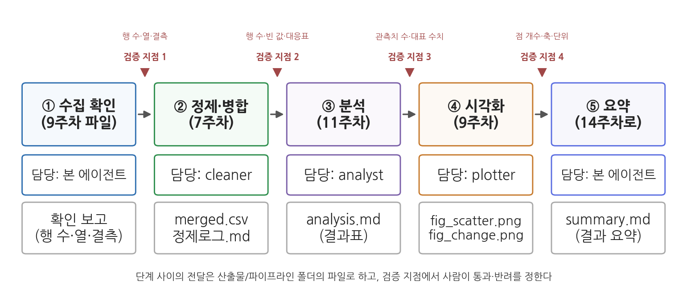
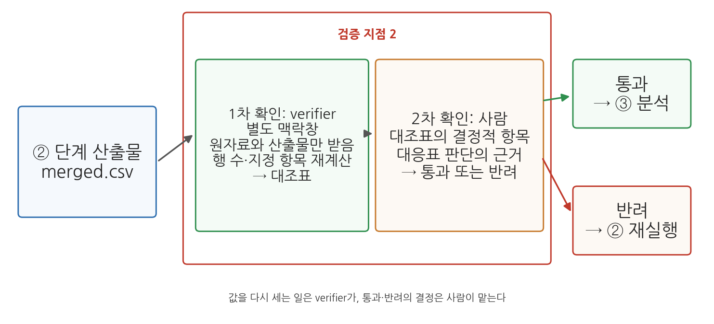
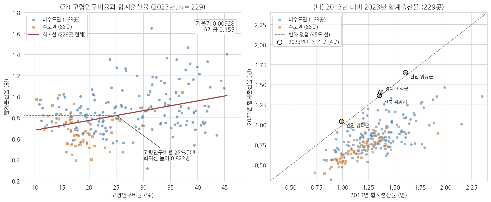

# 13주차 1차시. 서브에이전트를 활용한 분석

## 이 장에서 배우는 것

9주차 2차시에서는 kosis MCP로 받은 표를 `data/sigungu_mcp_2023.csv`로 결합해 탐색했고, 11주차 2차시에서는 같은 파일로 t검정과 회귀를 돌렸다. 이 작업들은 매번 다른 대화에서 하나씩 이루어졌다. 실제 업무에서는 "수도권과 비수도권의 고령화와 출산율을 정리해 달라"는 요청 하나 안에 수집 확인, 정제, 분석, 시각화가 모두 들어 있다.

이 장은 그 요청을 단계로 나누고, 단계마다 담당 서브에이전트를 두어 순서대로 처리하게 한다. 서브에이전트의 개념은 10주차 1차시 1.1에서 배웠고, 10주차 2차시에서는 정의 파일로 reader와 verifier를 만들었다. 오늘은 같은 방식으로 정제·분석·시각화 담당 세 개를 더 만들어 하나의 파이프라인으로 연결한다. 단계 사이에는 사람이 멈춰서 확인하는 검증 지점을 두되, 완성된 보고서의 검증은 14주차 1차시에서 다룬다.

학습 목표는 다음과 같다.

- 분석을 입력·처리·출력이 정해진 단계로 나누고 파이프라인 명세서로 적는다
- 단계별 담당 서브에이전트(cleaner, analyst, plotter)의 정의 파일을 만든다
- 하나의 지시로 단계를 분업시키고, 검증 지점에서 통과와 반려를 결정한다
- 같은 지시를 빈 폴더에서 다시 실행해 같은 수치가 나오는지 확인한다

완성 산출물은 `.claude/agents/`의 정의 파일 세 개(`cleaner.md`, `analyst.md`, `plotter.md`)와 `산출물/파이프라인/` 폴더의 명세서, 지시문, 병합 데이터, 분석 결과표, 그림 두 장, 결과 요약이다. 이 폴더의 결과는 14주차에 보고서로 옮겨진다.

<div style="border:1px solid #d9d9e3;border-left:5px solid #5b6ee1;background:#f7f7fc;padding:12px 16px;margin:18px 0;border-radius:4px;">
<strong>이 장의 로드맵</strong><br>
이 장은 하나의 질문을 중심으로 전개된다. <em>"분석 전 과정을 서브에이전트에게 나누어 맡길 때, 단계는 어떻게 정하고 확인은 어디서 하는가?"</em><br><br>
<strong>1.1</strong> 분석 파이프라인의 구조를 배운다 →
<strong>1.2</strong> 명세서를 쓰고 담당 서브에이전트 세 개를 만든다 →
<strong>1.3</strong> 검증 지점과 재현성의 개념을 배운다 →
<strong>1.4</strong> 분업을 실행하고 검증 지점 1·2를 운영한다 →
<strong>1.5</strong> 분석·시각화 결과를 검증 지점 3·4에서 확인한다 →
<strong>1.6</strong> 빈 폴더에서 다시 실행하고 실행 절차를 스킬로 저장한다.
</div>

## 준비물

| 구분 | 내용 |
|------|------|
| 데이터 | `data/sigungu_mcp_2023.csv` (229개 시군구 × 14열, 9주차 2차시에서 kosis MCP로 수집·결합), `data/sigungu_mcp_tfr_2013.csv` (2013년 시군구 합계출산율, 263행, 같은 실습에서 수집). 수집하지 못했으면 저장소의 같은 이름 파일을 내려받아 쓴다 |
| 도구 | VSCode + Claude Code, 3주차에 구축한 uv 파이썬 환경 |
| 서브에이전트 | 10주차 2차시에 만든 `.claude/agents/verifier.md` |
| 참고 코드 | `code/ch13_practice.py` (본문 수치의 계산 코드), `code/fig13_practice.py` (그림 13-3) |
| 선수 내용 | 10주차 1차시 1.1 (서브에이전트), 10주차 2차시 (정의 파일, verifier), 11주차 2차시 (Welch t검정, 회귀, interp-check), 9주차 2차시 (공통 데이터, eda-pack), 7주차 2차시 (병합과 대응표), 4주차 (SKILL.md) |

## 1.1 분석 파이프라인: 단계마다 입력과 출력이 정해진 구조

### 앞 단계의 출력 파일이 다음 단계의 입력이 된다

수집한 원자료가 정제의 입력이 되고, 정제된 데이터가 분석의 입력이 되며, 분석 결과가 그림과 요약의 입력이 된다.

<div style="border:1px solid #cdd9e5;border-left:5px solid #2f6fb0;background:#f5f9fd;padding:12px 16px;margin:18px 0;border-radius:4px;">
<strong>정의 · 분석 파이프라인</strong><br>
<strong>파이프라인</strong>(pipeline)은 분석 과정을 여러 단계로 나누고, 각 단계의 출력이 다음 단계의 입력이 되도록 이어 붙인 구조다. 각 단계는 입력, 처리, 출력으로 정의되며 출력은 파일로 저장되어 다음 단계로 전달된다.
</div>



그림 13-1이 오늘 만들 파이프라인이다. 위 줄의 다섯 상자가 단계이고 괄호 안은 그 기술을 배운 주차다. 가운데 줄은 각 단계의 담당, 아래 줄은 그 단계가 남기는 파일이며, 화살표 위의 붉은 표시는 1.3에서 다룰 검증 지점이다. 이 그림에서 알 수 있는 것은 각 단계의 기술은 이미 배웠고, 오늘 새로 다루는 것은 단계 사이의 연결과, 단계마다 담당을 따로 두는 방식이라는 점이다.

### 단계 사이를 파일로 잇는 이유

파이프라인의 규칙은 둘이다. 첫째, 모든 단계의 출력은 파일이다. "정제가 끝났습니다"라는 대화 속 보고가 아니라 폴더에 저장된 `merged.csv`가 출력이다. 둘째, 각 단계의 입력은 앞 단계의 출력 파일이다. 시각화 단계가 병합 파일 대신 원자료를 직접 읽으면 그림의 점 개수와 분석표의 관측치 수가 어긋난다.

<div style="border:1px solid #e0d8ea;border-left:5px solid #7a5fa8;background:#faf8fc;padding:12px 16px;margin:18px 0;border-radius:4px;">
<strong>왜 대화가 아니라 파일로 잇는가?</strong><br>
서브에이전트는 본 에이전트와의 대화를 보지 못하고, 작업 지시서와 CLAUDE.md만 받아 별도의 맥락창에서 일한다(10주차 1차시 1.1). 정제 담당이 무엇을 했는지 분석 담당이 알 수 있는 수단은 폴더에 남은 파일뿐이다. 파일로 이으면 사람이 아무 때나 열어 확인할 수 있고(검증), 분석에서 실패하면 정제 결과부터 다시 시작할 수 있으며(재시작), 같은 입력으로 같은 결과를 다시 만들 수 있다(재현).
</div>

### 수집 단계와 MCP

오늘의 첫 단계는 수집이 아니라 수집 확인이다. 9주차 2차시 2.1-2.2에서 kosis MCP로 받은 두 파일을 입력으로 받아 건수와 열과 결측을 확인한다. 6주차 2차시의 `kosis-collect` 스킬로 이 단계를 "표를 다시 받아 저장한다"로 바꾸면 새 연도 자료가 나왔을 때 재실행만으로 분석이 갱신되지만, 수업에서는 MCP 응답 지연을 피하려고 확인 단계로 고정한다.

## 1.2 실습: 파이프라인 명세서와 담당 서브에이전트 만들기

**무엇을 왜 하는가.** 분업을 시키기 전에 사람이 단계를 정한다. 무엇을 몇 단계로 나누고, 각 단계가 무엇을 받아 무엇을 내놓고, 누가 맡는지가 명세서의 내용이다. 칸은 사람이 정하고 파일로 만드는 일은 에이전트에게 시킨 뒤, 담당 열에 적힌 서브에이전트 세 개를 정의 파일로 만든다.

**표 13-1. 파이프라인 명세서 (`산출물/파이프라인/명세서.md`의 내용)**

| 단계 | 입력 | 처리 | 출력 | 담당 |
|------|------|------|------|------|
| ① 수집 확인 | `data/`의 CSV 2개 | 행 수·열 목록·결측 확인 | 확인 보고 | 본 에이전트 |
| ② 정제·병합 | ①의 CSV 2개 | 2023년 파일 기준 왼쪽 병합(키: 시도+시군구), 짝 없는 행 보고 | `merged.csv`, `정제로그.md` | cleaner |
| ③ 분석 | `merged.csv` | 수도권·비수도권 Welch t검정(고령인구비율, 합계출산율), 고령인구비율과 합계출산율의 단순회귀, 권역별 2013-2023 변화 | `analysis.md` | analyst |
| ④ 시각화 | `merged.csv`, `analysis.md` | 권역을 구분한 산점도와 회귀선, 2013년 대비 2023년 산점도 | `fig_scatter.png`, `fig_change.png` | plotter |
| ⑤ 요약 | ②③④의 산출물 | 수치를 인용한 결과 요약 | `summary.md` | 본 에이전트 |

출력 파일은 모두 `산출물/파이프라인/` 폴더에 둔다. ①은 파일을 열어 보는 일뿐이고 ⑤는 모든 산출물을 모아야 하므로 본 에이전트가 직접 맡는다.

<div style="border:1px solid #cfe3d4;border-left:5px solid #2f8f4e;background:#f4fbf6;padding:12px 16px;margin:18px 0;border-radius:4px;">
<strong>지시문 예시</strong><br>
"산출물/파이프라인 폴더를 만들고, 그 안에 명세서.md를 만들어 내가 붙여 넣는 표 13-1의 내용을 그대로 적어 줘. 그다음 아직 아무것도 실행하지 말고 이 명세서를 점검해 줘. (1) 각 단계의 입력이 앞 단계의 출력과 정확히 이어지는지, (2) 출력 파일 이름이 겹치거나 빠진 것이 없는지, (3) data/sigungu_mcp_2023.csv와 data/sigungu_mcp_tfr_2013.csv의 앞부분을 읽어 보고 병합에서 예상되는 문제가 있는지 검토 의견만 말해 줘."
</div>

**예상되는 에이전트의 행동과 결과.** 에이전트가 폴더와 명세서를 만들고, 두 데이터 파일의 앞부분을 읽은 뒤 검토 의견을 낸다.

```
[검토 의견]
1. 입력·출력 연결: ②의 merged.csv가 ③④의 입력으로 이어짐. 이상 없음.
2. 파일 이름: 겹침 없음. ④의 fig_change.png는 ③의 결과 없이도 그릴 수 있음.
3. 예상 문제: 2023년 파일 229행, 2013년 파일 263행. 2013년 파일에는 일반구 행과
   '남구(변동전)', '청주시(변동전)'처럼 옛 행정구역 표기가 있어 이름만으로는
   일부 시군구가 짝을 찾지 못할 수 있음. 같은 이름의 구가 여러 시도에 있으므로
   시도와 시군구를 함께 키로 써야 함.
```

**짚고 가기: 단계를 나누는 일은 파일을 정하는 일이다.** 표 13-1의 출력 열은 전부 파일 이름이다. 출력을 파일로 고정했기 때문에 에이전트가 검토 의견 1번에서 입력과 출력의 연결을 확인할 수 있었고, 1.4의 검증 지점도 이 파일들을 대상으로 성립한다. 검토 의견 3번은 9주차 2차시 2.2에서 결합할 때 이미 본 사실이다. (자세한 설명은 1.1)

이어서 담당 서브에이전트를 만든다. 10주차 2차시에서 verifier를 만든 것과 같은 방식이다. 정의 파일은 `.claude/agents/이름.md`에 두고 머리말에 `name`과 `description`을(`tools`는 선택), 본문에 규칙을 적는다.

**표 13-2. 담당 서브에이전트 정의 파일 세 개**

| 파일 | 단계 | 입력과 출력 | 지킬 규칙 |
|------|------|------|------|
| `cleaner.md` | ② 정제·병합 | `data/`의 CSV → `merged.csv`, `정제로그.md` | 원본 수정 금지, 키는 시도+시군구, 짝 없는 행과 결측은 지우거나 채우지 않고 목록으로 보고 |
| `analyst.md` | ③ 분석 | `merged.csv`만 → `analysis.md` | 결과표에 관측치 수를 적고 결측 제외 개수를 밝힘, 상관과 인과를 구분 |
| `plotter.md` | ④ 시각화 | `merged.csv`, `analysis.md`만 → PNG | 제목·축 이름·단위, 점 개수가 관측치 수와 다르면 멈추고 보고 |

세 파일 모두 마지막 규칙으로 네 줄 보고 형식을 두어, 담당이 코드 전체를 출력해 본 에이전트의 맥락창을 채우거나 "완료했습니다" 한 줄만 올리는 일을 막는다. 다음은 cleaner의 전문이다.

```markdown
---
name: cleaner
description: 파이프라인의 정제·병합 단계 담당. CSV 병합, 짝 없는 행과 결측 보고, 정제로그 작성에 사용.
---

너는 정제·병합 담당이다. 입력은 data 폴더의 원본 CSV이고, 출력은
산출물/파이프라인/merged.csv와 산출물/파이프라인/정제로그.md다.
1. 원본 파일은 수정하지 않는다.
2. 병합 키는 시도와 시군구 두 열의 조합이다. 병합 후 행 수가 기준 파일과
   같은지 확인한다.
3. 짝을 못 찾은 행과 결측값은 삭제하거나 채우지 않는다. 사용자가 준 대응표가
   있으면 그 대응표대로만 이름을 고치고, 나머지는 목록과 개수로 보고한다.
4. 무엇을 왜 처리했는지 정제로그.md에 기록한다.
5. 보고는 네 줄로만 한다. 산출 파일(경로, 행·열 수) / 핵심 수치 / 처리한 것과
   하지 않은 것 / 확인 필요(없으면 왜 없는지 한 줄).
```

<div style="border:1px solid #cfe3d4;border-left:5px solid #2f8f4e;background:#f4fbf6;padding:12px 16px;margin:18px 0;border-radius:4px;">
<strong>지시문 예시</strong><br>
".claude/agents 폴더에 서브에이전트 정의 파일 세 개를 만들어 줘. cleaner.md는 내가 붙여 넣는 내용 그대로 만들고, analyst.md와 plotter.md는 같은 틀(역할 선언, 입력과 출력, 규칙, 네 줄 보고 형식)로 만들되 표 13-2의 입력·출력과 규칙만 넣어 줘. analyst의 입력은 산출물/파이프라인/merged.csv 하나, plotter의 입력은 같은 폴더의 merged.csv와 analysis.md 두 개다. 그림은 koreanize_matplotlib로 한글을 처리하고 dpi 150으로 저장한다는 규칙을 plotter에 넣어 줘. 내가 주지 않은 규칙은 지어 보태지 말고, 만든 뒤 두 파일의 전문을 보여 줘."
</div>

**예상되는 에이전트의 행동과 결과.** 파일 세 개가 만들어지고, analyst에는 "data 폴더의 원본은 열지 않는다"와 "해석 문장에 '영향', '효과', '때문에'를 쓰지 않는다"가, plotter에는 "점 개수가 analysis.md의 관측치 수와 다르면 멈추고 보고한다"가 들어 있다. 손으로 만든 정의 파일은 새 세션에서 인식되므로 Claude Code를 다시 시작한 뒤 "지금 등록된 서브에이전트의 이름과 설명을 보여 줘"라고 물으면 10주차의 reader, verifier와 함께 다섯 개가 나온다.

**짚고 가기: 정의 파일에 규칙을 적는 이유.** cleaner는 지금 이 대화에서 주고받은 말을 모르는 채로 일을 시작한다. "결측은 채우지 않는다"를 대화에서 강조해도 본 에이전트가 작업 지시서에 옮겨 적지 않으면 전달되지 않지만, 정의 파일에 적은 규칙은 어떤 지시서를 받든 담당이 먼저 읽는다. 세 파일이 입력을 "무엇만 읽을 수 있는가"로 적은 것도 1.1의 둘째 규칙을 담당별로 고정하기 위해서다. 설명(description)은 본 에이전트가 요청을 어느 담당에게 넘길지 정하는 데 쓰이며, 오늘은 지시문에서 이름을 직접 부른다. (자세한 설명은 10주차 1차시 1.1)

**검증.** 세 정의 파일에 지시하지 않은 규칙(예: "결측은 평균으로 채운다")이 들어가지 않았는지 본다.

## 1.3 검증 지점과 재현성

### 오류는 다음 단계로 넘어간다

병합 키에 시도가 빠졌다고 하자. 이 데이터에서는 중구·남구·북구·서구·동구·강서구·고성군처럼 이름이 같은 시군구끼리 시도를 가리지 않고 짝지어져, 229행이던 표가 345행으로 불어난다(`code/ch13_practice.py`로 계산한 값이다). ③ 분석은 그 표로 회귀를 돌리고, ④ 시각화는 그 회귀선을 그리며, ⑤ 요약은 그 숫자를 문장으로 옮긴다. 결과물은 형식을 갖추었지만 내용이 틀려 있다.

<div style="border:1px solid #cdd9e5;border-left:5px solid #2f6fb0;background:#f5f9fd;padding:12px 16px;margin:18px 0;border-radius:4px;">
<strong>정의 · 검증 지점</strong><br>
<strong>검증 지점</strong>(checkpoint)은 파이프라인에서 단계 산출물이 다음 단계의 입력으로 넘어가기 전에 품질을 확인하는 자리다. 검증 지점을 통과하지 못한 산출물은 다음 단계로 보내지 않고 그 단계를 고쳐 다시 실행한다.
</div>

검증 지점에서 확인할 항목은 모두 앞 주차에서 배운 것이다. 원칙은 지점마다 결정적 항목을 두세 개만 정해 두고 그것만은 반드시 보는 것이다.

**표 13-3. 검증 지점별 결정적 항목**

| 검증 지점 | 위치 | 결정적 항목 | 배운 곳 |
|------|------|------|------|
| 1 | 수집 확인 뒤 | 두 파일의 행 수, 열 목록, 결측 위치 | 9주차 2차시 |
| 2 | 정제·병합 뒤 | 병합 후 행 수, 2013년 값이 빈 행의 개수, 대응표 | 7주차 2차시 |
| 3 | 분석 뒤 | 관측치 수, 대표 수치 재계산, 해석문의 인과 표현 | 11주차 2차시 |
| 4 | 시각화 뒤 | 그림의 점 개수, 축 이름과 단위 | 9주차 2차시 |

### 검증 지점에서 verifier와 사람이 나누어 맡는 일

값을 다시 세는 일은 10주차 2차시에 만든 verifier에게 맡긴다. verifier는 산출물을 만든 담당과 다른 맥락창에서 원자료와 산출물만 받아 지정한 항목을 다시 계산하므로, 만든 쪽의 판단을 이어받지 않는다.



그림 13-2는 검증 지점 2에서 일이 나뉘는 모습이다. `merged.csv`가 들어오면 1차로 verifier가 행 수와 지정 항목을 다시 계산해 대조표를 내고, 2차로 사람이 대조표의 결정적 항목과 담당이 판단을 미룬 항목(예: 짝 없는 행의 처리)을 보고 통과 또는 반려를 정한다. 이 그림에서 알 수 있는 것은 사람의 확인이 없어지지 않고 판단으로 바뀐다는 점이다. 완성된 보고서의 문장을 산출물과 대조하는 검증은 14주차 1차시에서 다룬다.

### 재현성

재현성은 파이프라인 전체의 확인이다. 같은 입력 파일과 같은 지시문으로 처음부터 다시 실행했을 때 같은 수치가 나오면, 그 결과는 절차에서 나온 것이고 다른 사람이 다시 만들 수 있다. 문장 표현은 실행마다 달라지므로(2주차의 비결정성), 같기를 요구하는 것은 행 수, 관측치 수, 통계량 같은 수치다. 이 구조에서 사람의 일은 단계와 입력·출력을 정하는 설계, 검증 지점에서 통과와 반려를 정하는 판단, 결과가 정책적으로 무엇을 뜻하는지 읽는 해석이다. 서브에이전트가 몇 개든 결과에 대한 책임은 사람에게 있다.

## 1.4 실습: 분업 실행과 검증 지점 1·2

**무엇을 왜 하는가.** 파이프라인 전체를 지시문 하나로 실행한다. 지시문에는 단계를 담당 서브에이전트에게 나누어 맡길 것, 단계 사이는 파일로 이을 것, 단계가 끝날 때마다 멈추고 승인을 기다릴 것이 들어간다. 지시문은 1.6의 재실행에서 다시 쓰므로 먼저 파일로 저장한다.

<div style="border:1px solid #cfe3d4;border-left:5px solid #2f8f4e;background:#f4fbf6;padding:12px 16px;margin:18px 0;border-radius:4px;">
<strong>지시문 예시</strong> (전 과정. 산출물/파이프라인/지시문_파이프라인.md로 먼저 저장한 뒤 실행)<br>
"아래 지시를 산출물/파이프라인/지시문_파이프라인.md로 저장한 뒤 그대로 실행해 줘.<br><br>
수도권·비수도권의 고령화와 출산율 분석 파이프라인을 실행한다. ②는 cleaner, ③은 analyst, ④는 plotter 서브에이전트에게 맡기고, ①과 ⑤는 네가 직접 처리한다. 모든 산출물은 산출물/파이프라인 폴더에 파일로 저장하고, 각 단계의 입력은 앞 단계의 출력 파일만 쓴다. 한 단계가 끝날 때마다 멈추고, 담당의 네 줄 보고를 고쳐 쓰지 말고 그대로 보여 준 뒤 내 승인을 기다린다.<br>
① 수집 확인: data/sigungu_mcp_2023.csv와 data/sigungu_mcp_tfr_2013.csv의 행 수, 열 목록, 결측이 있는 칸의 위치를 보고한다. 새로 수집하지 않는다.<br>
② 정제·병합: 2023년 파일 229행이 모두 남도록 시도와 시군구를 키로 왼쪽 병합해 merged.csv로 저장하고, 짝을 찾지 못한 행을 양쪽 파일별로 모두 보고한다.<br>
③ 분석: merged.csv만 써서 (가) 수도권 열로 나눈 두 집단의 고령인구비율과 2023년 합계출산율을 각각 Welch t검정으로 비교하고, (나) 고령인구비율을 설명변수, 2023년 합계출산율을 반응변수로 단순회귀를 하고, (다) 권역별 2013년·2023년 합계출산율 평균과 변화를 계산해 analysis.md에 저장한다. 표마다 관측치 수를 적는다.<br>
④ 시각화: (가) 권역을 색과 모양으로 구분한 고령인구비율-합계출산율 산점도에 회귀선을 얹어 fig_scatter.png로, (나) 가로축 2013년·세로축 2023년 합계출산율 산점도에 45도 선을 그어 fig_change.png로 저장한다.<br>
⑤ 요약: 위 산출물에 있는 수치만 인용해 summary.md에 결과를 다섯 문장 이내로 요약한다."
</div>

**예상되는 에이전트의 행동과 결과.** 본 에이전트가 ①을 직접 처리하고 멈춘다.

```
[① 수집 확인]
- sigungu_mcp_2023.csv: 229행 14열 (시도, 시군구, 총인구, ... , 출생아수, 수도권)
- 결측: 인구증가율 1칸 (대구 군위군). 그 밖의 열은 결측 없음
- 수도권 열: 수도권 66, 비수도권 163
- sigungu_mcp_tfr_2013.csv: 263행 3열 (시도, 시군구, 합계출산율_2013), 결측 없음
승인을 기다립니다.
```

**검증 지점 1.** 행 수와 열 수가 9주차에 만든 파일 그대로(229행 14열, 263행 3열)이고 결측이 군위군의 인구증가율 한 칸뿐인지 본다(2023년 7월 경북에서 대구로 편입되어 생긴 결측, 9주차 2차시). 확인했으면 "계속해"라고 답한다.

본 에이전트가 ②를 cleaner에게 넘긴다. 화면에 cleaner의 작업 항목이 따로 생기고, 끝나면 네 줄 보고가 올라온다.

```
[② cleaner 보고]
- 산출 파일: 산출물/파이프라인/merged.csv (229행 15열), 정제로그.md
- 핵심 수치: 입력 229행 -> 출력 229행. 2013년 값이 붙은 행 226, 빈 행 3
- 처리한 것: 시도+시군구 키로 왼쪽 병합 / 하지 않은 것: 짝 없는 행의 이름 수정
- 확인 필요: 2023년 쪽 짝 없는 3행(대구 군위군, 인천 미추홀구, 충북 청주시).
  2013년 쪽 짝 없는 37행 가운데 31행은 일반구, 6행은 '(변동전)' 표기.
  옛 이름과 연결할지 판단이 필요합니다.
```

**짚고 가기: 짝 없는 행은 사람이 판정한다.** 2013년 값이 빈 세 곳은 모두 2013년 이후 행정구역이 바뀐 곳이다. 인천 미추홀구는 2018년까지 인천 남구여서 "남구(변동전)"로, 대구 군위군은 2023년 7월까지 경북 소속이어서 경북 "군위군(변동전)"으로, 충북 청주시는 "청주시(변동전)"으로 2013년 표에 실려 있다. 7주차 2차시와 같이 세 곳 모두 연결하되, 청주시는 2014년에 청원군과 통합했으므로 2013년 값 1.341이 통합 전 청주시의 값이라는 유의 사항을 정제로그에 남긴다. 2013년 쪽의 일반구 33행(분당구, 진해구 등)은 시 단위 행이 양쪽에 있어 빠져도 정보 손실이 없고, 청원군(변동전)은 통합으로 사라진 지역이라 짝이 없는 것이 정상이다. cleaner가 이 판단을 "확인 필요"로 넘긴 것은 규칙 3의 결과다. (자세한 설명은 7주차 2차시의 대응표)

사람이 대응표를 정해 반려한다.

<div style="border:1px solid #cfe3d4;border-left:5px solid #2f8f4e;background:#f4fbf6;padding:12px 16px;margin:18px 0;border-radius:4px;">
<strong>지시문 예시</strong> (검증 지점 2에서 반려)<br>
"cleaner에게 다음 대응표로 다시 병합시켜 줘. (1) 2013년 파일의 '인천 남구(변동전)'은 인천 미추홀구로 연결한다(2018년 명칭 변경). (2) '경북 군위군(변동전)'은 대구 군위군으로 연결한다(2023년 7월 대구 편입). (3) '충북 청주시(변동전)'은 충북 청주시로 연결하되, 2014년 청원군 통합 전 청주시의 값이라는 유의 사항을 정제로그.md에 적는다. (4) 일반구 행과 청원군(변동전)은 병합에서 빠지는 것이 정상이다. 대응표와 근거를 정제로그.md에 기록하고, 다시 병합한 뒤 행 수와 2013년 값이 빈 행 수를 보고해 줘."
</div>

cleaner가 다시 병합해 "229행 15열, 2013년 값이 빈 행 0"을 보고한다. 이제 verifier에게 1차 확인을 맡긴다.

<div style="border:1px solid #cfe3d4;border-left:5px solid #2f8f4e;background:#f4fbf6;padding:12px 16px;margin:18px 0;border-radius:4px;">
<strong>지시문 예시</strong><br>
"verifier 서브에이전트로 산출물/파이프라인/merged.csv를 data의 두 원본 파일과 대조해 줘. merged.csv의 값을 베끼지 말고 원본에서 다시 읽어 확인할 것: (1) 행 수가 229이고 2013년 값이 빈 행이 없는가, (2) 인천 미추홀구, 대구 군위군, 충북 청주시의 2013년 값이 원본의 '(변동전)' 행 값과 같은가, (3) 강원 고성군과 경남 고성군의 값이 서로 바뀌지 않았는가. 항목별 일치 여부와 대조한 행 번호를 표로 보고해 줘."
</div>

**예상되는 에이전트의 행동과 결과.** verifier가 원본을 다시 읽어 표 13-4와 같은 대조표를 돌려준다. 행 번호는 VSCode의 줄 번호(1행은 열 이름)다.

**표 13-4. verifier 대조표 (검증 지점 2)**

| 항목 | merged.csv | 원본 | 일치 | 대조한 행 |
|------|------|------|------|------|
| 행 수 / 2013년 값이 빈 행 | 229 / 0 | 2023년 파일 229 | 일치 | 전체 |
| 인천 미추홀구 2013 | 1.107 | 남구(변동전) 1.107 | 일치 | merged 54행, 2013년 파일 53행 |
| 대구 군위군 2013 | 1.199 | 군위군(변동전) 1.199 | 일치 | merged 51행, 2013년 파일 227행 |
| 충북 청주시 2013 | 1.341 | 청주시(변동전) 1.341 | 일치 | merged 109행, 2013년 파일 146행 |
| 강원 고성군 2023 / 2013 | 0.870 / 1.309 | 0.870 / 1.309 | 일치 | merged 215행, 2013년 파일 144행 |
| 경남 고성군 2023 / 2013 | 0.619 / 1.422 | 0.619 / 1.422 | 일치 | merged 190행, 2013년 파일 256행 |

**검증.** 대조표가 전부 일치이고 `정제로그.md`에 대응표와 청주시 유의 사항이 적혀 있으면 "계속해"로 통과시킨다.

## 1.5 실습: 분석·시각화와 검증 지점 3·4

**무엇을 왜 하는가.** 통과시킨 `merged.csv`로 analyst가 11주차 2차시와 같은 계산을, plotter가 그림을 맡는다. 사람이 볼 것은 관측치 수가 앞 단계와 맞는지, 해석문이 수치가 말하는 범위를 넘지 않는지다.

**예상되는 에이전트의 행동과 결과.** "계속해"라고 답하면 analyst가 `analysis.md`를 만들고 네 줄로 보고한다. 결과표의 핵심은 표 13-5다(저자가 `code/ch13_practice.py`로 같은 계산을 한 값).

**표 13-5. analyst의 결과표 (`analysis.md`의 핵심)**

| 분석 | 수도권 | 비수도권 | 결과 |
|------|------|------|------|
| 고령인구비율 평균 (%) | 18.58 (66곳) | 27.82 (163곳) | 차이 9.24%포인트, Welch t = 9.89, p = 4.31e-19 |
| 2023년 합계출산율 평균 (명) | 0.690 (66곳) | 0.878 (163곳) | 차이 0.188명, Welch t = 7.64, p = 1.39e-12 |
| 회귀: 고령인구비율 → 2023년 합계출산율 | 229곳 전체 | | 절편 0.590, 기울기 0.00928, p = 6.98e-10, R제곱 0.155 |
| 2013년 → 2023년 합계출산율 평균 (명) | 1.148 → 0.690 (66곳) | 1.346 → 0.878 (163곳) | 평균 변화 수도권 -0.458, 비수도권 -0.468. 전체 229곳 1.289 → 0.824 (-0.465) |

```
[③ analyst 보고]
- 산출 파일: 산출물/파이프라인/analysis.md
- 핵심 수치: 모든 분석의 관측치 229 (결측 제외 없음)
  회귀 기울기 0.00928, R제곱 0.155
- 처리한 것: Welch t검정 2건, 단순회귀 1건, 권역별 변화 / 하지 않은 것: 결측 대치
- 확인 필요: 해석문은 상관 표현으로 썼으나 권역 차이가 회귀에 섞였을 수 있음
```

**짚고 가기: 관측치 수와 권역 차이.** 모든 분석이 229곳을 쓴다. 결측은 이번 분석에 쓰지 않는 인구증가율 한 칸뿐이고, 2013년 값은 대응표로 빈 행이 없어졌기 때문이다. 이 수가 앞 단계 보고(빈 행 0)와 이어지는지가 검증 지점 3의 첫 확인이다. 비수도권은 수도권보다 고령인구비율이 9.24%포인트 높고 합계출산율도 0.188명 높다. 그래서 229곳을 한데 놓고 회귀를 돌리면 기울기가 양수로 나온다. 같은 회귀를 권역별로 나누면 수도권 66곳의 기울기는 0.00314(p = 0.392)로 0과 구별되지 않고, 비수도권 163곳은 0.00665(R제곱 0.078)로 전체보다 작다(`code/ch13_practice.py`). 전체 기울기의 상당 부분이 권역 차이에서 온다는 뜻이며, 11주차 1차시에서 배운 교란요인의 예이고, analyst가 확인 필요에 올린 점이다. 2013년 대비 변화는 두 권역 모두 평균 0.46명 안팎 내렸고 권역 간 차이는 0.01명이다.

**검증 지점 3.** 숫자는 verifier에게 `merged.csv`에서 다시 계산하게 하고, 해석문은 11주차 2차시에 만든 `interp-check` 스킬로 심사한다.

<div style="border:1px solid #cfe3d4;border-left:5px solid #2f8f4e;background:#f4fbf6;padding:12px 16px;margin:18px 0;border-radius:4px;">
<strong>지시문 예시</strong><br>
"verifier 서브에이전트로 산출물/파이프라인/analysis.md를 같은 폴더의 merged.csv와 대조해 줘. merged.csv에서 먼저 다시 계산한 다음 결과표를 열 것. 다시 계산할 항목은 각 분석의 관측치 수, 두 Welch t값, 회귀의 기울기와 R제곱, 권역별 2013년·2023년 평균이다. 그다음 /interp-check로 analysis.md의 해석 문단을 심사하고 심사 기록을 산출물/파이프라인/심사_analysis.md로 저장해 줘."
</div>

대조표가 전부 일치하고 심사 기록에 인과 표현이 걸리지 않았으면 통과시킨다. 해석문에 "고령화가 출산율을 높인다"처럼 인과 표현이 있으면 "관련, 경향으로 바꾸고 권역 차이가 섞였을 가능성을 한 문장 덧붙여"라고 analyst에게 반려한다.

이어서 plotter가 그림 두 장을 그리고 "점 개수 229 / 229"를 보고한다.



**짚고 가기: 그림에서 확인할 것.** 그림 13-3은 저자가 같은 데이터로 그린 기준 그림이다. (가)에서 네모가 수도권, 동그라미가 비수도권이다. 수도권 66곳 가운데 59곳은 고령인구비율이 25% 이하이고 합계출산율은 0.394-1.043명 범위에 있어 점이 왼쪽 아래에 몰려 있으며, 비수도권은 오른쪽으로 넓게 퍼져 있다. 회귀선은 두 덩어리 사이를 잇는 방향으로 그어져 있고 고령인구비율 25%에서 높이가 0.822명이다. 앞에서 본 권역 차이가 그림에서는 두 덩어리의 위치로 보인다. (나)는 45도 선(변화 없음)을 기준으로 읽는다. 229곳 가운데 선 위, 곧 2023년이 2013년보다 높은 곳은 인천 강화군, 전남 영광군, 경북 의성군, 전북 김제시의 네 곳뿐이고 나머지 225곳은 모두 선 아래에 있다. 가장 크게 내린 곳은 전남 영암군(2.150에서 1.009)이다.

**검증 지점 4.** plotter가 보고한 점 개수가 두 그림 모두 229이고 제목·축 이름·단위가 있는지 본다. 확인했으면 "계속해"로 ⑤ 요약까지 마친다. `summary.md`의 수치 대조는 14주차 1차시에서 한다.

<div style="border:1px solid #ecd9c6;border-left:5px solid #c77b2f;background:#fdf9f4;padding:12px 16px;margin:18px 0;border-radius:4px;">
<strong>유의 · 담당이 바뀌지 않았는지 본다</strong><br>
본 에이전트가 담당을 부르지 않고 어떤 단계를 직접 처리하면 중간 출력이 본 대화의 맥락창에 쌓이고 정의 파일의 규칙도 적용되지 않는다. 보고가 네 줄 형식으로 오지 않으면 "이 단계는 analyst에게 맡겨 다시 해 줘"라고 지시한다.
</div>

## 1.6 실습: 빈 폴더에서 다시 실행하기와 run-pipeline 스킬

**무엇을 왜 하는가.** 같은 입력과 지시문으로 처음부터 다시 실행해 같은 수치가 나오는지 확인한다(1.3의 재현성). 정의 파일을 빠뜨리면 담당의 규칙이 전달되지 않으므로 함께 복사한다.

<div style="border:1px solid #cfe3d4;border-left:5px solid #2f8f4e;background:#f4fbf6;padding:12px 16px;margin:18px 0;border-radius:4px;">
<strong>지시문 예시</strong> (복사)<br>
"바탕화면에 파이프라인_재현 폴더를 만들고, data의 sigungu_mcp_2023.csv와 sigungu_mcp_tfr_2013.csv, 산출물/파이프라인/지시문_파이프라인.md, .claude/agents의 cleaner.md·analyst.md·plotter.md·verifier.md만 같은 폴더 구조로 복사해 줘. 산출물/파이프라인의 다른 파일은 복사하지 마."
</div>

복사한 폴더를 VSCode 새 창으로 열고 다음을 입력한다. 검증 지점 2의 대응표는 이번에는 지시문에 처음부터 넣는다.

<div style="border:1px solid #cfe3d4;border-left:5px solid #2f8f4e;background:#f4fbf6;padding:12px 16px;margin:18px 0;border-radius:4px;">
<strong>지시문 예시</strong> (재현 실행)<br>
"산출물/파이프라인/지시문_파이프라인.md를 읽고 그 지시를 처음부터 실행해 줘. ②에서는 2013년 파일의 인천 남구(변동전)를 인천 미추홀구로, 경북 군위군(변동전)을 대구 군위군으로, 충북 청주시(변동전)를 충북 청주시로 연결하고 청주시 값이 통합 전 값이라는 유의 사항을 정제로그에 적어. 이번에는 단계마다 멈추지 말고 끝까지 실행한 뒤 (1) merged.csv의 행 수와 2013년 값이 빈 행 수, (2) 회귀의 관측치 수·기울기·R제곱, (3) 합계출산율 Welch t값과 두 권역 평균을 보고해 줘."
</div>

**예상되는 에이전트의 행동과 결과.** 에이전트가 ①부터 ⑤까지 멈추지 않고 실행한 뒤 세 줄을 보고한다.

```
[재현 실행 결과]
(1) merged.csv: 229행, 2013년 값이 빈 행 0
(2) 회귀: 관측치 229, 기울기 0.00928, R제곱 0.155
(3) 합계출산율 Welch t = 7.64, 수도권 평균 0.690, 비수도권 평균 0.878
```

**검증.** 세 줄의 수치가 1.4-1.5의 결과와 같으면 통과다. 다르면 두 폴더의 `정제로그.md`를 비교해 갈라진 단계를 찾고, 지시문에 빠진 기준을 적어 다시 실행한다.

이제 원래 작업 폴더에서 실행 절차를 스킬로 저장한다.

<div style="border:1px solid #cfe3d4;border-left:5px solid #2f8f4e;background:#f4fbf6;padding:12px 16px;margin:18px 0;border-radius:4px;">
<strong>지시문 예시</strong><br>
".claude/skills/run-pipeline/SKILL.md를 만들어 줘. 머리말의 name은 run-pipeline, description은 '수도권·비수도권 고령화와 출산율 분석 파이프라인을 처음부터 실행한다', 그리고 disable-model-invocation: true를 넣어 줘. 본문에는 '산출물/파이프라인/지시문_파이프라인.md를 읽고 그 지시를 그대로 실행한다. ②에서는 지시문에 적힌 대응표를 적용한다. 사용자가 끝까지 실행하라고 하면 멈추지 않고 실행한 뒤 merged.csv 행 수, 회귀의 관측치 수·기울기·R제곱, 합계출산율 Welch t값을 보고한다'를 적어 줘. 지시문_파이프라인.md의 ② 항목 끝에도 오늘 정한 대응표를 덧붙여 줘."
</div>

**예상되는 에이전트의 행동과 결과.** 스킬 파일이 만들어지고 지시문 파일의 ②에 대응표가 추가된다. 대화창에 `/`를 입력하면 목록에 `/run-pipeline`이 보인다.

**짚고 가기: 스킬과 정의 파일은 저장하는 것이 다르다.** `disable-model-invocation: true`는 이 스킬을 사용자가 `/run-pipeline`으로 부를 때만 실행되게 한다. 파이프라인은 산출물 파일 여러 개를 덮어쓰므로 실행 시점은 사람이 정한다. 스킬은 일하는 절차를, `agents/cleaner.md` 등은 단계를 맡는 담당의 규칙을 저장하며, 한 번의 실행 안에서 순서는 스킬과 지시문이 정하고 각 단계의 일은 담당이 자기 맥락창에서 한다. (자세한 설명은 4주차 1차시)

**검증.** `/run-pipeline 끝까지 실행해 줘`로 부른 결과의 세 줄이 위 재현 실행 결과와 같은지 본다.

## 요약

분석 파이프라인은 분석을 입력·처리·출력이 정해진 단계로 나누고, 앞 단계의 출력 파일을 다음 단계의 입력으로 잇는 구조다. 단계 사이의 전달은 파일로 하고, 담당이 지킬 규칙(입력 제한, 네 줄 보고)은 cleaner, analyst, plotter의 정의 파일에 적었다. 검증 지점에서는 결정적 항목만 확인하며, 값을 다시 세는 일은 verifier가, 통과와 반려의 판단은 사람이 맡는다. 검증 지점 2에서는 행정구역 변경으로 짝을 못 찾은 인천 미추홀구, 대구 군위군, 충북 청주시를 2013년 표의 옛 표기와 연결하고, 청주시 값이 통합 전 값이라는 유의 사항을 기록했다. 분석 결과 비수도권은 수도권보다 고령인구비율이 9.24%포인트, 2023년 합계출산율이 0.188명 높았고, 229곳 전체의 회귀 기울기는 0.00928(R제곱 0.155)이었지만 권역별로 나누면 기울기가 작아져 권역 차이가 섞여 있음을 확인했다. 합계출산율은 229곳 평균 1.289에서 0.824로 내렸다. 빈 폴더에서 다시 실행해 같은 수치가 나오는지 보는 것이 재현성 확인이며, 실행 절차는 사용자만 부를 수 있는 `run-pipeline` 스킬로 저장했다. 이 결과를 보고서로 쓰고 검증하는 일은 14주차 1차시에서 한다.

## 검증 체크리스트

- [ ] `.claude/agents/`에 `cleaner.md`, `analyst.md`, `plotter.md`가 있고, 각 파일에 입력 제한과 네 줄 보고 형식이 들어 있다
- [ ] `산출물/파이프라인/merged.csv`가 229행이고 2013년 값이 빈 행이 없으며, 대응표와 청주시 유의 사항이 `정제로그.md`에 기록되어 있다
- [ ] 빈 폴더의 재현 실행에서 회귀 기울기 0.00928, R제곱 0.155, 합계출산율 Welch t = 7.64가 다시 나왔다

## 혼자서 해 보는 실습

**혼자 해 보기 13-A. 변수를 바꾼 파이프라인.** `지시문_파이프라인.md`를 복사해 `지시문_노령화지수.md`를 만들고, ③과 ④의 고령인구비율을 노령화지수로 바꾸어 실행한다. 산출물은 `산출물/파이프라인_노령화지수/` 폴더에 두게 한다. 스스로 확인할 점은 ②의 `merged.csv`가 원래와 같은 229행·빈 행 0인지, 바뀐 것이 ③ 이후 단계뿐인지다.

**혼자 해 보기 13-B. EDA 단계 넣기.** 9주차 2차시에 만든 `eda-pack` 스킬을 ②와 ③ 사이의 새 단계로 넣은 명세서를 쓰고, 그 단계의 입력·출력·담당과 검증 지점의 결정적 항목을 표 13-1과 표 13-3의 형식으로 정한다. 스스로 확인할 점은 새 단계의 입력이 `merged.csv`이고 새 단계의 출력이 ③의 입력을 바꾸지 않는지다.
