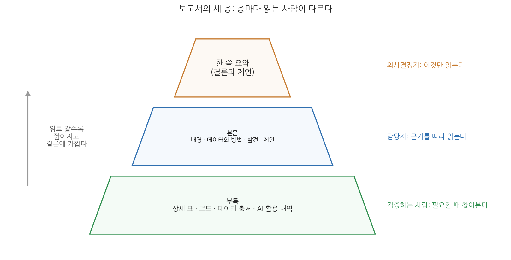
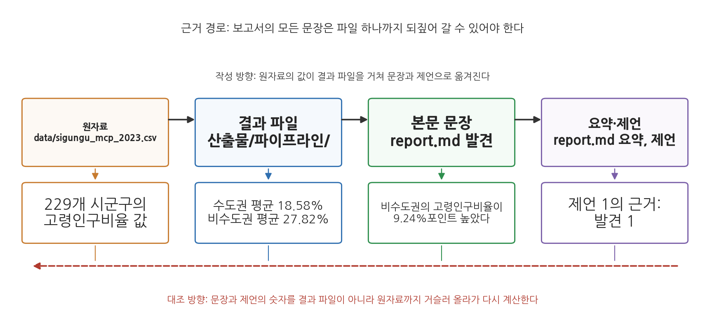
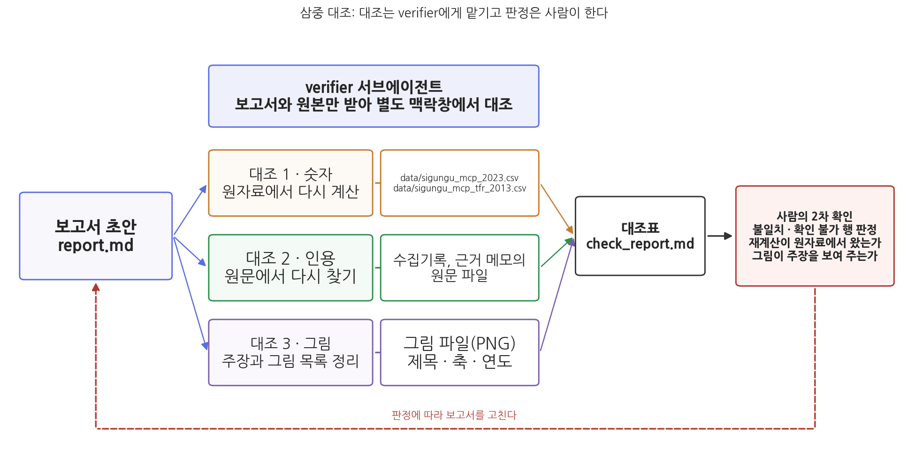
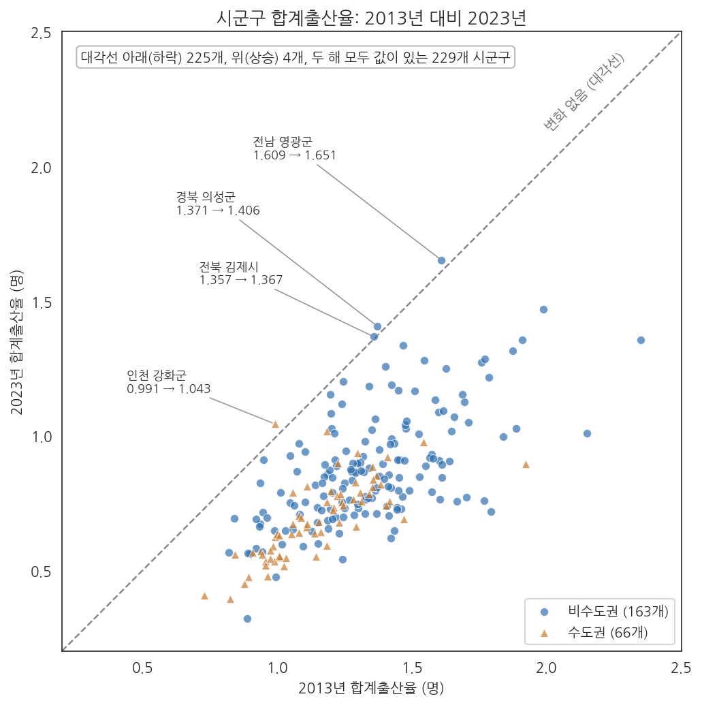

# 14주차 1차시. 서브에이전트를 활용한 검증

## 이 장에서 배우는 것

13주차 1차시에서 서브에이전트로 파이프라인을 꾸려 공통 데이터의 "수도권·비수도권의 고령화와 출산율"을 분석했다. `산출물/파이프라인/` 폴더에는 결과 파일과 그림이 남아 있다. 그러나 분석을 요청한 사람은 이 폴더를 열지 않고 보고서를 읽는다. 이 장에서는 그 분석 결과로 짧은 분석 보고서를 에이전트와 쓰고, 보고서의 숫자·인용·그림을 10주차 2차시에서 만든 verifier 서브에이전트에게 원본과 대조하게 한 뒤, 사람이 대조 결과를 2차로 확인하는 절차를 실습한다.

검증 절차를 장의 중심에 두는 이유는 보고서를 쓰는 단계에서 분석 단계에 없던 오류가 새로 생기기 때문이다. 에이전트가 문장을 다듬으며 0.878을 0.887로 옮기거나, 결과 파일에 없는 비율을 인상에 맞춰 적거나, 그림이 보여 주지 않는 내용을 "그림에서 보듯"이라고 쓰는 일이 실제로 일어난다. 2주차 1차시 1.3에서 배운 검증의 세 겹 가운데 이 장은 둘째 겹(검증 전담 서브에이전트)과 셋째 겹(사람의 확인)을 보고서 한 편에 적용한다.

학습 목표는 다음과 같다.

- 보고서의 세 층 구조와 질문-근거-함의 문단을 알고, 근거 파일을 단 초안을 에이전트에게 쓰게 한다
- verifier 서브에이전트에게 숫자·인용·그림의 삼중 대조를 맡기고 대조표를 받는다
- 대조표에서 사람이 판정할 항목을 골라 2차 확인을 하고 보고서를 고친다
- 도구·범위·검증·책임을 담은 AI 활용 내역을 보고서에 넣는다

완성 산출물은 `산출물/보고서/` 폴더의 `report.md`(삼중 대조를 거치고 AI 활용 내역이 들어간 보고서), `근거메모_고령화출산.md`(evidence-memo 스킬로 만든 배경 근거), `check_report.md`(verifier가 만든 대조표)다.

<div style="border:1px solid #d9d9e3;border-left:5px solid #5b6ee1;background:#f7f7fc;padding:12px 16px;margin:18px 0;border-radius:4px;">
<strong>이 장의 로드맵</strong><br>
<strong>1.1</strong> 보고서의 세 층과 질문-근거-함의 문단을 본다 (개념) →
<strong>1.2</strong> 근거 메모와 근거를 단 초안을 만든다 (실습) →
<strong>1.3</strong> 삼중 대조를 서브에이전트에게 맡기는 이유와 사람이 남기는 판정을 본다 (개념) →
<strong>1.4</strong> verifier로 삼중 대조를 하고 2차 확인 뒤 보고서를 고친다 (실습) →
<strong>1.5</strong> AI 사용 명시의 네 요소를 본다 (개념) →
<strong>1.6</strong> AI 활용 내역을 넣고 요약을 다시 쓴다 (실습) →
<strong>1.7</strong> 과목을 마무리한다.
</div>

## 준비물

| 구분 | 내용 |
|------|------|
| 데이터 | `data/sigungu_mcp_2023.csv`(9주차 2차시에 kosis MCP로 수집·결합한 229개 시군구, 2023년), `data/sigungu_mcp_tfr_2013.csv`(2013년 시군구 합계출산율). 9주차 2차시의 `수집기록.md`. 13주차 1차시의 `산출물/파이프라인/`(merged.csv, analysis.md, summary.md와 그림 둘) |
| 도구 | VSCode + Claude Code, uv 환경(3주차), `.claude/agents/verifier.md`(10주차 2차시), `evidence-memo` 스킬(10주차 2차시), `interp-check` 스킬(11주차 2차시) |
| 선수 내용 | 13주차 1차시(파이프라인 산출물), 11주차 2차시(t검정·회귀 해석), 10주차 1차시(근거의 세 유형), 9주차 2차시(그림 규격), 2주차 1차시 1.3(검증의 세 겹) |

## 1.1 보고서의 세 층과 질문-근거-함의 문단

분석 폴더는 보고서가 아니다. 폴더에는 CSV, 코드, 그림, 통계 출력이 들어 있지만, 의사결정자는 CSV를 열지 않고 회귀 출력을 읽지 않는다. 보고서는 그 결과 가운데 질문에 답하는 숫자를 골라 순서를 정하고, 그 숫자가 어디서 왔는지를 적은 문서다.



그림 14-1을 읽는 법은 이렇다. 사다리꼴 세 개가 보고서의 세 층이고, 오른쪽 글씨가 그 층을 읽는 사람이다. 맨 위 한 쪽 요약은 결론과 제언만 담고 의사결정자가 읽는다. 가운데 본문은 배경, 데이터와 방법, 발견, 제언으로 이루어지며 담당자가 근거를 따라 읽는다. 맨 아래 부록에는 상세 표, 코드, 데이터 출처, AI 활용 내역이 들어가고 검증하려는 사람이 찾아본다. 여기서 알 수 있는 것은 두 가지다. 어느 층에 무엇을 둘지 정하는 일이 보고서 설계라는 것, 그리고 맨 위 층은 아래 두 층이 완성된 뒤에 쓴다는 것이다. 이 장의 실습도 요약을 마지막(1.6)에 다시 쓴다.

"데이터와 방법"이 독립된 장인 이유는 검증 가능성이다. 어떤 통계표를 언제 받아 무엇을 결합하고 무엇을 제외했으며 어떤 검정을 썼는지 적혀 있어야, 다른 사람이 같은 결과를 재현하거나 반박할 수 있다.

### 같은 숫자, 다른 문단

발견 장의 문단은 숫자의 나열이 아니라 질문에 대한 답이어야 한다. 다음 두 문단은 공통 데이터에서 계산한 같은 숫자를 담고 있다.

**표 나열형.**

> 수도권 66개 시군구의 고령인구비율 평균은 18.58%, 비수도권 163개 시군구는 27.82%였다. 합계출산율 평균은 수도권 0.690명, 비수도권 0.878명이었다. 고령인구비율과 합계출산율의 상관계수는 0.393이었다.

**질문-근거-함의형.**

> 고령화가 더 진행된 비수도권에서 출산율은 더 낮은가. 2023년 시군구 자료에서 비수도권의 고령인구비율 평균(27.82%)은 수도권(18.58%)보다 9.24%포인트 높았지만, 합계출산율 평균은 비수도권(0.878명)이 수도권(0.690명)보다 높았다. 시군구 단위에서는 고령인구비율이 높은 곳일수록 합계출산율도 높은 경향(상관계수 0.393)이 나타난다. 이 결과는 저출산 대응을 고령화가 심한 지역의 문제로만 보면 출산율이 가장 낮은 수도권 도시 지역이 빠진다는 점을 시사한다. 다만 시군구 평균 사이의 상관이므로, 고령화가 출산율을 높인다고 해석할 수는 없다.

두 문단의 숫자는 같다. 차이는 세 가지다. 질문으로 시작하므로 뒤따르는 숫자가 답의 근거가 되고, 숫자마다 주장 안의 자리가 정해지며, 함의 뒤에 한계를 함께 적는다. 마지막 문장의 단서는 11주차에서 배운 "상관은 인과가 아니다"를 적용한 것이다.

<div style="border:1px solid #cdd9e5;border-left:5px solid #2f6fb0;background:#f5f9fd;padding:12px 16px;margin:18px 0;border-radius:4px;">
<strong>정의 · 데이터 스토리텔링</strong><br>
<strong>데이터 스토리텔링</strong>(data storytelling)은 분석 결과를 질문, 근거, 함의의 순서로 배열해 읽는 사람이 따라올 수 있게 전달하는 방법이다. 숫자를 새로 만들거나 고르는 것이 아니라, 검증된 숫자를 질문에 답하는 순서로 놓는 것이다.
</div>

<div style="border:1px solid #ecd9c6;border-left:5px solid #c77b2f;background:#fdf9f4;padding:12px 16px;margin:18px 0;border-radius:4px;">
<strong>유의 · 결론에 맞춰 숫자를 고르지 않는다</strong><br>
결론을 먼저 정하면 그에 맞는 숫자만 고르게 된다. "수도권 저출산"을 강조하려고 수도권 66곳 가운데 8곳은 비수도권 평균(0.878명) 이상이라는 사실을 빼면, 순서를 정한 것이 아니라 근거를 고른 것이다. 결론에 불리한 숫자는 본문에 남기고 해석을 붙인다.
</div>

## 1.2 근거 메모와 근거를 단 초안 만들기

**무엇을 왜 하는가.** 초안을 쓰기 전에 보고서가 기댈 근거를 파일로 모은다. 발견 장의 숫자는 13주차 파이프라인의 결과 파일에 있지만, 배경과 데이터 출처는 아직 파일로 정리되어 있지 않다. 10주차 2차시에서 만든 `evidence-memo` 스킬로 배경 근거 메모를 만들고, 그다음 장마다 근거 파일을 다는 초안을 쓰게 한다.



그림 14-2를 읽는 법은 이렇다. 위쪽 네 상자는 숫자가 옮겨 가는 네 단계이고, 아래 상자는 이 장의 보고서에서 실제로 옮겨지는 값이다. 검은 화살표가 작성 방향, 붉은 점선이 대조 방향이다. 원자료의 고령인구비율 229개가 결과 파일(`산출물/파이프라인/analysis.md`)의 권역 평균(18.58%, 27.82%)이 되고, 그 평균이 본문 문장의 "9.24%포인트"가 되며, 그 문장이 제언의 근거가 된다. 여기서 알 수 있는 것은 본문의 어느 문장이든 왼쪽으로 되짚어 가면 파일 하나에 닿아야 한다는 것, 그리고 대조는 결과 파일에서 멈추지 않고 원자료까지 가야 한다는 것이다. 결과 파일 자체가 틀렸다면 결과 파일과 맞춰 보는 것으로는 잡을 수 없다.

**1단계: 배경 근거 메모.**

<div style="border:1px solid #cfe3d4;border-left:5px solid #2f8f4e;background:#f4fbf6;padding:12px 16px;margin:18px 0;border-radius:4px;">
<strong>지시문 예시</strong><br>
"/evidence-memo 9주차 수집기록과 data/sigungu_mcp_2023.csv, data/sigungu_mcp_tfr_2013.csv로 '수도권과 비수도권의 고령화와 출산율 격차는 어느 정도이고, 10년 사이 출산율은 얼마나 변했는가'에 답하는 근거 메모를 만들어 줘. 주제는 고령화출산이야. 통계 근거마다 통계표 이름, 작성기관, 통계표 ID, 기준연도를 수집기록에서 그대로 옮기고, 수치는 데이터 파일에서 계산해. 결과는 산출물/보고서/근거메모_고령화출산.md로 저장해 줘."
</div>

**예상되는 에이전트의 행동과 결과.** 스킬이 불려 와 10주차에 정한 절차대로 수집기록과 데이터 파일을 읽고, 계산 코드를 실행한 뒤 메모를 저장한다. 메모의 출처 항목에는 "고령인구비율(시도/시/군/구), e-지방지표, DT_1YL20631, 2023"과 "시군구/출생아수 합계출산율, 인구동향조사, DT_1B81A23, 2013·2023"처럼 수집기록의 표기가 그대로 옮겨진다. 2013년 파일의 옛 이름(인천 "남구(변동전)", 충북 "청주시(변동전)", 경북 "군위군(변동전)")을 2023년의 미추홀구, 청주시, 대구 군위군에 연결했다는 처리 기록도 절차 근거로 남는다.

**검증.** 메모의 출처 항목에 있는 통계표 ID가 수집기록의 ID와 같은지 하나만 본다.

**2단계: 목차와 근거 대응.**

<div style="border:1px solid #cfe3d4;border-left:5px solid #2f8f4e;background:#f4fbf6;padding:12px 16px;margin:18px 0;border-radius:4px;">
<strong>지시문 예시</strong><br>
"산출물/파이프라인 폴더의 결과로 분석 보고서를 쓰려고 한다. 계획 모드로 목차부터 잡아 줘. 구조는 요약, 배경, 데이터와 방법, 발견, 제언, 한계, 부록으로 하고, 발견은 (1) 수도권과 비수도권의 고령인구비율 차이, (2) 고령인구비율과 합계출산율의 관계, (3) 2013년 대비 2023년 합계출산율 변화의 세 소절로 해. 소절마다 근거가 되는 파일과 항목을 산출물/파이프라인 폴더와 산출물/보고서/근거메모_고령화출산.md에서 직접 열어 찾아 적고, 근거 파일이 없는 소절은 '근거 없음'과 필요한 계산을 적어 줘. 본문은 아직 쓰지 마."
</div>

**예상되는 에이전트의 행동과 결과.** 계획 모드에서 결과 파일과 근거 메모를 차례로 읽고, 소절마다 근거 위치를 단 목차를 돌려준다. 발견 소절은 다음과 같은 모양이다.

```
발견
  발견 1. 비수도권의 고령인구비율은 수도권보다 얼마나 높은가
      근거: 파이프라인 결과 파일의 t검정 항목 (수도권 18.58%, 비수도권 27.82%)
  발견 2. 고령인구비율이 높은 곳은 출산율도 다른가
      근거: 파이프라인 결과 파일의 회귀 항목, 산점도 그림
  발견 3. 10년 사이 합계출산율은 얼마나 변했는가
      근거: 근거메모_고령화출산.md의 변화 항목, 2013-2023 산점도 그림
```

결과 파일에 어떤 계산이 없으면 그 소절에 "근거 없음"이 붙는다. 그때는 초안에 앞서 "필요한 계산을 산출물/파이프라인의 데이터로 실행해 결과 파일에 추가해 줘"라고 지시해 근거부터 만든다. 목차는 사람이 고쳐서 승인한다.

**3단계: 본문 초안.**

<div style="border:1px solid #cfe3d4;border-left:5px solid #2f8f4e;background:#f4fbf6;padding:12px 16px;margin:18px 0;border-radius:4px;">
<strong>지시문 예시</strong><br>
"승인한 목차대로 산출물/보고서/report.md에 배경, 데이터와 방법, 발견, 제언, 한계 장의 초안을 써 줘. 제약은 다섯 가지다. (1) 모든 수치는 산출물/파이프라인의 결과 파일과 근거메모_고령화출산.md에서만 가져오고, 기억이나 추정으로 숫자를 쓰지 마. (2) 발견의 각 소절은 질문 한 문장으로 시작해 근거 수치를 제시하고 함의와 한계를 한 문장씩 붙여. (3) 상관을 인과처럼 쓰지 마. (4) 각 문단 끝에 근거 파일과 항목, 그림 번호를 대괄호로 임시로 달아. (5) 제언마다 근거가 된 발견 번호를 괄호로 적고, 발견에 없는 규모나 숫자를 제언에 넣지 마. 결과 파일에 없는 수치가 필요하면 쓰지 말고 '계산 필요'라고 표시해. 요약은 아직 쓰지 마."
</div>

**예상되는 에이전트의 행동과 결과.** 결과 파일과 근거 메모를 읽고 다섯 장을 쓴다. 발견 1은 다음과 같은 문단이 된다.

```
발견 1. 비수도권의 고령인구비율은 수도권보다 얼마나 높은가
비수도권 163개 시군구의 고령인구비율 평균은 27.82%로 수도권 66개
시군구의 18.58%보다 9.24%포인트 높았고, Welch t검정에서 이 차이는
우연으로 보기 어려운 것으로 나타났다(t = 9.89, p < 0.001). (...)
[근거: 파이프라인 결과 파일 t검정 항목] (그림 없음)
```

발견 2에는 회귀식(합계출산율 = 0.590 + 0.00928 × 고령인구비율, R제곱 0.155)이, 발견 3에는 229개 시군구 가운데 225개에서 하락했고 평균이 1.289명에서 0.824명으로 0.465명 내려갔다는 수치가 근거 주석과 함께 들어간다. 제언에는 "(발견 1, 2)"처럼 발견 번호가 붙는다. "데이터와 방법" 장은 근거 메모의 출처와 처리 기록을 산문으로 옮긴 다음과 같은 문단이 된다.

```
데이터와 방법
2023년 시군구 지표는 kosis MCP로 통계표 여섯 개를 받아 시도·시군구 이름으로
결합한 229개 시군구 자료(data/sigungu_mcp_2023.csv)를, 2013년 합계출산율은
인구동향조사 표(DT_1B81A23)의 2013년 값(data/sigungu_mcp_tfr_2013.csv)을 썼다.
2013년 자료의 옛 행정구역 세 곳(인천 남구, 충북 옛 청주시, 경북 군위군)은
2023년의 미추홀구, 청주시, 대구 군위군에 연결했고, 일반구 행은 제외했다.
권역 비교는 Welch t검정, 관계는 단순회귀로 분석했다. [근거: 근거메모_고령화출산.md]
```

**짚고 가기: 데이터와 방법 장이 담는 것.** 화면의 문단에는 자료의 출처와 통계표 ID, 결합의 기준, 옛 행정구역을 어떻게 연결했는지, 무엇을 제외했는지, 어떤 방법을 썼는지가 들어 있다. 발견만 읽는 사람에게는 필요 없어 보이는 내용이지만, 이 기록이 있어야 다른 사람이 같은 229개를 만들고 같은 수치를 다시 계산할 수 있다. 특히 충북 청주시의 2013년 값은 2014년 청원군과 통합되기 전 옛 청주시의 값이므로, 청주시의 10년 변화는 관할 범위가 다른 두 값의 비교라는 점을 한계 장에 한 줄 적는다. (자세한 설명은 1.1)

**짚고 가기: 발견 문단과 해석의 강도.** 발견 1 문단의 "우연으로 보기 어려운 것으로 나타났다"와 발견 2 문단의 R제곱 0.155는 11주차 2차시에서 다룬 해석의 강도와 이어진다. p값은 두 권역의 평균 차이가 표본의 우연으로 생겼을 가능성이 작다는 말이고, R제곱 0.155는 시군구 간 합계출산율 차이 가운데 약 15%만 고령인구비율과 함께 움직인다는 말이다. 발견 장의 문단이 이 강도를 넘어서는지는 11주차 2차시에서 만든 `interp-check` 스킬로 한 번 심사한다. "/interp-check report.md의 발견 장 세 소절을 심사해 줘"라고 입력하면 기준별 판정 표가 나온다. (자세한 설명은 11주차 2차시)

**검증.** 근거 주석이 없는 숫자가 든 문단이 있는지 본다.

## 1.3 삼중 대조를 서브에이전트에게 맡기는 이유

초안이 나왔으니 제출 전에 보고서의 서술을 세 방향에서 원본과 맞춘다. 이것이 삼중 대조다.

<div style="border:1px solid #cdd9e5;border-left:5px solid #2f6fb0;background:#f5f9fd;padding:12px 16px;margin:18px 0;border-radius:4px;">
<strong>정의 · 삼중 대조</strong><br>
<strong>삼중 대조</strong>는 보고서의 서술을 서로 다른 세 원본과 맞추는 제출 전 검증이다. ① 숫자: 본문의 수치를 원자료에서 다시 계산한 값과 맞춘다. ② 인용: 출처 표기(통계표 이름, ID, 기준연도)와 인용문을 수집기록과 원문 파일에서 다시 찾는다. ③ 그림: 본문이 그림에 대해 하는 주장을 그림 파일의 내용과 맞춘다.
</div>

세 대조의 기준은 서로 다른 파일이다. 숫자는 데이터 파일이, 인용은 수집기록과 원문이, 그림은 PNG 파일이 기준이 된다. 하나를 빼면 그 방향의 오류는 걸러지지 않는다.

### 왜 서브에이전트에게 맡기는가

초안을 쓴 대화에 대조까지 시키면, 그 대화의 맥락창에는 초안을 쓰며 읽은 결과 파일과 에이전트 자신이 쓴 문장이 이미 올라가 있다. 이 상태에서 "본문의 숫자를 확인해 줘"라고 하면 원자료를 다시 계산하지 않고 맥락창에 있는 값과 본문을 맞춰 보는 일이 생긴다. 10주차에서 배웠듯 서브에이전트는 자기만의 별도 맥락창에서 일하고 결과만 돌려준다. verifier에게 보고서와 원자료 경로만 넘기면, verifier는 초안을 쓴 과정을 모르는 상태에서 원자료를 직접 읽고 다시 계산한다. 대조가 초안 작성과 분리되는 것이 서브에이전트를 쓰는 이유다.



그림 14-3을 읽는 법은 이렇다. 왼쪽 보고서 초안에서 세 대조가 갈라지고, 각 대조는 오른쪽의 원본(데이터 CSV, 수집기록과 원문 파일, 그림 파일)을 기준으로 삼는다. 위쪽 상자가 나타내듯 세 대조는 모두 verifier가 별도 맥락창에서 한다. 결과는 대조표 하나(`check_report.md`)로 모이고, 맨 오른쪽 사람의 2차 확인을 거쳐 붉은 점선을 따라 보고서 수정으로 돌아간다. 여기서 알 수 있는 것은 대조표를 만드는 일과 판정하는 일이 나뉘어 있다는 것이다.

### 사람에게 남는 판정

대조를 맡겼다고 판정까지 맡긴 것은 아니다. 사람이 하는 2차 확인은 세 가지로 좁힌다.

첫째, 불일치와 확인 불가로 표시된 행을 판정한다. 어느 쪽이 맞는지, 본문을 고칠지 결과 파일을 고칠지는 사람이 정한다. 둘째, 재계산이 원자료에서 나왔는지 본다. 대조표의 재계산 열이 결과 파일이나 본문을 옮겨 적은 것이라면 대조가 아니다. 계산 코드가 `data/` 폴더의 파일을 읽는지만 확인하면 된다. 셋째, 그림이 본문의 주장을 실제로 보여 주는지 눈으로 본다. verifier는 그림의 제목·축·연도를 정리할 수는 있지만, "그림에서 보듯"이라는 문장이 그림과 맞는지는 그림을 보는 사람이 판정한다.

## 1.4 verifier로 삼중 대조하고 2차 확인하기

**무엇을 왜 하는가.** 1.2의 초안을 verifier에게 넘겨 삼중 대조표를 받고, 1.3의 세 가지 판정을 한 뒤 보고서를 고친다. 10주차 2차시에서 만든 `.claude/agents/verifier.md`는 고치지 않는다. 이번 대조의 범위와 대조표 형식은 맡기는 지시문에 적는다.

**먼저 알아 둘 것.** 서브에이전트를 부르는 방법은 10주차 2차시와 같다. 지시문에 "verifier 서브에이전트에게 맡겨서"라고 쓰면 메인 대화의 에이전트가 정의 파일을 찾아 verifier를 실행하고, verifier가 일을 마치면 결과 요약이 메인 대화로 돌아온다. verifier는 메인 대화의 내용을 보지 못하므로, 읽을 파일의 경로와 산출물 경로를 지시문에 모두 적는다.

<div style="border:1px solid #cfe3d4;border-left:5px solid #2f8f4e;background:#f4fbf6;padding:12px 16px;margin:18px 0;border-radius:4px;">
<strong>지시문 예시</strong><br>
"verifier 서브에이전트에게 맡겨서 산출물/보고서/report.md를 세 방향으로 대조하게 해 줘. verifier에게 넘길 파일은 report.md, data/sigungu_mcp_2023.csv, data/sigungu_mcp_tfr_2013.csv, 9주차의 수집기록.md, 산출물/보고서/근거메모_고령화출산.md, 산출물/파이프라인 폴더다.<br>
(1) 숫자: 본문의 모든 수치를 뽑아 본문 문장, 본문 수치, 결과 파일의 값과 위치, 원자료에서 새 코드로 다시 계산한 값, 판정(일치/불일치/확인 불가)의 다섯 열로 정리해. 재계산은 반드시 data 폴더의 원자료에서 하고, 결과 파일에 없는 수치는 '결과 파일 없음'이라고 표시해.<br>
(2) 인용: 통계표 이름, 작성기관, 통계표 ID, 기준연도가 수집기록과 같은지, 인용문이 있으면 원문 파일에 글자 그대로 있는지 확인해. 인용문이 없으면 없다고 적어.<br>
(3) 그림: 그림을 참조하는 문장마다 그림 번호, 본문이 그 그림에 대해 하는 주장, 그림 파일 경로, 그림의 제목·축 이름·연도를 표로 정리해. 그림이 주장을 보여 주는지는 판정하지 말고 비워 둬.<br>
세 표를 산출물/보고서/check_report.md에 저장하고, 맨 앞에 대조한 파일과 수치 개수, 판정별 개수, 재계산 코드를 적어. report.md는 고치지 마."
</div>

**예상되는 에이전트의 행동과 결과.** 메인 대화 화면에 verifier가 실행 중이라는 표시가 나타나고, 끝나면 추출한 수치의 개수, 판정별(일치, 불일치, 결과 파일 없음, 확인 불가) 개수, 인용 대조 건수, 그림을 참조한 문장 수가 담긴 요약이 돌아온다. 개수는 초안의 문장에 따라 달라진다. `check_report.md`의 숫자 대조표 일부가 표 14-1이다.

**표 14-1. verifier가 만든 숫자 대조표의 예 (일부)**

| 본문 문장 | 본문 수치 | 결과 파일 | 원자료 재계산 | 판정 |
|------|------|------|------|------|
| 비수도권 163개 시군구의 고령인구비율 평균은 27.82% | 27.82 | t검정 항목 27.82 | sigungu_mcp_2023.csv 비수도권 163개 평균 27.82 | 일치 |
| 수도권 66개 시군구의 18.58%보다 9.24%포인트 높았고 | 18.58 / 9.24 | t검정 항목 18.58 | 수도권 66개 평균 18.58, 차이 9.24 | 일치 |
| t = 9.89, p < 0.001 | 9.89 | t검정 항목 9.89 | Welch t = 9.89, p = 4.31e-19 | 일치 |
| 합계출산율 = 0.590 + 0.00928 × 고령인구비율, R제곱 0.155 | 0.590 / 0.00928 / 0.155 | 회귀 항목 | 229개, 절편 0.590, 기울기 0.00928, R제곱 0.155 | 일치 |
| 229개 시군구 가운데 225개에서 하락했고 | 225 | 근거 메모 변화 항목 225 | 2013 파일 옛 이름 3곳 연결 후 229개, 하락 225, 상승 4 | 일치 |
| 수도권 66곳 가운데 8곳은 비수도권 평균 이상이었다 | 8 | 결과 파일 없음 | 수도권 중 0.878 이상 8곳 | 결과 파일 없음 |

표 14-1의 넷째 열이 원자료에서 새로 계산한 값이다. 마지막 행은 초안을 쓰는 단계에서 에이전트가 따로 계산해 넣은 수치라 결과 파일에 없다. 재계산 값이 같더라도 보고서의 숫자는 결과 파일까지 되짚어 갈 수 있어야 하므로, "이 계산을 산출물/파이프라인의 결과 파일에 추가해 줘"라고 지시해 근거를 남긴다. 불일치 행이 나오면 같은 방식으로 원자료 재계산 값을 기준으로 본문과 결과 파일 중 틀린 쪽을 고친다.

인용 대조표에는 근거 메모와 보고서의 "데이터와 방법" 장에 적힌 통계표 이름·ID·기준연도가 수집기록과 한 줄씩 맞춰져 있다. 2013년 합계출산율의 출처가 2023년과 같은 표(DT_1B81A23)의 다른 기준연도라는 점도 여기서 확인된다.

**짚고 가기: 재계산 열이 원자료에서 왔는가.** 대조표의 판정이 모두 "일치"이면 대조가 끝난 것처럼 보인다. 그러나 재계산 열이 결과 파일의 값을 옮겨 적은 것이라면, 표는 결과 파일과 본문이 같다는 것만 보여 주고 결과 파일 자체의 오류는 잡지 못한다(그림 14-2의 대조 방향). 그래서 2차 확인의 첫 일은 `check_report.md` 맨 앞의 재계산 코드가 `data/sigungu_mcp_2023.csv`와 `data/sigungu_mcp_tfr_2013.csv`를 읽는지 보는 것이다. 표 14-1의 다섯째 행처럼 2013년 파일의 옛 이름 세 곳을 어떻게 연결했는지가 재계산 열에 드러나 있으면, verifier가 원자료에서 직접 결합해 다시 센 것이다. 코드가 결과 파일만 읽고 있으면 "data 폴더의 원자료만 읽어서 다시 계산해"라고 verifier에게 다시 맡긴다. (자세한 설명은 1.3)

**사람이 보는 항목: 그림 대조.** 그림 대조표에는 "그림 2에서 보듯 2013년에 출산율이 높았던 시군구일수록 더 많이 내려갔다"는 문장과 그림 파일 경로가 적혀 있다. 교재에서는 이 그림을 그림 14-4로 다시 그렸다.



그림 14-4를 읽는 법은 이렇다. 가로축이 2013년, 세로축이 2023년의 합계출산율이고 점 하나가 시군구 하나다. 점선 대각선은 두 해의 값이 같은 자리이므로 대각선 아래의 점은 출산율이 내려간 곳이다. 세모가 수도권 66곳, 동그라미가 비수도권 163곳이다. 여기서 알 수 있는 것은 세 가지다. 거의 모든 점이 대각선 아래에 있고(하락 225개), 대각선 위의 점은 이름이 표시된 4곳(인천 강화군, 전남 영광군, 경북 의성군, 전북 김제시)뿐이며, 가로축 오른쪽의 점일수록 대각선에서 아래로 멀리 떨어져 있다. 마지막 관찰이 본문의 주장을 보여 주므로 이 행은 "주장과 맞음"으로 판정한다. 원자료에서 2013년 값과 변화의 상관계수를 계산하면 -0.594로, 눈으로 본 경향과 같다.

같은 그림을 근거로 "수도권의 하락 폭이 비수도권보다 컸다"는 문장이 있다면 판정은 달라진다. 그림에서 세모와 동그라미가 대각선에서 떨어진 정도는 비슷해 보이고, 원자료로 계산한 평균 변화도 수도권 -0.458명, 비수도권 -0.468명으로 비슷하다. 이 문장은 그림이 보여 주지 않는 주장이므로 "주장과 맞지 않음"으로 판정하고, 계산값 그대로 "두 권역의 평균 하락 폭은 수도권 0.458명, 비수도권 0.468명으로 비슷했다"로 고친다. 그림의 축 이름, 단위, 기호 구분이 9주차 2차시에서 정한 그림 규격을 지키는지도 이때 함께 본다.

**판정 뒤 수정.** 2차 확인에서 정한 내용을 메인 대화에 지시한다.

<div style="border:1px solid #cfe3d4;border-left:5px solid #2f8f4e;background:#f4fbf6;padding:12px 16px;margin:18px 0;border-radius:4px;">
<strong>지시문 예시</strong><br>
"check_report.md를 검토했다. 다음만 고쳐 줘. (1) '결과 파일 없음' 행의 계산(수도권 가운데 비수도권 평균 이상인 시군구 수)을 산출물/파이프라인의 결과 파일에 추가하고, report.md의 근거 주석을 그 항목으로 바꿔. (2) 그림 대조에서 내가 '주장과 맞지 않음'으로 표시한 문장은 check_report.md에 적힌 원자료 계산값으로 다시 써. (3) 제언 가운데 근거 발견 번호가 없거나 발견에 없는 숫자를 쓴 문장이 있으면 지우지 말고 목록으로 보여 줘. 고친 문장은 고치기 전과 후를 나란히 보여 줘."
</div>

**예상되는 에이전트의 행동과 결과.** 결과 파일에 계산 항목이 추가되고, `report.md`의 해당 문장이 고쳐지며, 고치기 전과 후가 나란히 표시된다. 제언 목록에서 "고령인구비율이 높은 지역의 출산 지원은 줄여도 된다"처럼 상관을 인과로 읽은 제언이나 발견에 없는 예산 규모를 쓴 제언이 나오면, 지우거나 "추가 분석이 필요하다"는 조건부 제언으로 바꾸는 판단은 사람이 한다.

**검증.** 고친 문장의 수치가 `check_report.md`의 재계산 열과 같은지 본다.

## 1.5 AI 사용 명시: 네 요소

에이전트와 함께 만든 보고서에는 그 사실과 범위를 밝힌다. 이것이 AI 사용 명시(AI disclosure)이고, 투명성을 문서에서 실천하는 절차다. AI와 관련한 책임, 편향, 개인정보의 문제는 14주차 2차시 특강에서 다룬다. 이 장은 보고서에 명시문을 쓰는 절차만 다룬다.

국제 학술 출판계와 국내 연구 지원 기관의 지침은 공통으로 AI 도구를 저자로 올리지 않고, 사용 사실을 본문이나 방법 부분에 적게 한다. 이 지침들이 요구하는 내용을 보고서에 맞게 추리면 네 요소다.

<div style="border:1px solid #cdd9e5;border-left:5px solid #2f6fb0;background:#f5f9fd;padding:12px 16px;margin:18px 0;border-radius:4px;">
<strong>정의 · AI 활용 내역의 네 요소</strong><br>
① <strong>도구</strong>: 어떤 도구를 어느 시점의 버전으로 썼는가. ② <strong>범위</strong>: 에이전트에게 맡긴 일과 사람이 한 일의 경계. ③ <strong>검증</strong>: 누가 무엇을 어떻게 확인했는가. ④ <strong>책임</strong>: 내용에 대한 최종 책임이 누구에게 있는가. 수업 과제라면 담당 교수의 지침이, 실무라면 소속 기관의 지침이 우선한다.
</div>

네 요소는 각각 다른 질문에 답한다. 도구와 범위가 없으면 어디까지가 사람의 판단인지 알 수 없고, 검증이 없으면 사용했다는 사실만 남으며, 책임 문장이 없으면 오류가 나왔을 때 이름을 걸 사람이 없다. 검증 절차가 적힌 명시문은 보고서를 어디까지 신뢰할 수 있고 어떻게 확인할 수 있는지를 알려 주는 정보가 된다. 이 장의 실습에서는 검증 항목을 `check_report.md`에서 가져온다. 파일에 흔적이 있는 검증만 적을 수 있다.

## 1.6 AI 활용 내역 넣고 요약 다시 쓰기

**무엇을 왜 하는가.** 1.4에서 본문이 고쳐졌으므로 마지막으로 두 가지를 한다. 이 보고서를 만들며 에이전트가 한 일과 사람이 확인한 일을 AI 활용 내역 문단으로 쓰고, 고친 본문만을 근거로 한 쪽 요약을 쓴다. 요약은 본문이 바뀌어도 자동으로 따라오지 않으므로 맨 마지막에 쓴다.

<div style="border:1px solid #cfe3d4;border-left:5px solid #2f8f4e;background:#f4fbf6;padding:12px 16px;margin:18px 0;border-radius:4px;">
<strong>지시문 예시</strong><br>
"두 가지를 해 줘. (1) 이 대화의 작업 기록, 산출물/보고서/check_report.md, 근거메모_고령화출산.md를 읽고 report.md 부록에 넣을 AI 활용 내역 문단을 5문장 이내로 써. 도구와 버전, 활용 범위, 검증 절차, 최종 책임의 네 요소를 담되, 파일에 흔적이 없는 검증을 했다고 쓰지 말고 활용 범위를 실제보다 줄여 쓰지도 마. (2) report.md의 맨 앞에 요약을 1쪽 이내로 새로 써. 구성은 핵심 질문 1문장, 데이터와 방법 1문장, 주요 발견 3개(각각 수치 1개 이상), 한계 1문장, 제언(지금 제언 장에 남아 있는 것만)이다. 본문만 근거로 쓰고, 문장마다 본문의 어느 소절에서 왔는지 괄호로 표시해."
</div>

**예상되는 에이전트의 행동과 결과.** 부록에 다음과 같은 꼴의 문단이 들어간다. "이 보고서는 AI 에이전트(Claude Code, VSCode 확장, 작성 시점의 버전)를 활용해 작성했다. 데이터 수집과 결합, 분석·그림 코드의 작성과 실행, 근거 메모와 본문 초안 작성을 에이전트가 수행했고, 분석 질문의 설정, 결과의 해석, 제언의 선택은 작성자가 했다. 본문의 수치는 검증 전담 서브에이전트가 원자료에서 다시 계산해 대조했고, 출처 표기는 수집기록과 대조했으며, 그림과 본문 서술의 대응은 작성자가 직접 확인했다. 내용에 대한 최종 책임은 작성자에게 있다." 요약에는 "(발견 1)", "(발견 3)"처럼 본문 위치가 붙은 문장이 이어진다.

**짚고 가기: 범위를 줄여 쓰는 것도 투명성을 해친다.** 화면의 문단을 네 요소로 나누면 첫 문장이 도구, 둘째 문장이 범위, 셋째 문장이 검증, 넷째 문장이 책임이다. 흔히 빠지는 것은 범위의 일부다. "본문 초안 작성"이 빠져 있으면 활용 범위가 실제보다 좁게 적힌 것이고, 이는 하지 않은 검증을 했다고 쓰는 것과 같은 정도로 명시문의 정보를 틀리게 만든다. 셋째 문장의 "작성자가 직접 확인했다"는 1.4의 그림 대조처럼 사람이 실제로 한 확인만 가리켜야 한다. (자세한 설명은 1.5)

**검증.** 요약의 수치 하나(예를 들어 하락 225개)가 본문의 같은 소절에 같은 자리수로 있는지 보고, 확인이 끝나면 괄호 표시를 지우게 한다.

**마지막 단계: 보고서 폴더 정리.** 보고서는 그것을 만든 파일과 함께 건넨다. 13주차 1차시에서 파이프라인 전체를 다시 실행해 같은 결과가 나오는지 확인했으므로, 여기서는 보고서 폴더가 그 파이프라인을 가리키게 정리한다.

<div style="border:1px solid #cfe3d4;border-left:5px solid #2f8f4e;background:#f4fbf6;padding:12px 16px;margin:18px 0;border-radius:4px;">
<strong>지시문 예시</strong><br>
"산출물/보고서 폴더에 README.md를 만들어 줘. 담을 내용은 (1) 폴더 안 파일 목록과 각 파일의 역할, (2) 보고서의 수치를 다시 만드는 순서(어느 데이터 파일을 읽고 산출물/파이프라인의 어떤 코드를 어떤 uv 명령으로 실행하는지), (3) 대조 기록은 check_report.md에 있다는 안내다. 명령은 실제로 폴더에 있는 파일 이름으로만 적고, 다 만들면 폴더 구조를 보여 줘."
</div>

**예상되는 에이전트의 행동과 결과.** `산출물/보고서/`에 `README.md`가 생기고 `report.md`, `근거메모_고령화출산.md`, `check_report.md`, `README.md`의 네 파일이 트리로 표시된다. README의 실행 명령은 3주차에서 배운 `uv run` 형식으로 파이프라인 코드를 가리킨다.

**검증.** README에 적힌 코드 파일 이름이 `산출물/파이프라인/`에 실제로 있는지 본다.

## 1.7 과목을 마치며

이 과목에서 다룬 도구는 바뀐다. 여러분이 졸업할 무렵의 Claude Code는 화면도 기능도 다를 것이고, 다른 도구가 표준이 되어 있을 수도 있다. 그러나 이 과목의 절차는 특정 제품의 기능이 아니라 일하는 방식이다. 다섯 요소를 갖춘 지시와 검증 조건(2주차), 재현 가능한 환경(3주차), 절차를 Skill로 저장하기(4-5주차), 출처가 기록된 수집(6주차)과 근거를 남기는 정제(7주차), 그림과 통계를 읽는 일(9주차, 11주차), 문서와 데이터에 근거한 답과 검증 전담 서브에이전트(10주차), 사람이 확인하는 지점을 정해 둔 파이프라인(13주차), 그리고 이 장의 삼중 대조와 AI 활용 내역은 새 도구에서도 같은 순서로 적용된다.

과목이 끝난 뒤에도 쓸 수 있는 것은 이 과목에서 만든 파일들이다. 지시문, CLAUDE.md, `csv-profile`부터 `interp-check`까지의 스킬, `verifier`를 비롯한 서브에이전트 정의 파일은 다른 데이터와 다른 과제에 그대로 옮겨 쓸 수 있다. 코드 작성은 에이전트가 맡는 비중이 커지고 있지만, 무엇을 물을지 정하고 결과가 맞는지 확인하는 일은 보고서에 이름을 적는 사람의 일로 남는다.

## 요약

분석 폴더는 보고서가 아니다. 보고서는 한 쪽 요약, 본문, 부록의 세 층으로 이루어지고 층마다 읽는 사람이 다르며, 발견 장의 문단은 질문-근거-함의의 순서로 숫자를 배열하고 한계를 함께 적는다. 초안은 evidence-memo 스킬로 만든 근거 메모와 13주차 파이프라인의 결과 파일에서만 숫자를 가져오고, 문단마다 근거 파일을 단다. 이 장의 보고서는 비수도권의 고령인구비율(27.82%)이 수도권(18.58%)보다 9.24%포인트 높고(t = 9.89, p < 0.001), 고령인구비율과 합계출산율이 같은 방향으로 움직이지만 설명력은 R제곱 0.155에 그치며, 229개 시군구 가운데 225개에서 합계출산율이 내려갔다(평균 1.289명에서 0.824명)는 발견을 담았다. 제출 전에는 숫자·인용·그림의 삼중 대조를 verifier 서브에이전트에게 맡긴다. verifier는 초안을 쓴 대화와 분리된 별도 맥락창에서 원자료를 직접 읽고 다시 계산한다. 사람은 불일치·확인 불가 행의 판정, 재계산이 원자료에서 나왔는지의 확인, 그림이 주장을 보여 주는지의 판정을 맡는다. 마지막으로 도구·범위·검증·책임의 네 요소를 갖춘 AI 활용 내역을 넣고, 고친 본문만으로 요약을 다시 쓴다.

## 검증 체크리스트

- [ ] `check_report.md`의 재계산 코드가 `data/sigungu_mcp_2023.csv`와 `data/sigungu_mcp_tfr_2013.csv`를 읽고, 불일치와 결과 파일 없음 행을 모두 처리했다
- [ ] 그림을 근거로 한 문장마다 그림을 직접 보고 판정했다
- [ ] `report.md`에 네 요소를 갖춘 AI 활용 내역이 있고, 요약의 수치가 본문과 같은 자리수로 일치한다

## 혼자서 해 보는 실습

**혼자 해 보기 14-A. 발견 하나 더 넣고 다시 대조하기.** 공통 데이터의 다른 변수(예를 들어 노령화지수나 중위연령)와 합계출산율의 관계를 발견 소절 하나로 `report.md`에 추가하고, 추가한 소절만 verifier에게 다시 대조시킨다. 스스로 확인할 점은 새 소절의 수치가 결과 파일에 근거를 갖는지, 대조표의 재계산 코드가 원자료를 읽는지다.

**혼자 해 보기 14-B. 한 쪽 브리핑.** `report.md`의 요약을 바탕으로 5분 발표용 `brief.md`를 만든다. 스스로 확인할 점은 `brief.md`의 수치가 보고서와 자리수까지 같은지, 보고서에 없는 강조 표현("급감", "절반")이 들어가지 않았는지다.
